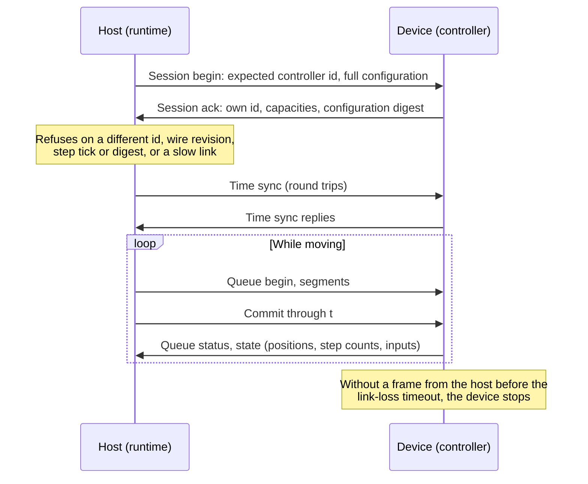
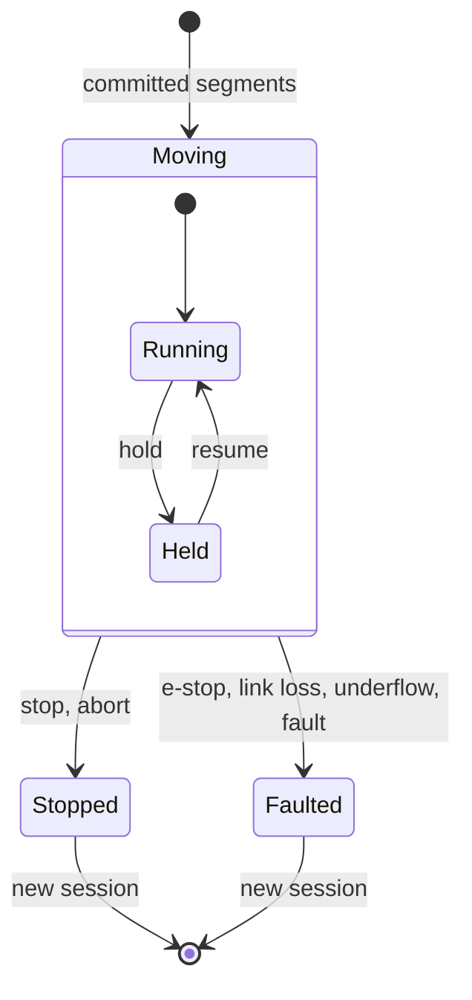

# The controller boundary

## The problem

Planning and simulation run on a computer with plenty of memory and no hard
deadlines. Motors need step pulses timed to microseconds, and they must stop
safely if the computer stalls, the cable is pulled or a drive faults. Something
has to sit between the two, and both sides need a precise agreement on what
crosses between them.

That agreement matters twice for Materia. Technically, it decides what the
host can trust the controller to do. For the project, it is the line between
the open stack and any controller, including a future commercial one (see
[Open core](../../OPEN_CORE.md)): the stack drives any controller that speaks
the protocol, and no controller gets private hooks into the kits.

## The model

### What crosses the line: committed polynomial segments

The host does not send step pulses or a stream of position setpoints. It sends
**motion as polynomial segments**: for each actuator, a polynomial of degree
up to 5 over a time interval in device ticks, anchored at a whole number of
motor steps so precision does not drift over long moves. These segments are
cut from the [execution plan](../motion/execution-plans.md).

Segments go into a **queue** and only run once **committed**. The host streams
and commits ahead of the device (about half a second) and may replace
uncommitted segments at a held boundary. If the device reaches the end of the
committed queue while still moving, that is an **underflow**, and it stops.

Alongside motion:

- **events**: output changes (a valve, a spindle, a torch) scheduled at a path
  time, so they fire exactly where the plan says;
- **immediate outputs**: digital or analog writes outside the path queue;
- **path control**: hold, resume, abort, stop, emergency stop.

### Who does what

| Host (planning computer) | Device (controller) |
|---|---|
| Plans and validates motion; checks the plan fits the controller's step rate and precision | Owns the path clock and evaluates the polynomials |
| Maps plan time to device time (clock estimation from round trips) | Generates step and direction pulses at the step tick, with minimum pulse spacing and direction setup time |
| Streams segments, paced by measured link occupancy, and commits ahead | Executes only committed, continuous segments |
| Latches faults, checks limit switches, enforces joint limits | Fires events at path time; ramps the path rate on hold |
| Decides when to stop | Stops on underflow, link loss, dual-drive skew or fault, and makes outputs safe |

### The session: knowing who you are talking to

A session starts with a handshake that pins down exactly which controller and
which configuration are in use:

- The host names the **controller it expects** (a unique board id) and sends
  the full configuration: per-actuator steps per unit, step timing,
  acceleration, dual-drive skew bounds, process channels with their safe
  values, and inputs.
- The device always reports its own id, and refuses a session addressed to
  another controller.
- Both sides compute a **digest of the configuration**. The host refuses the
  session if the digests differ, the wire revision differs, the step tick
  differs, the board has too few actuators, or the link is too slow.

A controller is therefore never driven with a configuration meant for another
machine.

### Stopping

- **Hold** slows the path rate within each actuator's acceleration budget, so
  the machine stays on its path and can resume.
- **Stop, abort, emergency stop, link loss and faults** brake each actuator
  independently at its acceleration limit. This is fast, but it does not stay
  on the path.
- Every process channel has a **safe value** and a **stop policy**: safe on
  every stop, or kept through a commanded stop (but never through an emergency
  stop, link loss or fault).
- The device runs a **link-loss watchdog**: no frame from the host within the
  configured timeout while moving (or while an output that needs the link is
  active) stops the machine.

## In Materia

**Open, in this repository:**

| Piece | Where |
|---|---|
| Protocol schema and generated codecs (Rust, C++) | `robotkit/schema/device_wire6.wire.idl`, `robotkit/runtime/DEVICE_PROTOCOL.md` |
| Conformance vectors and tests | `robotkit/schema/device_frame6_vectors.tsv`, `robotkit/device_protocol/tests/` |
| Reference device core (Rust, `no_std`, no allocator) | `robotkit/device_protocol`: `ScheduledCore`, `StepGenerator`, `DeviceEvents`, `InputCapture`, the `Board` trait |
| Process controllers | `boards/heater.rs` (PID, runaway watchdog), `boards/welder_retrofit.rs` |
| Bench board | `boards/nucleo-g474re` (minimal profile; no motors connected) |
| Virtual device | `robotkit/device_virtual` (full profile; simulated link latency, jitter and loss) |
| Host side | `Rkd6Endpoint` (runtime), `DeviceBinding` and `DeviceLayout` (actuator-to-channel mapping) |
| Deployment | `robotkit/deployment/*` (model, layout, controller id, timing) |

Two device **profiles** exist: the **full** profile (degree-5 segments, step
generation, events, homing) and a **minimal** profile (degree-1 segments, small
queue) for small boards.

**What a compatible controller implements**, in short:

1. The frame codec and the exact wire revision.
2. The handshake: a stable unique id, refusal of other ids, the configuration
   digest, truthful capacities.
3. The queue: revisions, commit, boundary replacement, underflow as a stop.
4. Path control: hold as a path-rate ramp, resume, abort, stop, emergency
   stop, and the link-loss watchdog on its own clock.
5. Step timing, safe outputs and stop policies, events at path time.
6. State reports: queue status, actuator positions and step counts, inputs.

The reference core, its tests and the frame vectors are the executable
specification. A controller that passes them speaks the protocol.

**Outside this codebase:** certified safety functions. The runtime's lease,
heartbeat and emergency stop are liveness safeguards for the control channel,
not a functional-safety system. Safe torque off, a hardware emergency-stop
chain and safety-rated monitoring belong to a certified controller underneath
the runtime: the scope of a commercial controller.

## What it isn't

- **Not G-code.** Controllers receive timed polynomials, not a program to
  interpret. G-code is compiled into an execution plan on the host (see
  [Toolpaths](../process/toolpaths.md)).
- **Not a setpoint stream.** The device does not need a frame every
  millisecond; it runs ahead on its committed queue.
- **Not a safety system.** See above.
- **Not a private interface.** Commercial and third-party controllers use the
  same protocol, and changes to it are made in the open.

## See also

- [The life of a machine](../start/life-of-a-machine.md), step 9
- [Execution plans](../motion/execution-plans.md)
- [The robot runtime](robot-runtime.md)
- [Open core](../../OPEN_CORE.md)

## Open questions

- **Recovering after an emergency stop.** The host sends `RESET_SAFETY`, but
  the virtual device and the bench board ignore it, and a stopped device
  refuses new queues. Recovery appears to need a new session.
- **No device-side position limits.** Both reference boards pass ±1e12 (none);
  position limits are enforced only on the host.
- **Stops leave the path.** Only hold stays on the path; a stop or fault brakes
  each axis independently.
- **`DEVICE_PROTOCOL.md` is behind the code**: frame sizes (session record
  5,013 bytes, not 4,940), deployment schema (6, not 5), and missing sections
  for homing, inputs and `RESET_SAFETY`.
- **Bench placeholders**: the controller id `baadf00d…`, placeholder heater
  pins, and welder ADC pins (PB0/PB1) that the switch inputs also use.
- **A conformance suite for third-party controllers** does not exist yet as a
  standalone artifact: today it is the reference core's tests and the frame
  vectors.
