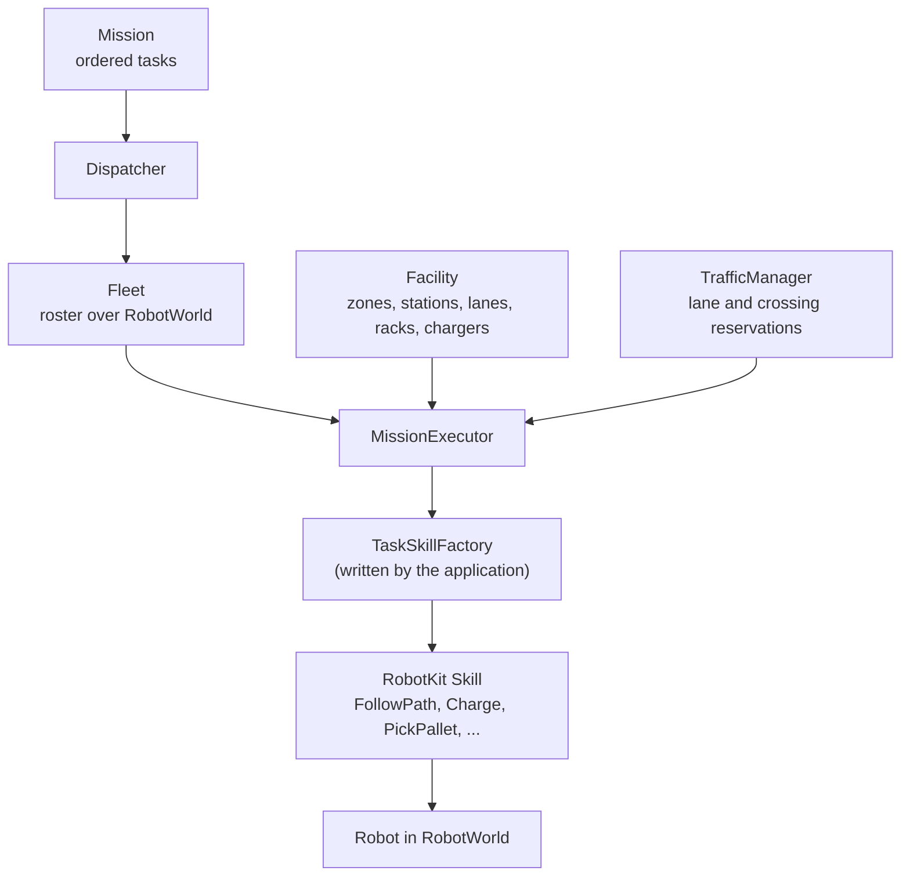

# Facilities and fleets

## The problem

A robot runtime knows one robot: its joints, its safety state, the plan it is
running. A warehouse floor needs more than that. Pallets wait at named
stations, robots drive along agreed lanes, two robots must not enter the same
crossing at once, and a job like "take this pallet from receiving to staging"
must go to a robot that is free, then be followed until it finishes or fails.

None of that belongs in the runtime, and none of it changes when a robot is
replaced. So Materia keeps the floor and its work in a separate layer,
**AutomationKit**, above `RobotWorld`.

## The model

### Topology is not robot state

A **facility** is a map of the floor, and it does not move. It has:

- **zones**: named areas with a boundary, each in a facility frame;
- **stations**: named places in a zone, each with a 2D pose; a station can also
  describe its work top (a `Surface`);
- **racks**: stations with named 3D slots, each of which can give the size
  of the item it holds;
- **chargers**: stations with a connector type and a rated power;
- **lanes**: travel corridors between two stations, with a centreline path, a
  width, a speed limit, and either one-way or two-way travel;
- **intersections**: crossings where several lanes meet, so that only one robot
  at a time can be inside.

Every entity is checked when it is added. Its IDs must be unique, the zone or
stations it names must exist, and frames must agree: a lane, its two stations
and its zone all share one frame.

Live state stays below, in [RobotWorld](robot-runtime.md): which robots are
attached, whether they are ready, and their latest snapshots. A facility never
holds a robot pose, and a robot never holds a lane.

### Tasks and missions

A **task** says *what* to do, not how. There are four kinds:

| Task | Says |
|---|---|
| `Transport` | carry a payload from one station to another |
| `Pick` | take a payload from a rack slot |
| `Place` | put a payload into a rack slot |
| `Charge` | charge at a charger to a target state of charge |

A **mission** is an ordered list of tasks with a lifecycle: pending, running,
then succeeded, failed or cancelled. It finishes one task at a time.

### From a task to motion: skills

A task never moves a robot by itself. For each task the **mission executor**
asks the application's **task skill factory** for a configured RobotKit
**skill**: for a `Transport`, typically a route from the facility router
followed by `FollowPath`; for a rack task, `PickPallet` or `PlacePallet`; for a
`Charge`, RobotKit's `Charge` skill. The executor starts the skill, updates it
each tick with the robot's latest snapshot, and moves to the next task when the
skill succeeds. The factory is where perception, localization and the robot's
own mechanism come in. AutomationKit does not guess them.

The skill then commands the robot through the usual `Robot` interface, so the
same mission runs on a simulated robot, on a robot behind `robotd`, or on a
recording being replayed.

### Fleets and dispatch

A **fleet** is a roster of robot IDs over one `RobotWorld`. The **dispatcher**
gives a pending mission to the first robot, in ID order, that is ready and has
no mission. Assigning starts the mission. When the mission ends, for any
reason, the executor releases the robot for the next one.

### Routes and traffic

The **facility router** finds the fastest chain of lanes between two stations,
from each lane's length, speed and direction. It joins their centrelines into
one path that carries a speed limit for each lane, so navigation slows down
before a slower lane.

The **traffic manager** keeps one robot per lane and per crossing:

- a robot reserves a **whole route at once**: every lane, every station it
  passes through, and every intersection on the way. While it waits, it holds
  nothing, so two waiting routes cannot deadlock;
- waiting requests are served by **priority**, then in arrival order;
- a lane can be **blocked** (closed), and a **speed zone** can cap a set of
  lanes for a while;
- routing through the traffic manager avoids closed lanes and lanes that other
  robots hold.

With a traffic manager, the executor reserves a `Transport`'s route before it
starts the skill. It leaves the skill idle while the route is queued, and
releases the route when the task ends.

## In Materia

| Piece | Where |
|---|---|
| Facility topology | `materia.automation.facility`: `Facility`, `Zone`, `Station`, `Lane`, `Intersection`, `Rack`, `RackSlot`, `Charger`, `Surface` |
| Routing | `FacilityRouter` → `FacilityRoute` (path, legs, `speedLimits()`) |
| Tasks | `materia.automation.task`: `Task`, `TaskKind`, `Transport`, `Pick`, `Place`, `Charge` |
| Missions | `materia.automation.mission`: `Mission`, `MissionStatus`, `MissionExecutor`, `MissionExecutionStatus`, `TaskSkillFactory` |
| Fleet and traffic | `materia.automation.fleet`: `Fleet`, `FleetAssignment`, `Dispatcher`, `TrafficManager`, `TrafficSpeedZone` |
| The skill interface | `robotkit.skill.Skill`, `SkillRunner` (`robotkit/core`) |
| Mobile and handling skills | `robotkit.skill`: `FollowPath`, `GoTo`, `Dock`, `Charge`, `PickPallet`, `PlacePallet`, `HandlePart` (`robotkit/autonomy`) |
| Process skills | `processkit.skill`: welding, finishing, scanning, earthwork |
| People on the floor | `humankit/facility`: walks and fetch jobs along facility routes |
| Tests | `automationkit/tests` (simulated transport mission, recorded and replayed through MCAP); `robotkit/tests/integration` (`WorldTcpIntegration`: the same mission through `robotd`) |

What exists today: the data model, routing, dispatch, traffic reservations and
the executor, all in code and tested headless. A facility is built in code;
there is no saved facility format and the editor does not load one (its only
facility is a small built-in demo for previewing a person walking a route).
No ready-made task skill factory ships with the kit: every application writes
its own, and the ones in the tests handle `Transport` only.

## What it isn't

- **Not the runtime.** AutomationKit never touches joints or safety; it hands
  configured skills to robots in `RobotWorld`, and the runtime still validates
  everything (see [The robot runtime](robot-runtime.md)).
- **Not a motion planner.** It produces lane paths and speed limits. Timing and
  trajectories come from RobotKit navigation and MotionKit (see
  [Paths vs. trajectories](../motion/paths-and-trajectories.md)).
- **Not a scene mission.** The pick-and-place steps the editor plays for one
  machine cell (the gantry picker's mission) are a different thing: a list of
  steps in the scene artifact, run by the editor's mission player. A facility
  mission is a list of tasks for a fleet.
- **Not a time-slot scheduler.** A reservation holds a whole lane until it is
  released; it does not book lanes for time windows or plan robots around each
  other's future positions.
- **Not a safety system.** One robot per lane is a software rule. It does not
  replace scanners, guards or the robot's own stops.

## See also

- [The life of a machine](../start/life-of-a-machine.md), step 6 (the picker's
  mission is a scene mission; facility missions sit one level above it)
- [The robot runtime](robot-runtime.md)
- [Process vs. robot](../process/process-and-robots.md)
- [Simulation worlds](simulation-worlds.md)
- [Frames and transforms](../foundations/frames.md)

## Open questions

- **Two things are called a mission.** `materia.automation.mission.Mission` is
  an ordered list of facility tasks; `SceneArtifactMission` (projectkit) is a
  cell's list of steps, run by the app's `MissionPlayer`. The glossary defines
  only the second.
- **`Charge` is both a task and a skill.** `materia.automation.task.Charge` and
  `robotkit.skill.Charge` share a name, which forces qualified imports when a
  factory maps one to the other.
- **The README calls lanes directed**, but `Lane` is two-way unless it is
  created with `bidirectional = false`.
- **A transport skips its pickup leg.** The executor routes and reserves from
  the pickup station to the destination; nothing in the kit gets the robot to
  the pickup station first, or loads the payload.
- **Station intersections are implicit.** `reserveRoute` reserves every
  intermediate station as a crossing, while `Intersection` declares crossings
  explicitly; both use the same "intersection" naming in `TrafficManager`.
