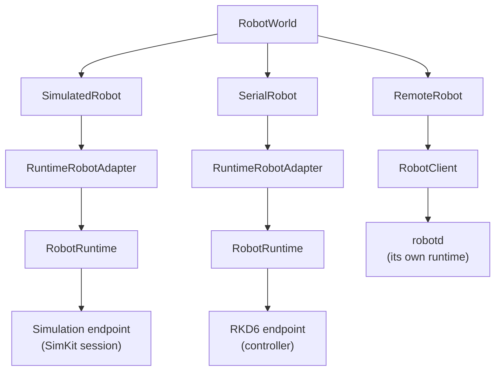

# The robot runtime

## The problem

Many things want to move a robot: the editor's Play button, a mission's
skills, a jog from the keyboard, a remote client, a test. If each of them drove
the motors directly, two of them could fight over a joint, a command could
arrive against a state that no longer holds, and nothing would stand between a
bug and the hardware.

So every robot has exactly one owner at the bottom, the **runtime**, and
everything else goes through it. The same runtime runs whether the robot is
simulated, on a serial port, or behind a network daemon.

## The model

### One interface for every robot

Code above the runtime sees a **`Robot`**: it can submit commands, stop, reset
safety, and read snapshots and events. Simulated, serial, remote and replayed
robots all look the same. A **`RobotWorld`** holds the robots of a scene and
belongs to one thread; other threads can only post events to it, which the
owner applies when it pumps.

### The runtime's tick

The runtime runs at a fixed owner period (10 ms by default). Each tick:

1. **Commands are taken from the mailbox.** Submitting only queues a command;
   nothing acts on it until the tick. Every command is validated on the way in:
   joint indices and modes, couplings consistent, a fresh sequence number.
2. **Arbitration.** An emergency stop wins outright. Otherwise commands apply
   in order. In a safety stop, everything is refused until a reset, and a reset
   is refused while a limit switch is still active.
3. **Control.** Joint targets move each joint's reference within its rate
   limit; a velocity target that is not renewed expires and brakes to zero; an
   execution plan is evaluated along its own clock, which hold and resume ramp
   down and up.
4. **Limits and safety.** A target outside a joint's limits does not just get
   refused: it **latches a fault**, which stops the robot and makes every
   output safe.
5. **The endpoint applies** the staged commands, then **samples** the observed
   state. A sample that is malformed, the wrong size, or beyond a joint's
   limits and overtravel also latches a fault.
6. **A snapshot is published**: positions, velocities, efforts, safety and
   mode, the active plan and how far it is committed, sensor samples. A
   snapshot is an immutable value; readers get the latest one.

**Execution plans** skip the mailbox: they are validated immediately against
the machine they will move (model and calibration revision, start state,
safety ready, replacement boundary) and refused on the spot if they do not fit
(see [Execution plans](../motion/execution-plans.md)).

### Endpoints

The runtime talks to the world through an **endpoint**, which applies commands
and samples state:

- the **simulation** endpoint binds the robot into a SimKit session;
- the **RKD6** endpoint drives a controller over the
  [device protocol](controller-boundary.md); the device then owns the motion
  queue and its clock, and the runtime follows the device's reported progress;
- the **virtual device** runs the reference controller in-process, with a
  simulated link;
- an **in-memory** loopback tracks setpoints exactly, for tests.

### Safety and faults

The runtime has four safety states: ready, stopping, emergency stop and fault.
A fault records its cause (endpoint failure, underflow, dual-drive skew, lost
clock sync, limit switch, missing process channel, brake feedback, …), stops
the robot, and sets every process output to its safe value. Recovery is an
explicit reset.

Everything above the runtime (skills, missions, motion guards, load policies)
is application logic: useful, but **not** the safety layer. Hard limits and
stops are enforced here, below it.

### In simulation

In simulation the runtime does not own the clock: the **SimKit session**
does. Each session step, every robot applies its pending commands, the session
submits their targets and steps physics once, and every robot publishes a
sample from the same instant. A robot that fails its tick is rolled back and
faulted alone; the others continue. Two backends exist: a deterministic test
backend and MuJoCo.

### Remote robots

`robotd` hosts a runtime as a daemon. Clients connect with authentication;
one of them holds a **control lease**, renewed by heartbeat. If the lease
lapses or the client disconnects, the robot is emergency-stopped and the next
controller must reset safety.

## In Materia

| Piece | Where |
|---|---|
| The robot interface and world | `robotkit.core.Robot`, `robotkit.world.RobotWorld` |
| Adapters | `RuntimeRobotAdapter`, `SimulatedRobot`, `SerialRobot`, `RemoteRobot` |
| The runtime | `robotkit.runtime.RobotRuntime` (Haxe) over the native runtime in `robotkit/runtime` |
| Building a runtime from a model | `RobotRuntimeCompiler.compile(model, profile)` → runtime blueprint |
| Model and profile | `RobotModel` (mechanics), `RobotProfile` (roles such as a mobile base) |
| Endpoints | native `RobotEndpoint`: simulation, `Rkd6Endpoint`, `VirtualDeviceEndpoint`, in-memory |
| Simulation | `robotkit.runtime.Simulation` as a participant in a SimKit session |
| Snapshots, streams, recording | `RobotSnapshot`, `SensorStreams`, `robotkit/recording` (MCAP) |
| Daemon | `robotkit/robotd` |
| Architecture | `robotkit/ARCHITECTURE.md`, `robotkit/RESTRUCTURE_PLAN.md` |

## What it isn't

- **Not a planner.** The runtime validates and executes plans and targets; it
  never computes a path.
- **Not a certified safety controller.** Its faults, leases and emergency stops
  are software safeguards (see [The controller boundary](controller-boundary.md)).
- **Not the firmware.** With a controller attached, step generation and the
  motion queue's clock live on the device.
- **Not a fleet or facility manager.** That is
  [AutomationKit](facilities-and-fleets.md), above `RobotWorld`.
- **Not the simulation's clock.** The SimKit session owns time.

## See also

- [The life of a machine](../start/life-of-a-machine.md), steps 8 and 9
- [Execution plans](../motion/execution-plans.md)
- [The controller boundary](controller-boundary.md)
- [Simulation worlds](simulation-worlds.md)

## Open questions

- **`ARCHITECTURE.md` is behind the code** in several places: it describes
  `Simulation.step` and a simulation-owned clock (now the SimKit session's),
  `RobotModelCodec` v12 (the model is v14), native ABI version 4 with 64 sensor
  values (36 and 360), `robotd --serial=` (now `--deployment=`), and
  `DeviceSerialEndpoint` as an endpoint (it is a factory for `Rkd6Endpoint`).
- **Stop and reset are commands in the C ABI but methods in Haxe**
  (`Robot.stop`, `Robot.resetSafety`), not `RobotCommand` cases.
- **Unfinished restructuring.** The raw-segment submission path and the legacy
  recording command remain (R7b); `robotd` still gives the controller slot to
  the first socket before its hello and keeps a legacy subscription mode (R7a).
- **Thread ownership is enforced only on HashLink.** On other targets the
  owner check uses one shared token.
