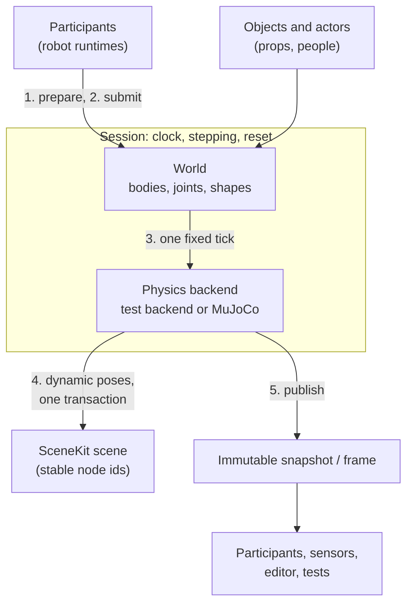

# Simulation worlds

## The problem

A simulated cell has many moving things: robots, cartons on a table, a door,
a person walking past. Each of them needs physics, and each of them needs to
see the others at the same instant. If every robot ran its own physics on its
own clock, a carton pushed by one arm would be in two places at once, and no
test could replay a run exactly.

So SimKit has one place that owns simulated time and physics, the
**session**, and everything that moves in simulation joins it instead of
owning a piece of it.

## The model

### World and session

A **world** holds the physical model: **shapes** (box, sphere, capsule,
cylinder, plane, convex hull, compound), **bodies** made of them, and
**joints** between bodies (fixed, revolute, prismatic and a few more). Joints
can be coupled to each other with a ratio and offset, which is how a lead
screw or a CoreXY belt reaches the simulator (see
[Transmissions](../modelling/transmissions.md)); a coupling may be ideal or a
spring with stiffness and damping. Bodies are static, kinematic (moved by
someone else) or dynamic (moved by physics).

A **session** wraps one world and owns what everyone shares:

- **Objects**: single environment bodies, such as a carton or a fixture. An
  object can be **held** by a carrier body, so a gripper carries it, and
  released again.
- **Actors**: groups of kinematic bodies that follow a timed trajectory, such
  as a person. Writers push keyframes in simulation time; an actor pushes
  dynamic bodies but is never pushed.
- **Participants**: native systems with per-tick callbacks. A robot runtime
  takes part this way.

Topology is fixed once the session starts: robots and objects are added while
it is stopped, and the first tick seals it.

### One fixed tick

The session advances in **fixed ticks** (10 ms in the editor by default). Each
tick:

1. every participant **prepares** its commands; if one fails, every
   participant discards and the tick does not advance;
2. every participant **submits** its physics inputs (joint targets, forces,
   body drives);
3. the backend steps once, possibly in several substeps;
4. dynamic body poses are written to the scene;
5. every participant **publishes** from the new snapshot.

The robot participant faults a single robot whose commands fail instead of
rejecting the tick, so one bad robot does not stop the cell (see
[The robot runtime](robot-runtime.md)).

### Who owns the clock

The session does. Robots, actors and players never keep their own simulated
time; they read the tick's step index and simulation time. The session can be
driven three ways:

- **Explicit stepping**: the caller asks for exactly one tick. Tests and
  headless runs do this.
- **Owner-paced realtime**: the owner reports elapsed wall time, the session
  says how many ticks are due (capped; the excess is dropped, so a slow owner
  slows simulation time instead of bursting), and the owner runs them one by
  one, acting between them.
- **Realtime loop**: the session ticks on its own physics thread. While it
  runs, the world belongs to that thread and other threads go through the
  session, which serialises their calls against ticks.

### Snapshots and frames

After every tick the session holds an immutable **snapshot** of body and joint
states, and can **capture** a **frame**: a consistent view of the clock, body
states, contacts and object and actor poses at that tick. Readers on any thread
use these; they never touch the live world (see
[Immutability and snapshots](../foundations/immutability.md)). Reset restores
the world, the clock, every object and actor, and every participant to their
initial state.

### Scene sync

Every body is created against a **SceneKit node id**. Static bodies stay where
the scene put them; kinematic bodies follow their node (or an exact drive
written to them); dynamic bodies are written back to their nodes after each
tick, in one scene transaction, and the step returns the resulting change set.
The renderer and the editor therefore see the simulation through the same
stable identities they already use (see [Identity](../foundations/identity.md)).
Physics engine ids never leave the backend.

### Backends

The backend is an internal contract below the world; callers see only SimKit
handles.

- The **deterministic test backend** is built in and has no dependencies. It
  integrates rigid bodies and joints, keeps every coupling ideal, and resolves
  simple box contacts. It does not report contact forces.
- **MuJoCo** is optional, enabled at build time. It adds full contact
  dynamics, solved contact wrenches and compliant couplings. MuJoCo's own
  model and data types never cross the API.

The editor's Play uses MuJoCo; the test backend can be selected from the
sensor panel, and tests choose per case.

### Determinism

Explicitly stepped runs are deterministic: the same build, backend, model and
inputs replay bit for bit, and both backends have tests that check it.
Realtime runs are not: how many ticks run between owner actions depends on
wall time. The two backends do not agree with each other bit for bit; they
model different physics. See [Determinism](../foundations/determinism.md).

## In Materia

| Piece | Where |
|---|---|
| World, bodies, joints, shapes, clock | `simkit/sim_core`: `nativekit_sim.h`, Haxe `nativekit.sim.SimWorld`, `Body`, `Joint`, `Shape` |
| Session, objects, actors, frames | `nativekit_sim_session.h`, Haxe `SimSession`, `SimObject`, `SimActor`, `SimFrame` |
| Participants | native `nksim_participant_desc` (prepare, discard, submit, publish, reset) |
| Snapshots and step results | `SimSnapshot`, `StepResult`, `SceneChanges` |
| Owner-thread host for a bare world | `nativekit_sim_host.h` (`nksim_host`) |
| MuJoCo backend | `simkit/sim_mujoco`, Haxe `nativekit.sim.MujocoSimWorld` |
| Scene, world and session together | `robotkit.runtime.SimulationSpace` (`DETERMINISTIC` or `MUJOCO`) |
| Robots in a session | `robotkit.runtime.Simulation`, native `robotkit/runtime/src/simulation.cpp` |
| The editor's simulation | `app.ApplicationSimulation`, members joining through `app.SessionParticipant` |
| People | `humankit.sim.HumanActor` over session actors |
| Sensors from simulated truth | SensorKit `sensor_sim` (reads an immutable `nksim_snapshot`) |

In the browser, SimKit and MuJoCo are linked into the Emscripten host, so Play
works there too. The browser has no simulation thread: ticks are owner-paced
on the UI thread.

## What it isn't

- **Not a robot controller.** The session steps physics and calls its
  participants; commands, limits and faults belong to
  [the robot runtime](robot-runtime.md).
- **Not the scene.** The world borrows a SceneKit scene and writes poses to
  it; it never owns or destroys it.
- **Not a fidelity switch.** Every session today runs full physics on its
  backend; choosing the test backend is not a "Kinematic" or "Ideal" level (see
  [Fidelity levels](fidelity.md)).
- **Not a sensor model.** The session provides truth; SensorKit turns it into
  noisy, delayed observations (see
  [Truth vs. observation](../foundations/truth-and-observation.md)).
- **Not reproducible in realtime.** Only explicitly stepped runs replay
  exactly.

## See also

- [The life of a machine](../start/life-of-a-machine.md), step 8
- [The robot runtime](robot-runtime.md)
- [Fidelity levels](fidelity.md)
- [Determinism](../foundations/determinism.md)
- [Identity](../foundations/identity.md)
- [Collision model](../modelling/collision.md)

## Open questions

- **The test backend is described as having no collisions.**
  `simkit/sim_core/README.md` calls it "gravity-only, no-collision", but it
  resolves oriented-box contacts for free dynamic bodies.
- **MuJoCo is still called "planned".** The same README says
  `NativeKit::sim_mujoco` "is the first engine adapter planned", though it is
  the editor's default backend.
- **Two names for one kit.** The code lives in `simkit/` but its targets,
  prefix and package are NativeKit's (`NativeKit::sim_core`, `nksim_`,
  `nativekit.sim`), and the README is titled "NativeKit simulation core".
- **Session objects are listed as box, sphere and capsule only.** The session
  also creates convex and compound convex objects
  (`nksim_session_create_convex_object`).
- **The MuJoCo adapter's joint list is narrower than the API.** The API defines
  spherical, cylindrical, planar and helical joints; the MuJoCo README lists
  only fixed, revolute and prismatic, and it is not stated which backend
  supports which.
- **Two meanings of "participant".** Native session participants have per-tick
  callbacks; `app.SessionParticipant` is an editor member that joins each new
  session and has none.
