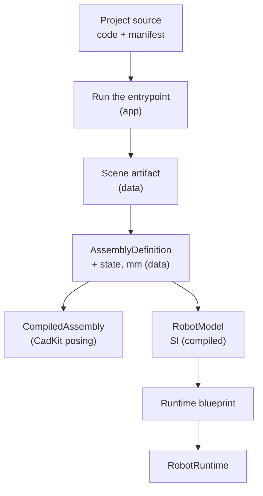

# Data vs. runtime

## The problem

Many kits need to agree on what a machine is: CadKit poses it, MachineKit
builds it, RobotKit simulates it, the editor shows it, a downloaded file
carries it to the browser. If each kit read the others' live objects, every
kit would depend on every other, and a saved file would only open where all of
them load, native libraries included.

So Materia keeps the things that are *exchanged* (records, formats and their
codecs) apart from the things that *act* on them (evaluation, solving,
compiling, simulating). The first kind sits at the bottom of the stack and
depends on nothing. The second kind sits above it and is free to change.

## The model

### Data is plain records with a strict codec

A **data type** is a typed record: ids, numbers, strings, nested records. It
has no behaviour beyond pure functions on itself, it holds no handles, and it
does no I/O. Each format has a **codec** that validates on the way out and on
the way in: references resolve, ids are unique, numbers are finite, buffers
have the right sizes, sizes stay under fixed bounds. A file that fails is
refused with a reason, not partly loaded.

ProjectKit is that layer for the formats every kit shares. It has no native
code and no dependency on another kit; it builds on Haxe's standard library
and Haxeon's wire codec only. Its own tests run without loading any downstream
kit or native library.

### One schema version, no migration

Each format carries a version number, and its decoder accepts **exactly the
current one**. There are no upgrade readers and no compatibility branches: a
file in an older version is rejected with a message naming both versions. For
a scene artifact the message says to rebuild it from its project source.

This works because most saved files are **derived**. The project's source
code and manifest are authoritative; the scene artifact is output, regenerated
whenever it does not match. The editor's prepared-scene cache is keyed on a
format string, the build identity and the artifact's hash, so a change makes
it miss rather than migrate. Authored files that are not regenerated (a
`.sheet.json`, a tooling document) follow the same rule: when the schema
moves, the file is rewritten in the new version.

### Descriptions vs. compiled models

A **description** says what the machine is, in the terms it was designed in.
`AssemblyDefinition` is the main one: component definitions with connectors,
occurrences, typed joints, couplings, mates, actuators and sensors, in
millimetres, with nested subassemblies. Its configuration lives beside it in
`AssemblyStateRecord`: joint coordinates and root poses only.

A **compiled model** is what a runtime needs, derived from a description and
never authored by hand:

- `AssemblyDefinitionFlattener` expands nested subassemblies into one flat
  definition with path-prefixed ids;
- CadKit's `CompiledAssembly` is the immutable topology used to pose and solve
  the assembly;
- `AssemblySimulationBridge.toRobotModel` turns the definition into a
  `RobotModel`: one link per rigid body, only moving joints, everything in SI;
- `RobotRuntimeCompiler.compile` checks the model against a profile and
  assigns the fixed indices of a `RobotRuntimeBlueprint`, which creates the
  native runtime.

Each step is one way. Nothing writes a compiled model back into the
description; to change the machine, edit the description (or the code that
builds it) and compile again. World poses, flattened ids and compiled models
are never saved in the artifact.

A description may name something only a runtime can resolve. An
`AssemblyConnector` can carry an opaque `reference` (a CadKit face or edge to
find again) next to the last `frame` it resolved to; ProjectKit stores the
string and never interprets it.

## In Materia

| Piece | Where |
|---|---|
| Shared formats, no dependencies | `projectkit/`: `materia.project`, `materia.assembly`, `materia.units`, `materia.drawing` |
| Scene artifact (binary `MTRG`) | `SceneArtifact.encode`, `decode`, `decodeView`; `SceneArtifact.VERSION` |
| Assembly description and state | `AssemblyDefinition`, `AssemblyStateRecord`, `AssemblyDefinitionCodec` (`VERSION`) |
| Flattening | `AssemblyDefinitionFlattener.flatten`, `flattenView`, `flattenState` |
| Units and materials | `LengthUnit`, `MaterialLibrary`, `MaterialDef`, `Appearance` |
| Running a project, loading its artifact | `MateriaProjectRunner`, `ProjectArtifactLoader`, `PreparedProjectCache` (`app`) |
| Compiled models | `cadkit.modeling.CompiledAssembly`; `cadbridge.AssemblySimulationBridge.toRobotModel`; `robotkit.model.RobotModel`; `RobotRuntimeCompiler.compile` → `RobotRuntimeBlueprint` |
| Robot model format | `RobotModelCodec` (`robotkit`), version `RobotModel.CURRENT_VERSION` |
| Manufacturing records | `manufacturingkit/` (depends only on ProjectKit): `SheetProjectCodec`, `ToolingCodec`, `BoxMoldCodec` |

ManufacturingKit follows the same split one level up. Its sheet and tooling
records and codecs need no CAD; MachineKit adapters such as
`FoundationToolingAdapter` fill them from live components, and the records
stay usable without the adapter. Its codecs also canonicalize their output so
fingerprints are stable, and `BoxMoldCodec` refuses a saved mold that differs
from regenerating it from its source document. See
[Manufacturing outputs](../process/manufacturing-outputs.md).

ProjectKit offers two decode paths for the artifact. `decode` returns
independent buffers; `decodeView` validates the same bytes but borrows mesh
streams from them, so the caller must keep the input unchanged. The editor
uses the view for its immutable artifact snapshot (see
[Immutability and snapshots](immutability.md)).

## What it isn't

- **Not "no logic".** Data types carry validation, flattening and other pure,
  deterministic functions. What they never do is I/O, native calls, or
  depend on a domain kit.
- **Not the source of truth.** A scene artifact is a cache of the project, made
  self-contained so it opens without the sources (the runner resolves
  manifest-only settings into it). Fix the project, not the file.
- **Not one data kit for everything.** ProjectKit holds what *every* kit
  shares. A format used by one kit lives with it: `RobotModelCodec` in
  RobotKit, sheet and tooling codecs in ManufacturingKit.
- **Not editable output.** Compiled models (`CompiledAssembly`, `RobotModel`
  built from an assembly, runtime blueprints) are rebuilt from the
  description; editing one does not change the machine.
- **Not versioned for old files.** A version number exists to detect a
  mismatch, not to select a reader.

## See also

- [The life of a machine](../start/life-of-a-machine.md), step 4
- [Conventions](conventions.md#units): where millimetres become SI
- [Assemblies and mates](../modelling/assemblies-and-mates.md)
- [Immutability and snapshots](immutability.md)
- [Determinism](determinism.md)
- [The editor and projects](../platform/editor-and-projects.md)

## Open questions

- **The ProjectKit README is behind the code.** It describes `MTRG` version 29
  (`SceneArtifact.VERSION` is 41, `projectkit/src/materia/project/SceneArtifact.hx:925`),
  says machine-motion records are part of assembly schema 10 while the codec is
  11 (`AssemblyDefinitionCodec.hx:19`), and says a legacy `AssemblyRecord`
  codec remains for the editor's tree, but `AssemblyRecord.hx` now holds only
  `AssemblyFrame` and `AssemblyConnector`. It does not mention `materia.drawing`.
- **Geometry computation inside the data layer.** ProjectKit holds
  `DrawingProjection` (hidden-line and section projection of meshes),
  `DrawingSvgExporter`, and `MeshMassProperties`, which `SceneArtifact.encode`
  calls to fill missing mass properties. They are pure, but they are behaviour,
  not formats.
- **Two wire styles in one artifact.** The assembly, machine motion and thread
  sections use the typed `JsonWire` codec; machining, missions, tools, sensors,
  controllers, signals, project settings and printing are `haxe.Json` text
  decoded by hand (`SceneArtifact.hx:3428-3487`).
- **`materia.*` spans two kits.** ManufacturingKit also publishes under
  `materia` (`materia.sheet`, `materia.tooling`, `materia.casting`), and
  `SheetInventory` does atomic file I/O there, so the namespace alone does not
  mark the pure-data layer.
