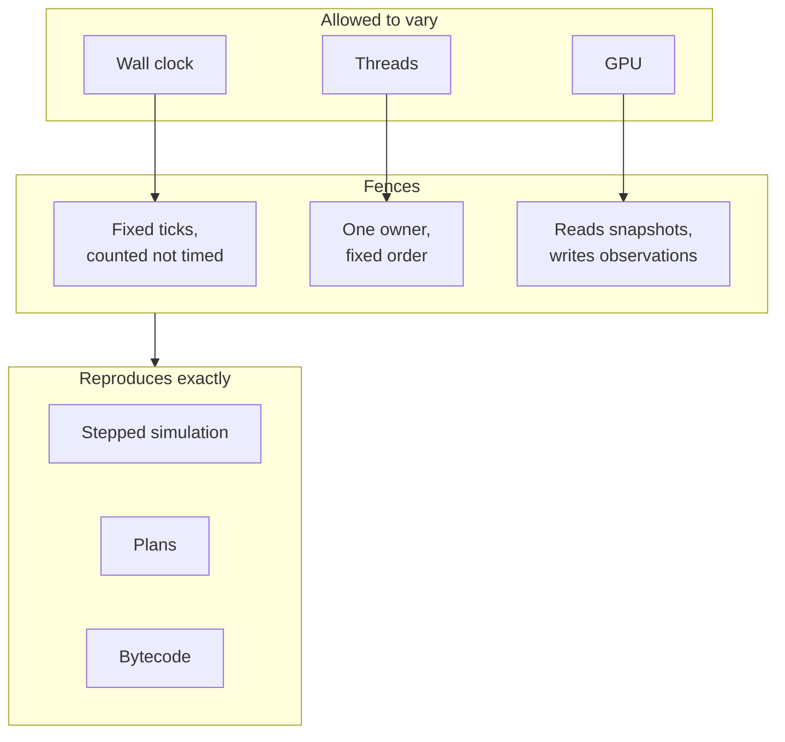

# Determinism

## The problem

A test passes, then fails on the next run with nothing changed. A plan comes
out slightly different the second time. A build made by editing one file
behaves differently from a clean build of the same sources. Each of these
costs hours, because nobody can tell whether the cause is a real bug or noise.

So Materia states what reproduces **bit for bit**, what only comes close,
and what is free to vary. Wherever something is allowed to vary, it is kept
out of the parts that must reproduce.

## The model

Three things are deterministic: the same build and the same inputs give the
same bits.

- **Explicitly stepped simulation**: the world after N ticks.
- **Planning**: the paths and execution plans a planner returns.
- **Compiler output**: the bytecode Haxeon emits for a set of sources.

Three things are allowed to vary: the **wall clock**, **threads**, and the
**GPU**. Each sits behind a fence that keeps it out of the three above.

### Simulation: time is a tick count

A simulation session's clock is a **step index** times a fixed timestep.
Simulation time is computed from that integer, never accumulated from wall
time. In an explicit step, every phase of the tick (prepare, submit, physics,
publish) sees the same owner timestamp, which defaults to the step index in
nanoseconds. Participants are visited in registration order on every tick.

A **realtime** run uses the same ticks, but the wall clock decides how many
run between owner actions. When the owner falls behind, the excess ticks are
dropped, so simulation time slows down instead of bursting to catch up.
Each tick is still exact; which commands land on which tick is not. That is
why only explicitly stepped runs replay, and why tests step explicitly. The
two backends (the built-in test backend and MuJoCo) each replay exactly, but
they do not agree with each other. See
[Simulation worlds](../execution/simulation-worlds.md#determinism).

### Planning: same inputs, same plan

Planners that sample carry their own seeded generator: RRT-Connect draws from
a xorshift generator seeded by the caller, and IK candidate sampling walks a
fixed grid of seeds. Search budgets are **counts** (iterations, edge checks,
candidates), never seconds. Planners do read the wall clock, but only to
report how long they took. Configuration selection on a ladder runs on one
thread unless the caller asks for more.

Planning can run on a **planner thread** beside the simulation (on the web,
cooperatively between frames). The plan does not depend on how fast that
thread runs, but *when* the plan is ready does. So a deterministic stepper
**waits** for each plan before it advances the clock, including at the cut
between two continuous plans. The editor's realtime Play plans ahead instead
and accepts a bounded underflow if planning falls behind.

### Builds: incremental equals clean

Haxeon's output depends only on the sources, not on the host that runs the
compiler and not on the build's history:

- float constants are pooled by their exact IEEE-754 bits, and closure
  captures are sorted by name, so a compiler built to HashLink and one run in
  the reference Haxe interpreter emit the same bytes;
- generated names (function adapters, lambdas in generic specializations,
  their environment objects) are numbered within their own function or by
  source offset, and stale ones are dropped, so an edit followed by an
  incremental build gives what a clean build gives;
- generated codecs take their source span from the type they encode, not from
  whichever call site asked first.

The rule behind all three: map iteration order never reaches the output, and
every decision is a pure function of the IR. The compiler also rebuilds
itself to a fixed point (stage 1 equals stage 2), and the C header importer
sorts its output, so the same header gives the same bindings. Hot patching
and the build caches rely on this: an incremental build is trusted to be the
clean build.

### Where variation is allowed

| Source | Used for | Fence |
|---|---|---|
| Wall clock | realtime pacing, recording timestamps, profiling | never sets simulation time; recordings replay in **arrival-ordinal** order, with wall time kept as metadata |
| Threads | realtime owner loops, planner threads, stock tiles, optional OpenMP ladders | a mutable world has one owner thread; results are combined in a fixed order (each stock tile belongs to one thread, see [Stock](../process/stock.md#resolution-and-determinism)) |
| GPU | rendering, camera images and their noise | reads immutable snapshots and produces observations only; a CPU reference model agrees with the GPU within one 8-bit level |

Randomness is not the same as non-determinism. Sensor noise is seeded, so a
reset repeats it exactly (see
[Truth vs. observation](truth-and-observation.md)).

## In Materia

| Piece | Where |
|---|---|
| Fixed-step clock and explicit steps | `simkit/sim_core`: `nksim_clock`, `nksim_session_step`; Haxe `SimSession.step` |
| Realtime pacing | `nksim_session_due_ticks`, `nksim_session_step_paced`, `nksim_session_start`; `ApplicationSimulation.pump` |
| Replay tests | `repeated_replays_are_identical` (`simkit/sim_core/tests/sim_core.cpp`), `mujoco_replay_is_deterministic` (`simkit/sim_mujoco/tests/mujoco.cpp`) |
| Seeded planning | `motionkit.planner.RrtConnect` (`PlannerRandom`), `ManipulatorKinematics.sampleCandidates` |
| Waiting for plans | `motionkit.robot.ProgramPlanner`, `ManipulatorMotion.run(program, waitForFirstPlan)` |
| Ladder threads | `mk_configuration_request.threads` in `motionkit/native/include/motionkit.h` (1 by default) |
| Build determinism | Haxeon `tests/compiler/DeterministicNamesMain.hx`, `scripts/check-self-hosting.sh` (run in CI) |
| Inspecting bytecode | `hldump` in Haxeon's HashLink fork (`vendor/hashlink/tools/hldump.c`) |
| Replay ordering | `robotkit.recording.McapRobotRecording`, `ReplayRobot` |
| GPU and CPU camera models | SensorKit `sensor_render::SceneCameraAdapter` (GPU), `apply_post_process_cpu` in `sensor_core` (CPU reference) |

## What it isn't

- **Not realtime.** A run paced by the wall clock does not replay.
- **Not across backends.** The test backend and MuJoCo model different
  physics; each is exact only against itself.
- **Not across targets or machines.** The promise is for one build. Compiler
  output is host-independent, but nothing checks that a HashLink run and a
  WebAssembly run of the same simulation give the same floating-point bits.
- **Not the real machine.** Hardware is never deterministic; the controller
  reports what happened (see
  [The controller boundary](../execution/controller-boundary.md)).
- **Not a ban on randomness.** Seeded random numbers are deterministic.
- **Not bit-exact images.** GPU camera frames match the reference model
  within a tolerance, not bit for bit.

## See also

- [The life of a machine](../start/life-of-a-machine.md), step 8
- [Simulation worlds](../execution/simulation-worlds.md)
- [Execution plans](../motion/execution-plans.md)
- [Stock and material removal](../process/stock.md)
- [Haxeon](../platform/haxeon.md)
- [Immutability and snapshots](immutability.md)

## Open questions

- **Replay tests cover one falling body.** Both replay tests step a bare world
  with a single dynamic body (`simkit/sim_core/tests/sim_core.cpp:487`,
  `simkit/sim_mujoco/tests/mujoco.cpp:405`). No test replays a session with
  participants, robots or contacts, which is what the guarantee is used for.
- **The byte-for-byte build check is not in the repository.** Haxeon commit
  `8cfbefb5` credits `tools/check-determinism.py`, which does not exist.
  `DeterministicNamesMain` compares only generated names, so a byte
  difference between an incremental and a clean build would go unnoticed.
- **Hobbing is fed by wall time in realtime.** `ApplicationSimulation.pump`
  says members are fed on the simulation clock, one call per tick, but
  `hobbing.advanceHandling(elapsed)` advances by wall seconds
  (`app/src/ApplicationSimulation.hx:1053`); `runTicks` uses the fixed timestep.
- **A failed prepare is silent in realtime.** In an explicit step it returns
  the participant's error; in a realtime tick the tick is skipped and the
  session reports success (`simkit/sim_core/src/session.cpp:1113`).
