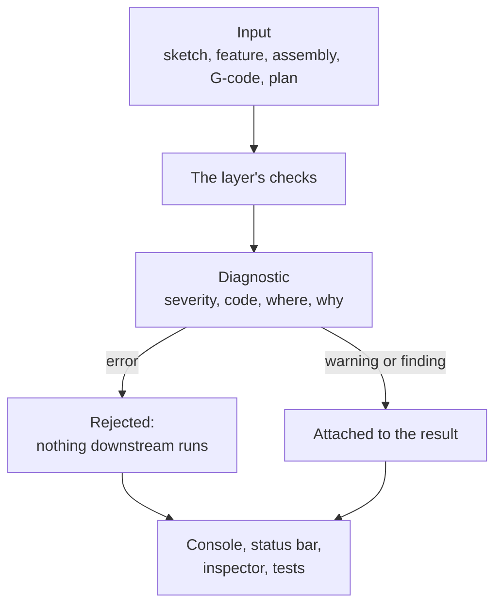

# Diagnostics

## The problem

A machine passes through many hands before it moves: a sketch, a CAD feature,
an assembly, a G-code file, a motion plan, a controller. Each of them can be
wrong. A constraint can conflict with another, a mate can hold a part it does
not touch, a G-code line can drive the tool past the machine's travel.

When something is wrong, the person fixing it asks two questions: *where*, and
*why*. "Planning failed" answers neither. And a layer that fixes the problem
quietly (rounds a value, drops a line, picks the nearest face) is worse than one
that stops: the mistake moves downstream and turns up later, on hardware, far
from its cause.

## The model

Three rules hold in every layer.

**Reject; do not guess or repair silently.** A layer that cannot honour its
input refuses it. The G-code compiler reports a line it cannot read instead of
skipping it; the plan validator does not clamp a velocity; a scene artifact
from an older schema version is refused, not migrated. Where a repair is possible, it is offered, not
applied: the constraint diagnosis suggests which constraint to remove, and a
broken face reference lists the faces it could mean now. The user picks.

**Say where.** Every diagnostic points back at the thing the user wrote, in the
user's own terms:

| Input | "Where" is |
|---|---|
| G-code | line and column |
| CAM program | the operation and feature that produced the move |
| Sketch | the constraint ids involved |
| CAD document | the feature that failed, and the state of its topology reference |
| Assembly | the mate, joint or member ids |
| Robot model | the path of the field in the model |
| Motion plan | the program op, the motor or axis, the time and distance along the path |

Positions survive translation. A toolpath operation carries its
[provenance](../process/toolpaths.md) through lowering, and a source map from
plan back to operation lets a problem found during motion name its G-code line.

**Say why, with numbers.** A message states what was needed and what was
allowed: "motor x needs 2.1 N m against 1.6 N m available", "mate m holds part p
on base b, which it does not touch: 3.2 mm apart". A stable code goes with it, so
logs and tests can match on the code instead of the text.

### Errors, warnings and findings

- An **error** means the input cannot be used. The layer refuses it, and
  nothing downstream runs.
- A **warning** means the input is used, but something was ignored or assumed:
  printer G-code settings the simulation does not model, an exact stop the
  lowering could not honour.
- A **finding** is the result of a check that predicts a physical problem
  rather than a broken input. Plan checks are the main case: a stepper that
  would stall, a servo over its rated torque, an axis that lags beyond
  tolerance. Findings are warnings by default, because their models carry
  assumptions (inertia, drag, cutting force) that are listed with each finding.
  A caller that trusts the model asks for rejection instead. See
  [Execution plans](../motion/execution-plans.md) for how this sits among the
  validation layers.

A check that could not be run is reported as *unchecked*, never as passed.

## In Materia

There is no single diagnostic type. Each kit has its own, and most share the
same shape (severity, code, subject, message), but not the same class.

| Piece | Where |
|---|---|
| G-code diagnostics: `CncDiagnostic` (`Error`/`Warning`, `CNC_*` code, `Provenance` span); `CncCompiler.compileDetailed` returns them sorted by line with the program | `cnckit` |
| Lowering warnings tied to an operation | `toolpathkit.motion.ToolpathDiagnostic` |
| Sketch solve result: status (under-, fully-constrained, redundant, conflicting), DOF, constraint ids; thrown as `SketchSolveError` | `cadkit.sketch.SolveDiagnostic` |
| Constraint diagnosis: subsystems, dependency groups, unsatisfied rows, `suggestedRemovals` (a suggestion, not the result) | `cadkit.solve.ConstraintDiagnosis`, `DiagnosisReport` |
| Recompute failure: the failing `FeatureId` and its `ReferenceState` | `cadkit.parametric.RecomputeError`, `ParametricError` |
| Assembly document errors (code, subject, message) | `cadkit.parametric.AssemblyDocumentDiagnostic` |
| MachineKit's shared list: `Diagnostics`, `Diagnostic`, `DiagnosticSeverity` | `machinekit.assembly` (also used by design, tooling, welding, milling checks) |
| Assembly integrity: support gaps, interference at rest and in sweeps, drive consistency (`integrity.*` codes) | `machinekit.assembly.AssemblyIntegrity`, `IntegrityReport` |
| Sheet metal checks | `cadkit.sheetmetal.SheetFinding` |
| Robot model compile errors, by field path | `robotkit.runtime.RobotCompileDiagnostic` |
| Plan limit failures, per check | `motionkit.trajectory.PlanLimitError` (`ValidationReport`) |
| Plan-check findings (`stepper-stall`, `servo-peak-torque`, ...) | `motionkit.trajectory.PlanDiagnostic`; `PlanCheckOptions.rejects` |
| Runtime faults (code, fatal flag) | `robotkit.core.RobotFault` |
| Scene artifact schema check | `materia.project.SceneArtifact` (`projectkit`) |

### How they reach the user

The editor has no problems panel. Diagnostics reach the user in four places:

- **The console.** A failed CAD edit (rejected parameter, failed recompute,
  kernel error) is logged and the edit is dropped. A G-code program with errors
  does not start; the console shows each error with its line, column and the
  source text of the line.
- **The status bar.** Simulation errors, mate conflicts, stale project edits and
  a project that could not be opened show there in the danger colour. While a
  program runs, it shows the current G-code line.
- **The inspector.** A CAD feature whose face or edge reference is broken, or
  resolved by shape alone, lists the issue and the candidates it could mean,
  with a repair the user confirms.
- **Operator messages.** A stopped program shows a plain title and a recovery
  step (`ProgramErrorMessage`), with the original diagnostic kept as technical
  detail. The operator can restart from a chosen G-code line.

Tests read the same objects: a test asserts on a code or a finding, not on a
screenshot.

## What it isn't

- **Not exceptions for control flow.** A diagnostic describes the user's
  input. A thrown exception for a bug in Materia (a null argument, a broken
  invariant) is not a diagnostic and has no source position.
- **Not runtime telemetry.** Faults from a running robot are reported as
  faults with a code; what the machine measured belongs to
  [Truth vs. observation](truth-and-observation.md).
- **Not compiler errors.** Haxeon reports errors in Haxe source with its own
  diagnostic type; this page is about errors in machines and programs.
- **Not automatic repair.** Suggestions and candidates are offered. Nothing is
  changed until the user chooses.

## See also

- [The life of a machine](../start/life-of-a-machine.md): every step can stop
  with a diagnostic
- [Execution plans](../motion/execution-plans.md): validation layers and plan
  checks
- [Toolpaths](../process/toolpaths.md): provenance and program checks
- [CAD documents](../modelling/cad-documents.md)
- [Assemblies and mates](../modelling/assemblies-and-mates.md)
- [Identity](identity.md): what happens when a name cannot be resolved

## Open questions

- **No shared diagnostic type.** `CncDiagnostic`, MachineKit's `Diagnostic`,
  `AssemblyDocumentDiagnostic`, `ToolpathDiagnostic`, `RobotCompileDiagnostic`,
  `PlanDiagnostic`, `SheetFinding` and `RobotFault` each carry severity, code and
  location differently (an enum, a string, a fixed `"error"`, none, an `Int`
  code). Codes use three styles: `CNC_TRAVEL`, `integrity.support.gap`,
  `stepper-stall`.
- **Errors collapse to strings.** Several callers turn a list of diagnostics
  into one thrown string, dropping codes and locations: `Diagnostics.throwIfErrors`,
  `CncProgramPlayer` before starting a program, and `ToolpathMotion.lower`,
  which throws only the first travel violation.
- **Operator messages match text, not codes.** `ProgramErrorMessage` picks its
  title by searching the failure text for words such as "collision" or
  "homing", so rewording a message changes what the operator is told.
- **Findings are not shown in the editor.** Plan-check findings are kept on the
  program player and can name their G-code line, but only tests read them; no
  panel lists them.
- **A G-code result with errors still has a program.** `CncCompiler.compileDetailed`
  returns the program alongside its errors, so refusing it is each caller's job
  (the editor's players do; nothing in the type forces it).
- **No click-to-source.** Diagnostics name a G-code line or a feature, but the
  editor does not jump to it from the console.
- **CNC names on general code.** Toolpath lowering emits `CNC_EXACT_STOP` for
  any program, CAM ones included.
