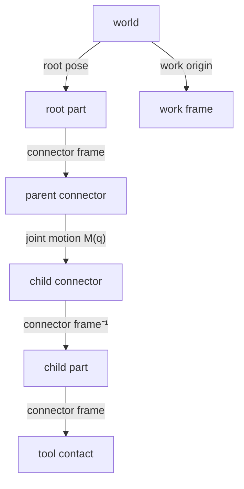

# Frames and transforms

## The problem

Every question a machine answers is a question about where something is
*relative to something else*. Where is the tool tip relative to the part?
Where is this carton relative to the robot's base? How far did the carriage
move along its rail? Each answer needs two frames and the transform between
them, and those transforms come from many places: the shape of a part, how two
parts are joined, a joint's current value, a tool mounted on a flange, a work
offset set on the machine.

If every kit kept its own idea of where things are, two kits could disagree
about the same pose. Materia keeps one rule for writing transforms (stated in
[Conventions](conventions.md#space)) and one shape for the frame graph, so a
pose is computed the same way in the editor, the planner and the simulator.

## The model

### Frames hang in a tree

A **frame** is a named origin and three axes. Every frame has at most one
parent, and its pose is stored as `parent_T_child`: the child's pose expressed
in the parent. Frames form a **forest**: each tree has a root (usually the
world), and frames in different trees have no transform between them.

Composition follows the names, as in
[Conventions](conventions.md#space): `world_T_tool = world_T_flange *
flange_T_tool`. To get `A_T_B` between any two frames of one tree, walk each up
to the root and combine: `A_T_B = (root_T_A)⁻¹ * root_T_B`.



### Where frames come from

Most frames are **authored** once, as fixed offsets on something rigid:

- **Connectors** are frames on a component definition: a mounting face, a
  shaft axis, a bolt hole, a carton's `top`. Every occurrence of the
  definition carries the same connectors. A connector can also be **derived**
  from geometry: CadKit's geometric connectors find their face or edge again
  after an edit and re-frame themselves from it.
- **Occurrences** are placed parts. A root occurrence has a pose in the world;
  every other one hangs from a joint.
- **Tool frames** are the point a tool works at: a suction cup's `contact`, a
  torch's wire tip, a screwdriver's bit. In the scene they are connectors on
  the tool's parts; in a robot they become frames on the link that carries
  them.
- **Work frames** are where a job's coordinates start: a toolpath setup's work
  origin, a surface registered against a wall, or a frame on a positioner that
  holds the workpiece.

Other frames are **derived** at a given configuration and never saved: the
world pose of every moving part, and so of every connector on it.

### Joints are the transforms that move

A joint joins a child's connector to a parent's connector. Its transform is
three pieces in a row:

```
parent_T_child = parent_T_parentConnector · M(q) · (child_T_childConnector)⁻¹
```

`M(q)` is the joint's motion: a turn about its axis or a slide along it, by the
coordinate `q`, in the parent connector frame. At `q = 0` the two connector
frames coincide. A fixed joint has `M = I`, so
parts bolted together are one rigid body with constant offsets between them.

The robot model uses the same form with different names: a joint's
`parentFrame` and `childFrame` place a joint frame on each link, and its axis
is expressed in that joint frame. When an assembly becomes a robot model, the
authored starting value of each joint is folded into its parent frame, which is
how robot joint zero lands on the authored pose (see
[Conventions](conventions.md#joint-coordinates)).

### Looking a frame up

Two kinds of lookup exist, for two kinds of frames:

- **Moving frames** (anything on a body that joints move) are looked up by
  evaluating the compiled kinematic model at one set of joint coordinates. The
  snapshot gives every body's and every frame's world pose, and Jacobians at
  those frames; relative poses come from two world poses.
- **Static frames** (a building's storeys, a wall a robot works on, a map's
  registration) live in a frame tree of plain parent/child edges, where a
  lookup walks both frames to their common root and fails with an error when
  they are disconnected or the edges form a cycle.

### Tool and work frames in planning

A planning target is a tool frame placed relative to a reference frame. For an
arm alone the reference is the arm's base link. With a **work frame** on a
positioner, every pose, Jacobian and IK target is expressed in the work frame,
so a path drawn on the workpiece stays on it however the positioner turns.

For machining, toolpath points are **programmed points** in the active setup's
work coordinates, as G-code writes them. The machine's controlled point (the
spindle gauge line) is the programmed point plus the setup's work origin plus
the active tool length offset; the physical tip is that less the loaded tool's
own length. A wrong length offset therefore shows up as a shifted tip, not as a
silently trusted one.

## In Materia

| Piece | Where |
|---|---|
| Transform types: assembly frames (mm, xyzw), kinematics, robot | `AssemblyFrame` / `AssemblyFrames` (ProjectKit), `kinematicskit.Transform`, `robotkit.spatial.Transform3` |
| Connectors and occurrences | `AssemblyConnector`, `AssemblyComponentDefinition`, `AssemblyComponentOccurrence` (ProjectKit); `MachineComponent.connectors`, `ConnectorRole` (MachineKit) |
| Geometric connectors | `GeometricConnectors`, `GeometricConnector` (CadKit) |
| Joint transform | `KinematicJoint`, `AssemblyFrames.axisMotion` (ProjectKit); `Joint.parentFrame*` / `childFrame*` (RobotKit) |
| Moving-frame lookup | `KinematicModel`, `KinematicSnapshot.bodyPose` / `framePose` (KinematicsKit); `AssemblyState.worldPose` / `worldConnector` (CadKit) |
| Compilers into the model | `AssemblyKinematics.compile` (CadKit), `RobotKinematics.compile` (RobotKit) |
| Robot frames on links | `robotkit.model.Frame` (`link_T_frame`); flange and sensor frames from `AssemblySimulationBridge` |
| Static frame trees | `FrameTree3`, `FrameTransform3` (RobotKit); `FrameTree2` for planar localization; `BimFrameBridge` |
| Tool frames | `robotkit.tool.Tool` (`flange_T_tcp`), `EndEffectorBridge`; scene tools' `contact` (`SceneArtifactRobotTool`) |
| Work frames | `KinematicGroup.workFrame` (RobotKit); `WorkSurface`, `ToolpathPoint.work_T_tcp` (ProcessKit); `Setup.workOrigin`, `ToolpathFrame` (ToolpathKit) |
| Definition of the joint-frame convention | `robotkit/ARCHITECTURE.md` (Joint-frame convention) |

The three transform types use the same formulas, so a model compiled from an
assembly and one compiled from a robot give the same poses; they differ in
units (the assembly's length unit vs. metres) and in which kit owns them.

## What it isn't

- **Not a scene graph.** SceneKit nodes are drawn from these poses; they are
  not where poses come from.
- **Not a ROS-style live transform server.** There is no global broadcaster
  of timed transforms. Moving frames are computed from joint coordinates when
  asked; static trees are plain data.
- **Not one tree for everything.** Assemblies, robot models, static frame
  trees and toolpath setups each hold their own frames. They meet through
  explicit conversions, such as the assembly-to-robot bridge.
- **Mates do not add frames.** A mate relates two existing connector frames;
  it places parts but adds no edge to the tree (see
  [Assemblies and mates](../modelling/assemblies-and-mates.md)).
- **Closures are not tree edges.** A loop-closing joint is a condition between
  two connector frames; forward kinematics never walks it.

## See also

- [The life of a machine](../start/life-of-a-machine.md), steps 2 and 3
- [Conventions](conventions.md)
- [Assemblies and mates](../modelling/assemblies-and-mates.md)
- [Machine components](../modelling/machine-components.md)
- [The kinematic forest](../motion/kinematic-forest.md)
- [Toolpaths](../process/toolpaths.md)

## Open questions

- **Three spellings of `A_T_B` in code.** `FrameTransform3.parent_T_child`,
  `WorkSurface.frame_T_surface` and `ToolpathPoint.work_T_tcp` use the
  underscored form; `Tool.flangeTTcp` (`robotkit/core/haxe/robotkit/tool/Tool.hx:15`)
  and `KinematicModel.jointParentTJoint` / `jointJointTChild`
  (`kinematicskit/haxe/kinematicskit/KinematicModel.hx:30`) use camel case.
- **Many pose types despite "one 3D pose type".** `robotkit/CONSTRUCTION_ROADMAP.md:67`
  asks for `Transform3` only, but `motionkit.kinematics.Pose3`,
  `visionkit.Pose3` and `robotkit.mobile.Pose3` also exist, alongside
  `AssemblyFrame` and `kinematicskit.Transform`.
- **Connector approach axis differs by origin.** MachineKit connectors put
  faces and axes on +Y (`machinekit/haxe/src/machinekit/component/ConnectorRole.hx:5`);
  CadKit geometric connectors put the feature direction on +Z
  (`cadkit/haxe/src/cadkit/parametric/GeometricConnectors.hx:44`) and editor
  mates use axis +Z (`app/src/ProjectDocumentSession.hx:668`). Each record
  states its axis, so this works, but the default is not one convention.
- **Two routes to a tool frame, only one converts.** `EndEffectorBridge`
  turns a MachineKit +Y connector into a RobotKit +Z tool frame
  (`EndEffectorFrames.approachYToZ`,
  `machinekit/haxe/src/machinekit/robotics/EndEffectorFrames.hx:11`); the
  editor's `AssemblyRobot.mountFrame` (`app/src/AssemblyRobot.hx:441`) uses the
  contact connector's frame unchanged.
- **Hard-coded millimetres at some frame seams.** `EndEffectorFrames.toMetres`
  multiplies by 0.001 (`EndEffectorFrames.hx:22`) and `MissionPlayer.graspPoint`
  divides by 1000 (`app/src/MissionPlayer.hx:2635`), while Conventions says
  the conversion reads `metresPerUnit`.
- **Row-major rotation matrices.** `AssemblyFrames.fromRotationMatrix` and
  `toRotationMatrix` take and return row-major 3×3 matrices
  (`projectkit/src/materia/assembly/AssemblyFrames.hx:21`), against the
  column-major convention.
- **Work coordinates cannot rotate.** `Setup.workOrigin` is a translation only
  (`toolpathkit/haxe/toolpathkit/setup/Setup.hx:9`), so a rotated fixture or
  a tilted setup has no representation in a toolpath program.
- **Static and moving frames do not meet.** `FrameTree3` is used by BIM and
  ProcessKit only; no code registers a robot's link or tool frames into it, so
  a `WorkSurface` frame and a robot's tool frame are joined by hand.
