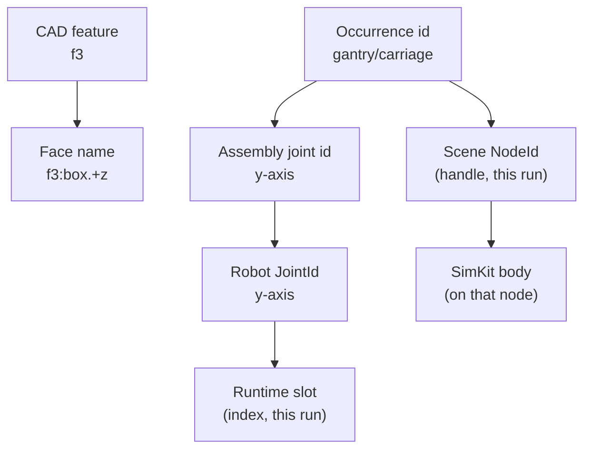

# Identity

## The problem

A fillet is put on "this edge". A sketch sits on "that face". A mate holds a
motor's shaft in "this bore". A motion track drives "the Y axis". Each of these
is a reference to something that will be rebuilt: the box gets wider, a hole is
added upstream, the machine is recompiled, the scene is reloaded.

If a reference is an index ("face 4", "joint 2"), it breaks silently. After a
rebuild, face 4 may be a different face, and the fillet moves to the wrong
edge without any error. Materia's rule is that every reference uses a name
that means the same thing after a rebuild. When that thing is gone, or has
split in two, the reference says so. It never quietly picks something else.

## The model

**Authored ids** name what a person or a builder created: features,
occurrences, joints. **Derived names** are computed for what nobody creates
one by one, the faces and edges of a solid, from how it was built, so they
come out the same on every recompute. Handles and indices (a scene node, a
joint's slot in a runtime array) live only inside one run and are never saved.

### Topological names: faces that keep their names

Each shape that CadKit makes carries an **element map**: a name for every face,
and for edges and vertices where needed. Names are text, built from three
sources:

- **Starting names** come from how an element was made, never from the order
  it was enumerated in. A box's top face is `box.+z`, a cylinder's side is
  `cyl.side`, a sketch line keeps its entity id (`e.l3`).
- **Each operation carries names through.** Inside one boolean, extrude,
  fillet or shell, the operation's own history says which input face became
  which output face. A face that is unchanged or only trimmed keeps its name;
  a face that is created gets a name from its source (`side(e.l3)`,
  `fillet(...)`); a face that splits gets one name per piece, marked by the
  faces that bound only that piece.
- **Feature tags.** After each feature runs, its new names get its tag:
  `f3:box.+z` is the top of the box made by feature 3. Pattern copies are
  tagged per instance (`i2`), and a component recipe can tag a body by role
  (`shaft`, `bolt1`).

Edges and vertices are named from their faces: the edge between the right
and top faces is `E(f3:box.+x|f3:box.+z)`, so it can never disagree with them.

History is used only inside one operation, never to match one recompute
against the next. Across recomputes, identity is **equality of names**.

### Resolving a reference

A stored reference keeps a **name** and a **fingerprint** (the element's kind,
size and position). After a recompute it is resolved:

1. **By name.** One exact match (or a merge alias) resolves.
2. **By relative.** If the face was split, or the reference was to a piece
   that is now whole again, the pieces are compared by their names. The
   fingerprint breaks ties among those candidates only.
3. **By geometry.** With no usable name, the exact fingerprint is matched
   over the whole shape, as a last resort.

A **weak** name depends on order (an index for a STEP-imported face, an
ordinal between mirror-image pieces) and resolves only if the fingerprint
agrees.

When resolution fails, the reference says why:

| State | Meaning |
|---|---|
| `Ambiguous` | the face split; the reference lists the pieces it could mean |
| `Deleted` | the feature that made the element is gone or suppressed |
| `Unresolved` | the feature exists, but the element is lost |

The recompute stops with that error. In the editor, an edit that makes a
reference ambiguous becomes a choice ("which piece did you mean?"), and a
broken reference can be retargeted to a candidate or a picked face or edge,
as one undoable change. People see names as labels ("box 2 › top (piece)");
labels are never stored.

Names are part of the document format. Each saved name records the **naming
scheme** that made it. A name from other rules is dropped on load, and the
reference falls back to its fingerprint, so a rule change can never make an
old name point at a different face.

### Assembly and robot ids

Assembly ids are authored strings: an **occurrence** id names one placed part,
a **joint** id names one degree of freedom. Nested assemblies flatten into
paths joined by `/` (`gantry/carriage`), so a local id may not contain `/`.
Saved assembly states and motion tracks are keyed by joint id.

When the assembly compiles into a robot model, those ids carry over. A robot
joint's `JointId` is the assembly joint's id; a link's `LinkId` is the id of
the occurrence at the root of its rigid body. `JointId`, `LinkId` and
`FrameId` are documented as "never a runtime index". Below the model, the
runtime works in arrays: a snapshot's positions are in model joint order.

### Scene ids

SceneKit separates an **entity** (a shared logical source, such as one wheel
design) from a **node** (one placement of it, such as the front-left wheel).
A `NodeId` is a 64-bit value from a counter that never reuses a value within
one scene. It is stable for the life of that scene, not across sessions.

The editor keys its objects by the scene artifact's string ids (occurrence
ids) and maps each to its node. SimKit creates every body against a node id
and writes poses back to it, so renderer, editor and simulation agree on what
moved (see [Simulation worlds](../execution/simulation-worlds.md#scene-sync)).

## In Materia

| Piece | Where |
|---|---|
| Element maps, naming rules, per-operation adapters | `cadkit/core/src/naming.cpp`, `naming_adapters.hpp` |
| Names, aliases, stamping, scheme | `Shape.elementNames`, `elementAliases`, `stamped`, `instance`, `namingScheme` |
| Matching and labels; naming bodies | `ElementNames`, `ElementMatch`; `Part.named`, `Solids.named` (MachineKit) |
| References and resolution | `TopologyReference`, `TopologyFingerprint`, `ReferenceState`, `TopologyResolver`, `ResolutionMethod`, `TopologyRemapReport` |
| Stated intent instead of a pick | `SelectionRecipe` |
| Mates on named faces | `GeometricConnectors` (`describeFaces`, `captureDescribed`), `SceneArtifact` face descriptors |
| Repair | `TopologyReference.retarget`, `Document.brokenReferences`, `EditorScene.selectedReferenceIssues` |
| Document ids | `FeatureId`, `ElementId`, `DocumentId`, `PersistentReference` |
| Assembly ids and paths | `materia.assembly.AssemblyDefinition`, `AssemblyDefinitionFlattener`, `AssemblyBodies` |
| Robot ids | `robotkit.model.JointId`, `LinkId`, `FrameId` |
| Scene ids | `nativekit.scene.NodeId`, entities in [SceneKit](../../../scenekit/README.md) |
| Editor id-to-node map | `SceneBridge` in `app/src/EditorScene.hx` |

## What it isn't

- **Not a database key for every edge.** Only faces (and solids) are tracked
  through operations; edges and vertices are derived from them.
- **Not OCCT's `TNaming`.** Names are computed in CadKit's core with OCCT's
  per-operation history, without an OCAF document.
- **Not a guess.** Where names and geometry cannot pick one element, the
  answer is `Ambiguous` with the candidates, never the closest match.
- **Not intent.** "The top face, whatever it is called" is a
  `SelectionRecipe`, and an authored connector on a component is preferred
  over a picked face.
- **Not persistent scene handles.** A `NodeId` lives as long as its scene.
  What is saved is the occurrence id it was created for.

## See also

- [The life of a machine](../start/life-of-a-machine.md), steps 1 and 3
- [CAD documents](../modelling/cad-documents.md)
- [Assemblies and mates](../modelling/assemblies-and-mates.md)
- [Simulation worlds](../execution/simulation-worlds.md)
- [Diagnostics](diagnostics.md)

## Open questions

- **`Remapped` does not mean "found by geometry".** The plan (TN-D9) reports a
  whole-shape fingerprint match as `Remapped`, but `prepareRemap` sets
  `Remapped` after any successful remap, by name too; only `resolvedBy()`
  tells them apart (`cadkit/haxe/src/cadkit/parametric/TopologyReference.hx:234`).
- **Stale comment about history.** `TopologyReference.hx:23` says the
  fallback selection is used "when identity/history cannot resolve", though
  cross-recompute history was removed (TN-D2).
- **Plan layout and scheme storage are out of date.**
  `cadkit/plans/TOPOLOGICAL_NAMING.md` lists a `core/src/naming/` directory (line 300)
  (the code is `naming.cpp`, `naming.hpp`, `naming_adapters.hpp`) and says
  documents record the scheme at the root (TN-D13, line 166; TN4.5 moved it onto each name).
  TN-D13/TN-D14 also describe a legacy-document path, while
  `DocumentCodec.VERSION` 16 rejects every other version.
- **Four id styles.** CAD elements get random ids (`element-<hex>`,
  `PersistentId`), features get integers, assembly and robot ids are
  authored strings (plain `String` in the assembly, `JointId` typedefs in
  RobotKit), and scene nodes are 64-bit counters. No shared id type or rule
  says which is used where.
- **A robot joint's id defaults to its display name.**
  `robotkit/core/haxe/robotkit/model/Joint.hx:38` sets `id = name` when no id is
  passed, so hand-built models (such as `robotd`'s `"left wheel joint"`) use
  labels as identities.
- **Link ids follow a body's root occurrence** (`AssemblyBodies.of`). Changing
  which occurrence roots a rigid body renames its robot link.
