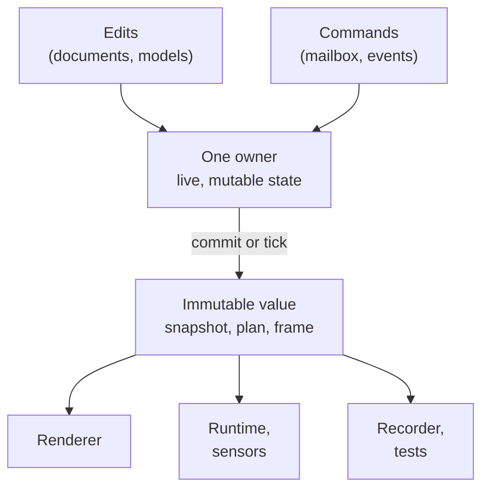

# Immutability and snapshots

## The problem

A running cell has several things reading the same state at once: the
renderer draws the scene, the robot runtime evaluates a plan, a sensor model
reads joint positions, a recorder writes everything to disk, a test compares
the result. Some of them run on other threads. Meanwhile something is changing
that state: physics steps, an edit lands, a new sample arrives.

If readers looked at live, changing objects, a reader could see half of an
update (a parent moved, its child not yet), a plan could change after it was
checked, and two runs could disagree depending on who read first. Locking
every read would make the hot paths slow and still leave the question of
which version a reader saw.

So Materia keeps changing state in one place, with one owner, and hands
everyone else **values**: copies that do not change after they are made.

## The model

### One owner changes things; everyone else reads values

Every piece of live state has exactly one owner: a scene, a simulation
session, a robot runtime, a robot world. Only the owner changes it, and only
at defined points: when a transaction commits, or once per tick. At each of
those points the owner **publishes** a value describing the new state. Readers
hold on to the value they got; the next change produces a new value, it does
not alter the old one.

Anyone else who wants to change something asks the owner: a command goes into
a robot's mailbox, an event is queued for the world's owner thread, a scene
edit is written into a transaction. Nothing outside the owner reaches into the
live state.

### Plans are values

A **trajectory** is a working object: a planner builds it, slices it, merges
its segments, projects couplings onto it. Each of those operations returns a
new trajectory rather than editing the old one, but a trajectory still
belongs to one thread at a time.

An **execution plan** is the frozen result. Creating one deep-copies the
trajectory, validates it, and refuses it if any check fails; after that the
plan has no setters. Its segments, start state, events and validation report
stay as they were validated, so what was checked is what runs. A plan may be
read from several threads at once, and evaluating it at a time returns a
copied state, never a view into the plan (see
[Execution plans](../motion/execution-plans.md)).

A plan also records the **model and calibration revisions** it was planned
for. The machine can change after a plan is made; the plan cannot. Instead of
updating old plans, the runtime refuses a plan whose revisions do not match
the machine it would move.

### Scenes change by transaction

The scene is edited through **transactions**. A transaction records changes
(create a node, reparent it, move it, give it geometry) and applies nothing
until it commits. On commit, the whole set is validated against the current
scene (stale ids, hierarchy cycles) and then applied at once, or refused with
nothing applied. Each commit bumps the scene's **revision** and can return the
**change set**: which nodes changed, and in which domain.

A **scene snapshot** is the scene at one revision. Its nodes are immutable;
unchanged parts are shared between successive snapshots, so taking one is
cheap. The renderer, picking and the simulation's scene sync read snapshots,
not the live scene.

### Snapshots of motion and physics

The same pattern repeats wherever things move:

- After every **simulation tick**, the session holds an immutable snapshot of
  bodies and joints, and can capture a **frame**: clock, body states, contacts,
  objects and actors at that tick (see
  [Simulation worlds](../execution/simulation-worlds.md)). The editor draws
  from a copied presentation snapshot without locking the simulation.
- After every **runtime tick**, a robot runtime publishes a **robot snapshot**:
  positions, velocities, efforts, safety, mode, plan progress and sensor
  samples. The arrays belong to the snapshot and are never reused (see
  [The robot runtime](../execution/robot-runtime.md)).
- A **world snapshot** gathers one robot snapshot per attached robot, copied
  again, with a sequence number and the world's topology revision.

Every snapshot carries a sequence or revision number, and observations carry
both the source's timestamp and the receiver's, so a reader can tell which
state it holds without asking the owner. Small values follow the same rule:
RobotKit's `Vec3`, `Quat` and `Transform3` are immutable, and operations on
them return new values.

## In Materia

| Piece | Where |
|---|---|
| Plans: deep copy on creation, read-only, thread-safe reads | `trajectory_core` (`mk_plan_create`), `motionkit.trajectory.ExecutionPlan` |
| Working trajectories (one thread at a time; operations return copies) | `motionkit.trajectory.Trajectory` |
| Evaluated state at an instant | `TrajectoryState` |
| Scene transactions and change sets | `nativekit.scene.Transaction`, `ChangeSet` (SceneKit `scene`) |
| Scene snapshots and node state | `SceneSnapshot`, `SceneNode` |
| Physics snapshots and frames | SimKit `nksim_snapshot`, `nksim_frame` (`sim_core`) |
| Editor-side simulation view | `robotkit.runtime.SimulationPresentationSnapshot` |
| Robot and world snapshots | `robotkit.core.RobotSnapshot`, `robotkit.world.WorldSnapshot`, `ImmutableFloatArray`, `SensorFrame` |
| Single-owner world and its event queue | `robotkit.world.RobotWorld` (`enqueue`, `pump`) |
| Compiled runtime description | `RobotRuntimeCompiler.compile` → `RobotRuntimeBlueprint` (with `revision`) |
| Spatial values | `robotkit.spatial.Vec3`, `Quat`, `Transform3` |

Who owns what:

| Owner | Changes | Publishes |
|---|---|---|
| SceneKit scene | nodes, by transaction; resources, directly | scene snapshots, change sets |
| SimKit session | the physics world, once per tick | snapshots and frames |
| `RobotRuntime` | its intent, safety and plan clock, once per tick | robot snapshots |
| `RobotWorld` | attached robots, on its owner thread | world snapshots |
| CadKit document | features and parameters, by undoable change | recomputed shapes |

## What it isn't

- **Not language-enforced.** Haxe's `final` makes a field unassignable, not
  its contents. Most snapshots are immutable by ownership: they copy their
  data in and hand out copies or read-only views. Code must still not modify
  arrays it is given.
- **Not "nothing changes".** Documents, models and the live world are
  mutable. Immutability is for what crosses from an owner to its readers.
- **Not a history.** Snapshots are not kept unless someone keeps them. Undo
  lives in CadKit's document changes; replay lives in recordings.
- **Not a lock-free promise for writers.** Owners still serialize their own
  writes: a session serializes calls against ticks, a world rejects calls from
  other threads.
- **Not every scene change.** Geometry, material and texture data are set on
  the scene directly, outside transactions, and published with the next
  snapshot. Only the node hierarchy and its placements go through
  transactions.

## See also

- [The life of a machine](../start/life-of-a-machine.md), steps 6, 8 and 9
- [Execution plans](../motion/execution-plans.md)
- [Simulation worlds](../execution/simulation-worlds.md)
- [The robot runtime](../execution/robot-runtime.md)
- [Data vs. runtime](data-and-runtime.md)
- [Determinism](determinism.md)
- [Identity](identity.md)

## Open questions

- **Plan-check findings are writable by anyone.** `ExecutionPlan.checked` is
  a plain public field (`motionkit/haxe/motionkit/trajectory/ExecutionPlan.hx:22`),
  while `endsAtRest` next to it is restricted to `PlanCertification`.
- **Two `RobotSnapshot` types.** `robotkit.core.RobotSnapshot`
  (`positions`, `velocities`) and `robotkit.runtime.RobotSnapshot` (`q`, `dq`)
  describe the same observation with different field names
  (`robotkit/core/haxe/robotkit/core/RobotSnapshot.hx`,
  `robotkit/core/haxe/robotkit/runtime/RobotSnapshot.hx`).
- **Revisions are chosen by the caller.** `RobotRuntimeCompiler.compile`
  defaults `revision` to 1 (`robotkit/core/haxe/robotkit/runtime/RobotRuntimeCompiler.hx:29`),
  so a plan's revision check only tells models apart when the caller bumps it,
  as the editor does (`app/src/ApplicationSimulation.hx:273`).
- **Shallow values.** `TrajectoryState` holds plain arrays in `final` fields
  (`motionkit/haxe/motionkit/trajectory/TrajectoryState.hx:5-8`), and
  `RobotRuntimeBlueprint`'s arrays are edited after compilation in tests
  (`machinekit/examples/machine-tending/TendingElectricGripperPhysicsChecks.hx:33`).
