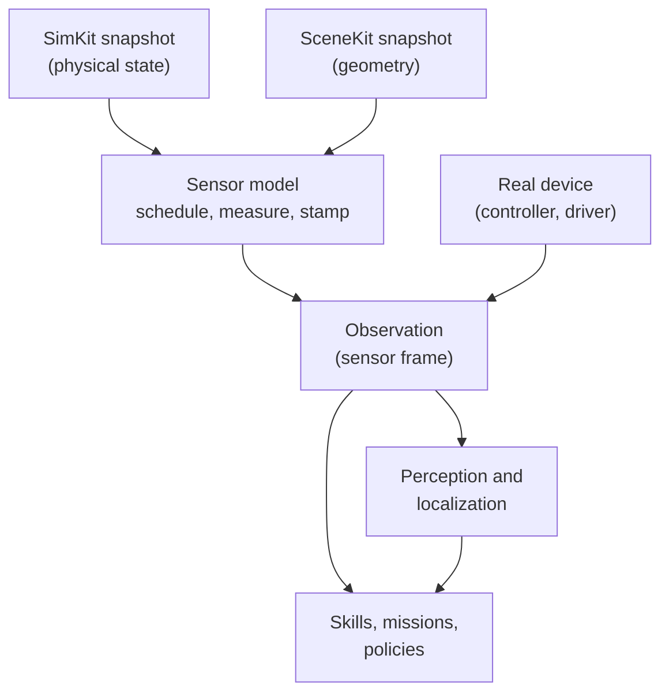

# Truth vs. observation

## The problem

A simulator knows everything: where every body is, how fast it moves, whether
the carton is really on the suction cup. A real machine knows none of that. It
knows what its encoders counted, what its vacuum switch reported, what its
camera saw a few milliseconds ago.

If control code reads the simulator's answers directly, it works in simulation
and fails on the machine: it never had to cope with noise, delay, a dropped
sample or a sensor that cannot see. So Materia keeps two things apart: the
**truth** the world holds, and the **observations** a sensor makes of it.

## The model

### Truth is a snapshot

Truth lives in the world: the SimKit session's bodies and joints, and the
SceneKit scene's geometry. A sensor model never reads a live world. It reads
an **immutable snapshot** taken at one instant, so a sample cannot see a state
that changes halfway through it, and the same snapshot always gives the same
sample (see [Immutability and snapshots](immutability.md)).

### Sensors are a sibling, not a layer

SensorKit sits beside SimKit and SceneKit, not above them. SimKit supplies
physical state, SceneKit supplies geometry and rendering, and SensorKit owns
what turns them into observations. Its core depends on neither: a backend
binding, called a **producer**, closes over a snapshot and hands the sensor
model the truth it needs (a body's pose and velocity for an IMU, ray hits for a
LiDAR, a rendered image for a camera).

### A sensor model has three parts

- **Sampling.** Each sensor has a schedule: periodic at a rate and phase, or
  triggered by hand. Due samples are taken in capture-time order, so two
  sensors at different rates interleave as they would on a machine.
- **Measurement.** The model turns truth into what the sensor would report:
  Gaussian noise, bias that drifts as a random walk, quantization, clipping,
  per-ray or per-pixel dropout, lens distortion, exposure. An IMU reports
  specific force, so a stationary one reads +9.81 m/s² up, not zero.
- **Delivery.** Every sample carries a **capture time** and a later
  **delivery time** (capture delay plus latency plus jitter), an integration
  window, and a sequence number. A whole sample can be dropped.

All randomness comes from per-sensor seeds, so a seeded run reproduces its
noise exactly (see [Determinism](determinism.md)).

### Control sees observations only

Code that decides what the machine does (skills, missions, policies, the
runtime's own checks) reads **observations**: timestamped sensor frames and
the robot snapshot. It never asks the simulator where something is. Higher
level estimates, such as a robot's pose on the map or the obstacles around it,
are made from observations by **perception** and **localization**; a pose
estimate carries its own quality and covariance.

This is what lets the same code run in simulation and on hardware. In
simulation, an adapter reads truth after each step and publishes the frame a
real device would; on the machine, the device publishes it. The consumer
cannot tell the difference, and should not be able to.

When a test wants to remove perception from the question, it may plug truth in
**behind an observation interface**: a ground-truth perception or localization
that answers through the same API as the real one. That is a declared
shortcut, visible at the place it is chosen, not a back door.

## In Materia

| Piece | Where |
|---|---|
| Sensor models, schedule, timing | `sensorkit/sensor_core`: `nksensor::Sensor`, `SensorTiming`, `SensorTick`, `SensorSampleHeader` |
| Measurement models | `ImuSensor`, `LidarSensor`, `CameraSensor`, `DepthSensor`, `SegmentationSensor`, `GaussianNoise` |
| Scheduling many sensors | `SensorRuntime` (producers, capture-time order) |
| Truth from simulation and scene | `sensorkit/sensor_sim`: `ImuTruthAdapter` (SimKit snapshot), `SceneLidarAdapter` (SceneKit snapshot) |
| Rendered cameras | `sensorkit/sensor_render`: `SceneCameraAdapter` (RGB, depth, segmentation) |
| Wire format, fan-out, replay | `sensorkit/sensor_io`: `SensorWireCodec`, `PacketFanout`, `PacketBuffer` |
| Robot sensors in the model | `robotkit.model.Sensor` (kind, mount frame, rate, noise, seed) |
| Sensors the runtime samples itself | `RobotRuntimeSensorBlueprint.isNativeKind`: encoders, IMU, LiDAR, switches, at-speed, presence, brake feedback |
| Sensors published from outside | `isExternalKind` (camera, vacuum, contact, force-torque, GNSS, …) via `RobotRuntime.publishSensorFrame` |
| Simulated external sensors | `robotkit/sim`: `SimulatedSuctionTool`, `SimulatedSwitchSensorAdapter`, `SimulatedPresenceInputAdapter`, `SimulatedRobotZoneAdapter` |
| The observation | `robotkit.core.SensorFrame`, `RobotSnapshot`, `SensorStreams` |
| Estimates from observations | `robotkit.perception.Perception`, `robotkit.localization.Localization` |
| Declared truth shortcuts | `GroundTruthPerception`, `SimulationTruthLocalization` |
| Camera geometry and markers | [VisionKit](../../../visionkit/README.md): calibration, PnP, `MarkerDetector`; RobotKit's `VisionKitFiducialDetector` |
| Kit README | [SensorKit](../../../sensorkit/README.md) |

Sensors that the native runtime samples are part of its tick: after each
SimKit step it reads the session snapshot, computes each due sensor's value,
adds its noise and packs it into the robot's state, where it reaches the
snapshot with a source timestamp. Sensors that come from outside the runtime
take the other path: a simulated adapter in simulation, or a device adapter
such as `DeviceSwitchSensorAdapter` on hardware, publishes a `SensorFrame`
against the sensor's authored mount.

VisionKit is downstream of observation. It does not make images; it turns
camera frames into geometry (undistortion, marker poses, calibrations), which
perception then lifts into the robot's frames.

## What it isn't

- **Not the simulation.** SensorKit never steps physics or moves a body. It
  reads snapshots the [simulation world](../execution/simulation-worlds.md)
  publishes.
- **Not a transport.** `sensor_io` defines packets, fan-out and an in-memory
  replay buffer. Choosing a file format, a socket or ROS is left to the
  caller; RobotKit records sensor frames in its own MCAP recordings.
- **Not perception.** A sensor model produces what a sensor reports. Turning
  that into "an obstacle here" or "the robot is there" is perception and
  localization, in RobotKit.
- **Not a licence to peek.** A ground-truth perception or localization is a
  test or editor convenience behind the same interface. Code that needs the
  real pose should take a `Localization`, not a `Simulation`.
- **Not every input.** Plain process inputs (a digital line, a cell
  controller's signal) are channel values and events of
  [the robot runtime](../execution/robot-runtime.md), not sensor models.

## See also

- [The life of a machine](../start/life-of-a-machine.md), step 8
- [Simulation worlds](../execution/simulation-worlds.md)
- [The robot runtime](../execution/robot-runtime.md)
- [Fidelity levels](../execution/fidelity.md)
- [Immutability and snapshots](immutability.md)
- [Determinism](determinism.md)

## Open questions

- **Two sensor models.** RobotKit's native runtime samples encoders, IMU,
  LiDAR and presence itself, with its own rate, Gaussian noise and seed
  (`robotkit/runtime/src/simulation_robot.cpp:436-565`,
  `robotkit/runtime/include/robotkit_runtime.h:327-339`), and has no latency,
  jitter, dropout, bias or quantization. SensorKit models all of these but no
  package uses it; only a spike test and `robotkit/tests/haxeon.json:9`
  reach `sensor_io`.
- **Delivery time is stamped, not enforced.** `SensorRuntime::poll` returns a
  sample at its capture tick (`sensorkit/sensor_core/src/sensor_core.cpp:234-257`)
  and nothing in the repository reads `delivery_time`, so latency exists only
  as a field a consumer may honour.
- **Editor missions localise on truth.** `MissionPlayer` drives mobile bases
  with `SimulationTruthLocalization` and runs wheel odometry beside it only
  for comparison (`app/src/MissionPlayer.hx:431,509`), so Play does not
  exercise the robot's own pose estimate.
- **The SensorKit README contradicts itself on cameras.** It says the first
  slice is RGB only and that segmentation, distortion, exposure and noise "can
  reuse" the render path (`sensorkit/README.md:115-121`), while the paragraphs
  above describe the post-processing as implemented and
  `SceneCameraAdapter::capture_segmentation` exists
  (`sensorkit/sensor_render/include/nativekit_sensor_render.hpp:52`).
- **`sensor_sim` is not only SimKit.** The README lists it as "SimKit truth
  adapters" (`sensorkit/README.md:23`), but `SceneLidarAdapter` reads a
  SceneKit snapshot.
- **Two names for one kit.** As with SimKit, the code is SensorKit but its
  targets, namespace and headers are NativeKit's (`NativeKit::sensor_core`,
  `nksensor`, `nativekit_sensor_core.hpp`).
