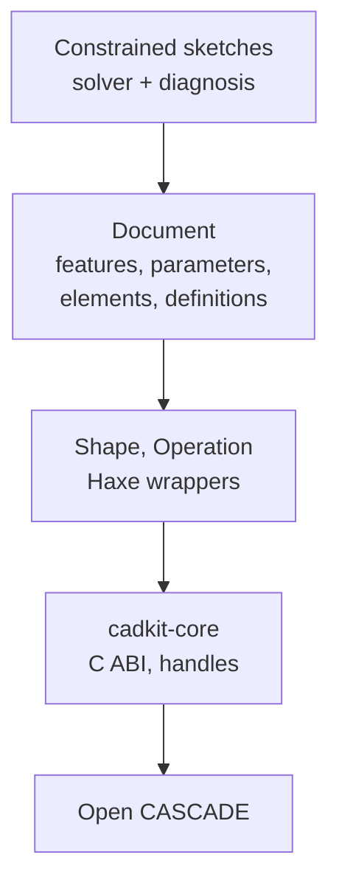

# CAD documents

## The problem

A machine needs solid geometry, and Open CASCADE (OCCT) computes it very well.
But a part described as a sequence of OCCT calls is fixed: change the plate's
thickness and nothing remembers that the holes were drilled through it, that
the fillet was on its outer edges, or that the sketch sat on its top face.

A designer wants the other kind of model: a recipe of steps with named
dimensions, where an edit replays the recipe and the holes, fillets and
sketches follow. That recipe also has to be saved, undone, reused as a
library part and shared by many copies, without any of it leaking into the
geometry kernel.

## The model

CadKit splits the problem into two layers with a hard boundary between them.

### A headless core with a C ABI

`cadkit-core` is a small C library over OCCT: primitives, booleans, extrude
and revolve, fillets and chamfers, lofts, sweeps, shells, tessellation, mass
properties and STEP import and export. It links nothing else: no window, no
renderer, no NativeKit, no Haxeon, no document model. It can run in a test, a
server worker or the editor alike.

Its boundary follows a few rules. Only C crosses it, never OCCT classes.
Shapes, meshes and operations are opaque handles with a kind tag and a
generation, so a stale handle is rejected instead of reused. Handles live only
in one process and are never saved. Large data such as meshes crosses in bulk.
Every operation returns its OCCT **history** (which faces were generated,
modified or deleted), and every shape carries a **topological name** for each
face, edge and vertex.

Haxe code reaches the core through Haxeon's FFI, as typed wrappers (`Shape`,
`Operation`, face and edge collections). An immediate modelling layer
(`cadkit.modeling`: `Part`, `Sketch`, `Plane`, the `Build*` builders) sits on
those wrappers for code that just wants shapes, as most MachineKit parts do.

### Documents: features in a dependency graph

A **document** is a directed graph of **features**. Each feature has scalar
**parameters** and reads the results of the features it depends on: a sketch,
an extrude of that sketch, a fillet on some of its edges, a boolean with
another body. **Named parameters** bind one value to many feature slots, and
may be **expressions** over other named parameters (`plate_t * 2`). Values are
stored in canonical units (mm, rad); the document records its own length unit.

A document also holds **elements**: persistent, named things it exposes. A
geometry element points at one output feature and has a placement and an
optional parent element. Levels and reference planes are geometry-free
elements that features can attach to. Typed **relationships** connect
elements; MachineKit uses them for port connections between instances.

### Recompute is staged and atomic

Editing a parameter marks its feature dirty, and everything downstream with
it. **Recompute** evaluates the dirty features in dependency order into a
staging area, re-finds every saved topology reference, and only then swaps the
new results in. If any step fails, nothing is published: the previous
geometry stays, a `RecomputeError` names the feature that failed and the state
of the reference that broke, and the caller can undo. Recompute can be
cancelled between features, which is how the editor drops a stale evaluation
when the user keeps typing.

**Undo and redo** work on change sets. A **transaction** groups several edits
(parameters, elements, placements, sketches) into one undo step. When an
editor owns project-wide history, it clears the document's own stack after
each edit and keeps its own.

### References that survive recompute

A fillet "on the top outer edges" has to find those edges again after the
plate grows. Two mechanisms do this, and they are not the same:

- A **topology reference** stores the element's topological name plus a
  conservative geometric fingerprint. After recompute it is resolved by name
  first, with geometry as the tie-breaker and the fallback. It ends
  `Resolved`, `Remapped`, `Deleted`, `Unresolved` or `Ambiguous`; an ambiguous
  match is reported with its candidates, never guessed.
- A **selection recipe** stores a geometric query with an expected count
  ("the four vertical edges") and runs it afresh on each result. A changed
  count is an error, not a silent new selection.

How names are made and matched is in [Identity](../foundations/identity.md).

### Sketches and constraint solving

A **constrained sketch** is 2D authored geometry (points, lines, circles,
arcs, with construction flags) plus **constraints**: coincident, horizontal,
vertical, parallel, perpendicular, tangent, equal, symmetric, concentric,
point-on, fixed, and the dimensions distance, radius and angle. A dimension
can be a **reference** dimension: measured after the solve, never driving it.

The solver is pure Haxe. It splits the sketch into independent parts, solves
each with Levenberg–Marquardt on analytic Jacobians and a sparse factorization,
and reuses unchanged parts from the previous solve, so dragging stays
interactive. A drag is a soft target that pulls points against the
constraints instead of overriding them.

Every solve is **diagnosed**, by the same `ConstraintDiagnosis` module that
assembly loops and mates use. It answers four separate questions: which
subsystems are independent, the local rank, whether the current geometry is a
degenerate special case, and whether the constraints can all hold. It reports
remaining degrees of freedom, **dependency groups** (A, B and C together
repeat one condition) and which points and entities are still free. Which
constraint to delete is only a suggestion, never the result. A sketch becomes
a profile only once it is solved and its regions validate; a
`ConstrainedSketchFeature` places it on a plane, a datum or a picked planar
face.

### Definitions and instances

A **definition** is a reusable part with typed **inputs** (defaults),
named **outputs** (geometry, tools) and a revision. It is produced either by
a registered **recipe** (MachineKit registers each component type this way)
or by a **subgraph**: another document, encoded and stored inside, with its
parameters bound to the inputs and chosen features exposed as outputs.

An **instance** element places a definition with **overrides** for some
inputs. Instances with the same definition revision and resolved inputs share
one cached shape. Editing a definition restages every affected instance before
any of them changes, with the same all-or-nothing rule as recompute.

`DocumentCodec` saves all of this as versioned JSON; native handles and
meshes never enter the file, and a file of another schema version is rejected.

## In Materia

| Piece | Where |
|---|---|
| Core C ABI over OCCT | `cadkit/core/include/cadkit.h`, `cadkit/core/src` |
| Haxe wrappers | `cadkit.Shape`, `Operation`, `Face`, `Edge`, `ElementNames` |
| Immediate modelling | `cadkit.modeling`: `Part`, `Sketch`, `Plane`, `BuildPart`, `Selection` |
| Document graph | `cadkit.parametric`: `Document`, `Feature`, `Parameter`, `NamedParameter`, `ParameterExpression` |
| Features | `cadkit.parametric.features`: `ExtrudeFeature`, `PocketFeature`, `HoleFeature`, `FilletFeature`, `BooleanFeature`, `ConstrainedSketchFeature`, `ImportedShapeFeature`, … |
| Recompute and undo | `Document.recompute`, `RecomputeError`, `Transaction`, `EvaluationContext` |
| References | `TopologyReference`, `TopologyResolver`, `ReferenceState`, `SelectionRecipe`, `TopologyRemapReport` |
| Elements | `Element`, `ElementKind`, `LevelElement`, `ReferencePlaneElement`, `Relationship`, `Placement` |
| Definitions | `Definition`, `DefinitionSubgraph`, `InstanceElement`, `DefinitionEvaluatorRegistry` |
| Building in code | `cadkit.parametric.recording.DocumentBuilder` |
| Sketches | `cadkit.sketch`: `ConstrainedSketch`, `SketchConstraint`, `SketchSolver`, `SketchSession`, `SolvedSketch`, `SketchProfile` |
| Diagnosis | `cadkit.solve.ConstraintDiagnosis` |
| Saving | `DocumentCodec` |
| Editor | `CadDocumentSession`, `CadSketchEditSession` (`app/src`) |

See the [CadKit README](../../../cadkit/README.md) for building the core and
its prebuilt OCCT.

## What it isn't

- **Not an assembly.** A document places instances, but joints, couplings,
  mates and loop solving belong to the assembly layer. See
  [Assemblies and mates](assemblies-and-mates.md).
- **Not required.** Most machine parts are built directly with
  `cadkit.modeling` or the core wrappers, with no document, recompute or
  history. Documents are for parts that must stay editable.
- **Not in the native core.** The core knows shapes and operations only.
  Features, parameters, sketch solving and names-to-references policy live in
  Haxe above it.
- **Not a mesh.** CAD topology and render meshes are separate. Meshes are
  derived for display and never saved in the document.

## See also

- [The life of a machine](../start/life-of-a-machine.md), step 1
- [Assemblies and mates](assemblies-and-mates.md)
- [Identity](../foundations/identity.md)
- [Machine components](machine-components.md)
- [Specialized models](specialized-models.md): sheet metal and BIM on documents
- [Conventions](../foundations/conventions.md)

## Open questions

- **`ARCHITECTURE.md` describes a schema migration that no longer exists.** It
  says format version 2 migrates version 1 input; `DocumentCodec.VERSION` is
  16 and any other version is rejected (`cadkit/haxe/src/cadkit/parametric/DocumentCodec.hx:90`, `:261`).
- **`ParameterKind` keeps "backward-compatible names"** for `QuantityKind`, two
  names for one set of values
  (`cadkit/haxe/src/cadkit/parametric/ParameterKind.hx:3`).
- **Sketch status is a free string.** `SolveDiagnostic.status` uses
  `"fully-constrained"`, `"under-constrained"`, `"redundant"`, `"conflicting"`
  and `"nonconvergent"` (`cadkit/haxe/src/cadkit/sketch/SketchSolver.hx:181`,
  `:190`), while assembly solves report their own vocabulary; there is no
  shared status type.
