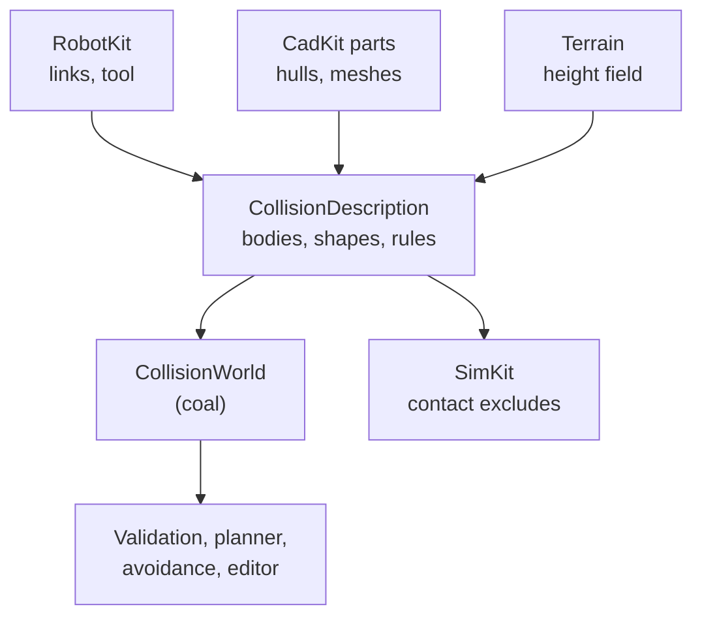

# Collision model

## The problem

A cell holds a robot, perhaps a second one, a fixture, a mechanism and loose
parts. Before a move runs, someone has to ask: does anything touch anything
it should not, and how close does it get? The planner asks it thousands of
times per path, the editor asks while you drag a joint, and the simulation
needs to know which parts may never collide.

If each of them builds its own geometry and its own idea of which pairs
count, they disagree: the planner certifies a move that the simulation then
reports as a crash, or the other way round. And a pair that is skipped
without a reason looks exactly like a pair that was checked and passed.

## The model

### The world knows bodies, not models

The collision world does not know what a robot is. The caller registers
**bodies**, poses each one with seven numbers (position and quaternion,
usually from a kinematic snapshot) and attaches **shapes** to them at
offsets. Body −1 is the world itself. So one world holds a whole cell:
several robots and CAD mechanisms, each with its own kinematic model, plus
the environment. The world keeps no model copy and does no forward
kinematics.

A shape can move between bodies. A grasped part is re-attached from the
table to the tool body and follows the tool's rules from then on, with its
stable id intact, so rules and reports survive the change.

### One shape vocabulary

Every kit describes collision with the same `CollisionGeometry`:

- **primitives**: box, sphere, capsule, cylinder, half-space;
- **convex sets**: the hull of a point set;
- **triangle meshes**;
- **height fields**: a grid of heights, solid down to a minimum (terrain
  lowered by digging replaces its heights; none may go below the minimum).

Primitives and convex sets can be **inflated** by a radius, which shrinks
every distance to them by that amount. Tool padding is carried this way,
exactly. Meshes are **surfaces**: a shape wholly inside a mesh reads as
clear. So solids are convex pieces or hulls; non-convex CAD parts are split
into convex pieces (V-HACD), and the pieces are inflated until their union
encloses the tessellated part. Meshes are for floors, walls and sheet.
Robot links accept primitives and convex sets only; meshes, height fields
and half-spaces are scene geometry.

### Pair rules say why a pair is checked

Not every pair should be checked: a link and its neighbour across a joint
touch by design. Each skipped pair records **why**, so a report can say why
a contact was not counted:

| Reason | Meaning |
|---|---|
| static | both bodies are fixed in this cell |
| rigid | joined only through fixed joints |
| adjacent | one movable joint apart |
| closure | joined by a closed loop of the model |
| overlaps at reference | overlap in the articulation's own reference pose |
| declared contact | meant to touch (two fingers closing) |
| process contact | a torch on its seam, allowed for one window |

Rigid, adjacent and closure pairs follow from the model's structure.
Overlap at reference is found from the geometry, but only among one
articulation's own bodies: an overlap between a robot and a fixture at the
reference pose is a **layout error**, and it is reported. Declared rules
override the defaults: `Allow` skips a pair, `Check` forces it, and `Touch`
permits contact at zero margin but not penetration.

A checked pair whose shapes cannot be compared (two height fields) makes
queries fail. And without a collision backend, callers report collision as
**unchecked**, never as passed.

### Margins per class, inflated for motion

Each body belongs to a **margin class** (installed robot links, tool, held
part, loose work, the surrounding air of fixtures), and each pair of
classes has a margin: closer than that is a violation. There are two
tables: the ordinary travel margin, and a tighter one for process contact
(a tool where it works). Single object pairs can override both.

A path is not just its samples. Between two checked configurations, no point
of a body moves further than a **motion bound** computed from each joint's
travel and its distance to the body. A violation query takes that bound per
body as extra inflation; if the segment is not clear with it, the segment is
bisected. That turns a sampled check into a proof that nothing came closer
than the margin over the whole move. "Exact" here means exact for the
declared geometry: tessellation deflection, hull kinds, inflation and the
solver's tolerance go into the report's assumptions.

### Batched queries

The world answers a few questions: pairs colliding within a margin, pair
distances up to a query distance, the first violation, the closest pair.
The planner's questions come by the thousand, so `firstViolation` and
`violations` take many pose sets in one native call and return the first
failure, or one flag per set.

## In Materia

| Piece | Where |
|---|---|
| World interface and types | `collisionkit.CollisionWorld`, `CollisionGeometry`, `CollisionPose` |
| Rules and reasons | `CollisionPairRule`, `CollisionPairStatus` |
| Margins | `CollisionMargins`, `CollisionMarginClass` |
| The cell's description | `CollisionDescription` → `build` → `CollisionBuild` (layout errors, held-part transfer) |
| A model's bodies and pairs | `collisionkit.kinematics.ModelBodies`, `kinematicskit.KinematicBodyPairs` |
| Native backend on coal | `collisionkit.native.NativeCollisionWorld`, C ABI `ck_*` in `collisionkit/native/include/collisionkit.h` |
| Convex decomposition | `ConvexDecomposer`, `NativeConvexDecomposer` (V-HACD 4) |
| Robot and cell geometry | `robotkit.model.CollisionShape`, `RobotCollision`, `CollisionSceneBuilder`, cadbridge `CellCollisionSnapshot` |
| Simulation excludes | `RobotCollision.simulationExcludes`, fed to SimKit |
| Clearance checks | `robotkit.collision.CollisionClearance`, kinematicskit `ClearanceMotionEnvelope`, motionkit `JointCurveClearance` |
| Avoidance rows | `kinematicskit.AvoidanceRows` |
| Free-space planner | `motionkit.planner.RrtConnect` behind `MotionPlanner` |
| Editor overlay | `app/src/SceneCollision.hx` |
| Kit overview | [`collisionkit/`](../../../collisionkit/README.md) |

coal is vendored from Materia's fork, which adds height-field distance;
patches stay small and meant for upstream. Above 512 checked pairs the native
world switches from a pair loop to coal's dynamic AABB tree.

## What it isn't

- **Not dynamics.** Contact forces, friction and resting bodies belong to the
  [simulation](../execution/simulation-worlds.md). SimKit takes its exclusions
  from the same description, so it may exclude more pairs than the
  clearance world, never fewer.
- **Not continuous collision of swept volumes.** Motion is covered by the
  conservative bound and bisection, not by sweeping shapes.
- **Not a model.** The world holds bodies and shapes. Kinematics, FK and
  which joints move stay with the caller.
- **Not the stock simulation.** Tool against workpiece material is
  [StockKit's](../process/stock.md) concern.
- **Not a mesh loader.** URDF `<mesh>` references are recorded and left out.

## See also

- [The life of a machine](../start/life-of-a-machine.md), step 7
- [Assemblies and mates](assemblies-and-mates.md)
- [Paths vs. trajectories](../motion/paths-and-trajectories.md)
- [Execution plans](../motion/execution-plans.md)
- [Simulation worlds](../execution/simulation-worlds.md)

## Open questions

- **The plan's pair classes are not the code's.** `collisionkit/plans/COLLISION.md`
  (CL-D4, lines 185-187) names self, robot-environment and robot-robot classes
  with `ds`/`di` defaults of 5/30 and 10/50 mm; the code has
  `CollisionMarginClass` (Air, Installed, Tool, Work, Held) with air and
  contact tables, a 5 mm default (`CollisionClearance.MARGIN`), and the
  influence distance only on `kinematicskit.AvoidancePair`.
- **The README undersells the pure half.** `collisionkit/README.md:16` says
  the caller turns `KinematicBodyPairs` into rules, but
  `collisionkit.kinematics.ModelBodies` does it, and the README does not
  mention `CollisionDescription` at all.
- **A deleted type is still imported.**
  `robotkit/tests/src/tests/PressFingerContactTests.hx:7` imports
  `CollisionShape.CollisionPrimitive`, which CL9a removed.
- **A fixture keeps a retired name.** `ClearanceBodyData`, deleted by CL9c,
  survives as a test typedef in
  `motionkit/tests/clearance-validation/src/ClearanceBodyData.hx`.
