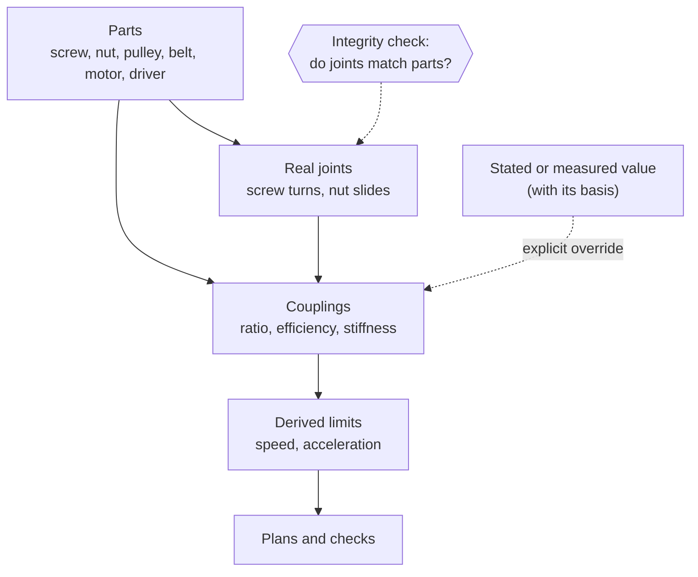

# Mechanical truth

## The problem

A model can move correctly and still be wrong. A carriage that slides on a
"helical joint", an axis with a typed-in top speed, a wheel whose axis is
flipped so that positive means forward: each of these plays back fine in the
viewer. Each also stores a fact about the machine somewhere the machine does
not keep it.

Such shortcuts break when the design changes. Swap a pulley and the typed
speed is still the old one. Move a motor to the other side and the flipped
axis is now backwards. Nothing in the model notices, because nothing ties the
number to the part it came from.

## The model

**Mechanical truth** is one rule applied everywhere: the model follows the
real mechanism closely enough that everything else can be derived from it.

- **Every real motion is a real joint.** A part that turns in bearings gets a
  turning joint; a part that slides on a rail gets a sliding joint. A lead
  screw is a screw turning (revolute) and a nut sliding (prismatic), tied by a
  coupling. There is no helical shortcut, and a set of mates that would leave
  a part a screw motion is refused rather than turned into a joint.
- **Joints keep their physical sense.** A wheel turns about its own axle as
  authored, so a right wheel on an outward-facing shaft rolls backward for a
  positive rate, exactly as its encoder counts. The control convention
  ("positive is forward") is derived from the joint's axis later, not encoded
  by flipping the joint.
- **The leader is the planned coordinate.** Motion is planned in the axes;
  screws, pulleys and motor shafts follow them through their couplings. A
  CoreXY machine is two belts, two motors and two axes: each motor follows both
  axes, one coupling per axis. A dual-screw axis is one axis with two screws
  following it. This is a choice about what is planned, not about cause: the
  motor still drives the axis.
- **Numbers come from parts.** Ratios, efficiencies, stiffness, speed caps
  and the axis limits built on them are derived from the parts that make the
  drive. Change a part and every derived number changes with it.
- **Every value says where it came from.** A value is **derived** from parts,
  taken from a **catalog**, **stated** by the designer, **assumed** to get a
  model running, or **measured** on the machine. A stated or measured value
  overrides the derived one explicitly and is recorded as such; it never
  silently replaces it.
- **The model is checked against its parts.** An assembly whose joints and
  couplings disagree with its geometry is rejected, not played back.

### Driven, passive and following joints

Not every joint is a motion the controller commands. A joint can be:

- **followed**: a coupling target, such as a screw or a motor shaft. It has
  no freedom of its own; its value comes from its leaders.
- **driven**: an input of a closed mechanism, where the motor or cylinder
  acts. Loop solves never move it; the other joints on the loop follow it.
- **passive**: it moves physically but is not position-controlled or held at
  power-on, such as a hinge that swings under contact. A passive joint cannot
  carry a motor or a cylinder.

Loops that a tree cannot express (a linkage, a cylinder on a boom) are
**closures**, explained in [Assemblies and mates](assemblies-and-mates.md).
Mechanical truth asks that the loop be modelled as a loop, not replaced by a
single joint that moves the end correctly.

### Why the extra joints are worth it

Modelling the real mechanism costs parts, joints and bodies. The CNC router
went from 3 joints to 7 when its four screws started turning, and from 4 rigid
bodies to 8. In return the router's axis limits stopped being hand-written,
its motors sit on the joints they actually turn, encoders see what real ones
would (lost steps on the motor's joint, stretch beyond the drive), and the
same assembly drives simulation, plan checks and the bill of materials.

## In Materia

| Piece | Where |
|---|---|
| Real drive joints and couplings | `MachineAssembly.addTransmission`, `addMotor`; `machinekit.assembly.Transmission` |
| Couplings a transmission owns are read-only | `MachineAssembly.addCoupling` refuses them; edit the parts or `setTransmissionOverrides` |
| Value provenance | `machinekit.transmission.ValueBasis` (`Derived`, `Catalog`, `Stated`, `Assumed`, `Measured`), `TransmissionRelation.basis`, `EngineeringMetadata` |
| Assumptions made visible | `TransmissionRelation.assumptions()`, `AssumedCatalogComponent` |
| Measured values | `MachineAssembly.calibrateBelts`, `clearBeltCalibration` |
| Joint kinds | `KinematicJoint.driven`, `passive`; `MachineAssembly.setPassive`; `AssemblyJointRole.Closure` |
| Screw motion refused as a mate result | `cadkit.modeling.AssemblyMateJoints` |
| Integrity of the put-together machine | `machinekit.assembly.AssemblyIntegrity`, `IntegrityReport` |
| Derived axis limits | `RobotModel.coupledLimits` |
| Control conventions derived from joints | RobotKit's runtime compiler (wheel directions from wheel axes) |

`AssemblyIntegrity.check` takes any `MachineAssembly` and reports, as
`integrity.*` diagnostics:

- **support**: the members of every mate touch, and everything is held up
  from the ground (or a given floor) through mates whose members touch. A part
  "fixed" to something half a metre away is found.
- **overlap** and **sweep**: nothing shares volume at rest or at sampled joint
  states, except meshes the transmissions themselves declare (screw in nut,
  belt on pulley, gear and rack teeth). No hand-written list excuses an
  overlap.
- **drive**: each screw, rack or gear coupling agrees with its parts. The
  leader is nudged and the parts' material points compared: a nut must travel
  one signed lead per turn, a pinion's pitch point must stay on its rack. A
  wrong ratio or a wrong thread hand shows up here.

Measured and stated values do not mix silently either: a measured belt
calibration conflicts with explicit transmission overrides, and the measured
value must be cleared before a competing override is authored.

The details of each drive (ratios, efficiencies, motor curves, the limit
formulas and the plan check) belong to [Transmissions](transmissions.md).

## What it isn't

- **Not full geometric detail.** Threads are described, not modelled, and a
  screw's thread is a coupling, not a helical surface. Mechanical truth is
  about which parts move and how, not about rendering every tooth.
- **Not physics.** Real joints make physics possible but do not imply it. The
  same assembly runs at kinematic, ideal or physical
  [fidelity](../execution/fidelity.md).
- **Not "no numbers by hand".** A designer may state a value, and an assumed
  value is allowed. What is not allowed is a hand-typed number that pretends
  to be derived, or that the model cannot trace.
- **Not cause and effect.** The leader is the coordinate planned in. Force
  still comes from the motor.
- **Not a complete check.** Integrity sweeps are samples, not swept volumes,
  and belts and chains are not checked for drive consistency, because their
  strands are not part geometry.

## See also

- [The life of a machine](../start/life-of-a-machine.md), steps 3 and 5
- [Transmissions](transmissions.md)
- [Assemblies and mates](assemblies-and-mates.md)
- [Machine components](machine-components.md)
- [Conventions](../foundations/conventions.md#couplings-and-transmissions)
- [Truth vs. observation](../foundations/truth-and-observation.md)

## Open questions

- **`AssemblyIntegrity` is not run over the examples yet.** Only
  `AssemblyIntegrityTests` and `GripperIntegrityTests` call it; the rollout to
  every example machine, and the removal of the per-machine clearance checks,
  is still pending.
- **Driven joints cannot be authored in MachineKit.** The data model has
  `driven`, but `MachineAssembly` has no way to set it, so a closed mechanism
  built in MachineKit has no declared input (see the matching question in
  [Assemblies and mates](assemblies-and-mates.md#open-questions)).
- **`ValueBasis` lives in `machinekit.transmission`** but is used for
  component and axis values as well (`EngineeringMetadata`, `RotaryAxisSpec`),
  so its package undersells it.
- **`Transmission` is still in `machinekit.assembly`.** The planned move to
  `machinekit.transmission` has not happened.
