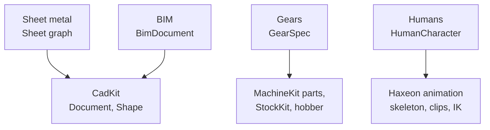

# Specialized models

## The problem

A plain CAD solid is enough to place, mesh and weigh a part. Some things need
more, and the extra cannot be read back from the solid later:

- A bent bracket must also unfold to a flat blank whose size is right to a
  tenth of a millimetre.
- A gear must have a tooth that meshes, can be cut, and can be inspected
  against a standard.
- A wall in a building has to know that a window sits in it, which storey it
  belongs to, and how to export itself to IFC.
- A person working next to a machine needs bones that code can address by
  anatomy, hands that can hold a tool, and a body that can collide.

Each of these is a domain model that sits next to, or on top of, the shared
core. It adds its own vocabulary and keeps the core generic.

## The model

The four models share one rule: **the domain model is the source, and the
geometry is derived from it.** They differ in what they stand on. Sheet metal
and BIM live inside CadKit documents. Gears are dependency-free mathematics
that machines and stock consume. Humans stand on a skeletal-animation layer,
not on CAD at all.

### Sheet metal: the sheet is the model

A sheet-metal part is a **`Sheet`**: a graph of flat **walls** (2D outlines
with holes, lines and arcs) joined by **bends** (an angle, an inner radius and
a bend rule). **Rips** are zero-gap cuts that break the graph's loops. One
thickness and one material cover the whole sheet.

Folding is forward kinematics. A **`SheetState`** gives every bend an angle
between zero and its target: `flat()` is all zeros, `folded()` all targets,
and every partly folded state in between is just as cheap. Walking the graph
from a root wall gives each wall's frame, so the folded solid, the flat
pattern and each step of a press-brake program come from the same graph and
always agree.

The flat length of a bend comes from an explicit **bend rule**: a K-factor
table (`BA = θ·(R + K·T)`, with `R` the inner radius) or a calibrated
air-bending process. A sheet with no rule is refused rather than given a
default. Features (base, edge flange, hem, cut, relief, rip, corner) edit the
graph; nothing edits the solid. The solid's faces are named from permanent
wall and bend ids, so names survive parameter edits.

The **flat pattern** is data first: developed regions, bend lines with their
angle, radius and allowance, and grain direction. Files come from it: DXF and
SVG drawings, manufacturability findings (short flanges, cuts near bends,
missing reliefs, radii too small, bends along the grain, overlap) and a blank
requirement for the sheet stock planner.

### Gears: teeth as exact profiles

GearKit describes a spur gear by its tooth system: module, tooth count,
pressure angle, profile shift, internal or external, and the cutter and tip
radii. From that it computes the analytic involute flank, the trochoidal root
fillet and the tip rounding (`ToothProfile`). It recovers the generating rack
from a tooth (`ConjugateRack`) and designs a hob from that rack
(`HobDesign`). Its metrology side grades a cut gear: it reads ring-shaped stock
through a small read interface and reports ISO 1328 deviations and an error
budget.

GearKit has no CAD, stock or machine dependency. The flexspline hobber and
StockKit's ring stock use it to cut and grade gears; MachineKit's transmission
gears are a separate implementation (see Open questions). Tooth design for
strain-wave gears (non-involute forms, the circular spline as an envelope,
meshing analysis) is planned, not built.

### BIM: a typed façade over a CadKit document

A **`BimDocument`** wraps an ordinary CadKit `Document`. BIM classes (project,
site, building, storey, space, wall, slab, window, door) are typed properties
on generic CadKit elements. Hierarchy and containment are CadKit
relationships (`bim.aggregates`, `bim.contains`), and a window or door is
**hosted** in a wall through a `bim.host` relationship that records where it
sits along the wall and its sill height.

Window and door types are CadKit definitions; their instances use the core
instance machinery, so editing a type updates every window of that type.
Saving uses the CadKit document codec unchanged; there is no separate BIM
file format. `IfcExporter` writes the supported subset as IFC4.

Only straight vertical walls host openings today, and the openings are
rectangular.

### Humans: a standard skeleton above any rig

A character asset comes with its own joint names. The **standard skeleton**
(`HumanBone`, about 30 bones: pelvis, spine, neck, head, and per side the
shoulder, arm, hand, three knuckles, leg, foot and toe) names bones by
anatomy. A **rig mapping** links each standard bone to an asset joint; presets
cover Quaternius, the Universal Animation Library and Mixamo, and a rig is
detected by the first preset that supplies every required bone.

From the current pose, code reads **landmarks** (any standard bone's position
and frame, in metres) and a **hand frame** derived from the knuckles, the
same on every rig. **Attachments** hang a rigid prop under a bone at an
offset in that frame, so a wrench stays in the fist through a walk.

HumanKit builds a worker on top: measured body dimensions, a fifteen-capsule
collision proxy, gait-matched walking, reaching with two-bone IK, and jobs
(pick, place, press, walk) written as versioned JSON that refer to scene
objects. In simulation the person is a kinematic actor: it pushes what it
walks into and is never pushed back.

## In Materia

| Piece | Where |
|---|---|
| Sheet graph, states, evaluation | `cadkit.sheetmetal`: `Sheet`, `Wall`, `Bend`, `Rip`, `SheetState`, `SheetEvaluation` |
| Bend rules and process | `BendRule` (`KFactor`, `Process`), `KFactorTable`; `cadkit.sheetmetal.process`: `AirBending`, `CalibrationTable` |
| Sheet features in a document | `SheetFeature` and subclasses: `SheetBaseFeature`, `SheetEdgeFlangeFeature`, `SheetHemFeature`, `SheetCutFeature`, `SheetRipFeature`, `SheetCornerFeature` |
| Solid, flat pattern, checks, blank | `SheetSolid`, `FlatPattern`, `SheetChecks`, `SheetBlank`; drawings in `cadkit.drawing` (`Drawing2D`, `Dxf`, `Svg`) |
| Press brake and bend planning | `machinekit.pressbrake`, `machinekit.pressbrake.planning` |
| Gear teeth, hobs, inspection | `gearkit`: `GearSpec`, `ToothProfile`, `ConjugateRack`, `HobDesign`, `GearMeasurement`, `Iso1328` |
| Transmission gears as parts | `machinekit.transmission`: `SpurGear`, `HelicalPinion` |
| BIM façade, vocabulary, IFC | [`bimkit`](../../../bimkit/README.md): `BimDocument`, `BimSchema`, `HostRelationship`, `BimCodec`, `IfcExporter` |
| GlTF import, clips, blending, IK | [`haxeon/packages/animation`](../../../haxeon/packages/animation/README.md): `AnimationAsset`, `AnimationInstance`, `ClipPlayer` |
| Standard skeleton and landmarks | `haxeon.animation.rig`: `HumanBone`, `RigMapping`, `HumanoidRig`, `HumanPose` |
| SceneKit presentation | [`animkit`](../../../animkit/README.md): `animkit.scene.SkinnedModel` |
| Worker, attachments, body, walking | [`humankit`](../../../humankit/README.md): `HumanCharacter`, `HumanGrip`, `HumanDescription`, `HumanBodyProxy`, `HumanBody`, `HumanWalker` |
| Jobs and actions | `humankit.job` (`HumanJobSpec`, `HumanJobBuilder`), `humankit.action` |
| People in simulation and facilities | `humankit.sim` (`HumanActor`, `HumanWorker`), `humankit/facility` (`FacilityWalk`) |

## What it isn't

- **Not feature recognition.** Sheet metal is designed as a sheet. Converting
  an imported or plain solid into a `Sheet` is planned, not available, and
  the flat pattern never comes from unfolding the folded solid.
- **Not a press brake.** CadKit owns the part and the bend process numbers;
  the press, its tooling and bend-order planning live in MachineKit.
- **Not a gear-strength calculator.** GearKit does geometry and metrology. The
  load ratings and limits of a drive are derived by MachineKit
  ([Transmissions](transmissions.md)).
- **Not a full BIM authoring tool.** BimKit covers a narrow, exact subset
  (straight walls, rectangular openings, storeys, spaces, slabs) and exports
  it; it does not import IFC.
- **Not an ergonomics model.** A human's posture is tuned to look natural and
  reach comfortably; it is not a validated biomechanical or safety-rated
  model. The collision proxy is capsules, not the skinned mesh.

## See also

- [The life of a machine](../start/life-of-a-machine.md), steps 1 and 10
- [CAD documents](cad-documents.md)
- [Identity](../foundations/identity.md)
- [Transmissions](transmissions.md)
- [Stock and material removal](../process/stock.md)
- [Manufacturing outputs](../process/manufacturing-outputs.md)
- [Simulation worlds](../execution/simulation-worlds.md)
- [Facilities and fleets](../execution/facilities-and-fleets.md)

## Open questions

- **Two involute implementations.** `machinekit.transmission.SpurGear`
  samples its own involute flank and drops to the root on a radial step
  (`machinekit/haxe/src/machinekit/transmission/SpurGear.hx:22`), while
  GearKit's `ToothProfile` has the analytic flank and trochoidal fillet. A
  transmission gear and a hobbed gear of the same spec do not share geometry.
- **The BimKit README describes a legacy reader.** It says `BimCodec.decode()`
  imports BimKit format v2 (`bimkit/README.md:3`); the code accepts only the
  current CadKit document version and throws otherwise
  (`bimkit/haxe/src/bimkit/BimCodec.hx:12`).
- **The HumanKit README predates the move to Haxeon.** It lists only the
  Quaternius and Mixamo presets (`humankit/README.md:43`; `RigMapping` also has
  `universal`) and calls the IK "AnimKit's" (`humankit/README.md:82`). The
  AnimKit README says `ClipPlayer` plays one clip at a time
  (`animkit/README.md:20`); Haxeon's describes crossfades plus a whole-body
  overlay.
- **Solid-to-sheet conversion is decided but unbuilt.** `SheetConvert` and a
  `sheet-convert` feature (SM-D7, SM5 in `cadkit/plans/SHEET_METAL.md`) were
  deferred; only the native face-ancestry queries landed.
- **Strain-wave tooth design is all planned.** TD0–TD10 in
  `gearkit/TOOTH_DESIGN_PLAN.md` have not started; GearKit is involute-only.
