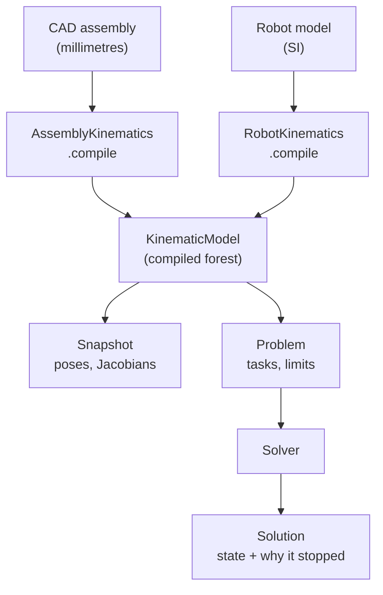

# The kinematic forest

## The problem

Three things in Materia need to know where a part is for given joint values,
and which joint values put a part where you want it. The CAD side poses
assemblies, closes linkages and drags parts in the editor. The robot side
solves inverse kinematics for tools and plans along paths. The servo loop
takes small, bounded steps every tick.

Each of these once had its own engine with its own linear algebra, and they
could disagree about the same machine. KinematicsKit replaces them with one
core: CAD assemblies and robot models compile into the same structure, and the
same solvers run on it.

## The model

### A compiled forest

A **kinematic model** is a forest of rigid **bodies** joined by **joints**.
Each body has at most one parent joint; a body without one is a **root**, and
its pose comes from the state. A model can have several roots: a machine and
the loose parts beside it, or a robot on a mobile base.

- **Joints** are fixed, revolute or prismatic, with a unit axis. A joint places
  its child as `parent · parentTJoint · motion(axis, q) · jointTChild`, the
  convention CAD and robot models already shared.
- **Degrees of freedom (DOFs)** are the movable joints that drive themselves,
  in authored order, with optional limits and a continuous flag.
- **Couplings resolve at compile time.** A coupled joint has no DOF of its own:
  its value is `Σ ratio × leader + offset` over its leaders, so a screw follows
  its axis and a CoreXY motor follows both axes. A follower's own limits narrow
  its leader's range.
- **Frames** are fixed offsets on bodies: RobotKit frames, CadKit connectors.
- **Closures** are loops the tree cannot express: two frames that must meet,
  as a fixed, revolute, prismatic, spherical, cylindrical or planar joint, or
  as a mate relation (parallel, perpendicular, distance, angle).
  **Closures are never walked by forward kinematics**; they are only ever
  solved as constraints.

Building the model checks it: one parent per body, no cycles in the tree or in
the couplings, unit axes, finite transforms, valid limits, unique ids. The
model is immutable once built.

### State and snapshot

A **state** holds the DOF values and the root poses. A **snapshot** evaluates a
state: the world pose of every body and frame (forward kinematics), and each
movable joint's world origin and axis. From those it gives **geometric
Jacobians** (6 rows: linear velocity at a point, angular velocity) for any
frame or point, with a coupled joint's column folded into its leader's.

### Tasks, limits and solvers

A **problem** says what a solve should achieve:

- **Tasks** each contribute residual rows and Jacobian rows. A frame task
  puts a frame at a target, with masks such as "position and tool axis, roll
  free". Others aim an axis at a point (look-at), set a 7-axis arm's elbow
  swivel, prefer a posture, damp some DOFs or a moving base, ask a frame for a
  twist over one step, or hold a closure shut. **Hard** tasks decide
  convergence; **soft** tasks only shape the answer.
- **Active DOFs** say which joints the solve may move; the rest stay at the
  seed, and Jacobians are only as wide as the active set.
- **Root motion** can make a root's pose a variable: planar (x, y, yaw) for a
  wheeled base, or a free rigid pose for a floating base.
- **Limits** are hard: the model's joint ranges, plus per-step bounds on
  velocity, acceleration and braking for servo steps.

Several solvers run on the same problem, each kept for the job it is good at:

| Solver | Job |
|---|---|
| Damped least squares | **Tracking**: small, smooth steps from a nearby seed (following a path, jogging, dragging). Fixed damping keeps joint motion small near singularities. |
| Levenberg–Marquardt | **Reaching**: closing assembly loops, far targets from a cold start, with diagnostics on failure. |
| Prioritized | Hard tasks as exact equalities, soft ones as well as they allow (a preferred posture while the tool stays on target). |
| Native QP step | One bounded differential step per servo tick (ProxQP), with the limits held exactly. |

The first three are pure Haxe, so they run in the editor and the browser. The
QP step is native.

**Solvers never modify their inputs.** They return a **solution**: the new
state, and a status that says why the solve stopped (converged, blocked by a
joint limit, conflicting tasks, out of iterations, numerical failure), with
per-task errors, the Jacobian's rank, the free DOFs left and the limits hit.
The caller decides whether to commit it. That is what lets the editor solve on
a preview and throw it away.

### Two ways in

**CAD assemblies** compile through CadKit: occurrences become bodies, tree
joints become joints, connectors become frames, closure joints (and, for the
mate solver, mates) become closures. Lengths stay in the assembly's
millimetres; the kit has no units of its own, and the solvers scale prismatic
steps by a characteristic length.

**Robot models** compile through RobotKit: links become bodies, joints and
couplings carry over, frames stay frames, all in SI. A robot model is itself
made from an assembly by the simulation bridge, which converts to metres and
rebases joint zero (see [Conventions](../foundations/conventions.md#units)).

Each compiler keeps the map from its own stable ids to compiled indices.
Indices never appear in RobotKit or CadKit APIs.

## In Materia

| Piece | Where |
|---|---|
| Compiled model, builder, state, snapshot | `kinematicskit.KinematicModel`, `KinematicModelBuilder`, `KinematicState`, `KinematicSnapshot`, `JointKind`, `ClosureKind` |
| Problems and tasks | `KinematicProblem`, `FrameTask`, `LookAtTask`, `SwivelTask`, `PostureTask`, `DofDampingTask`, `RootDampingTask`, `FrameVelocityTask`, `ClosureTask` |
| Solvers and results | `DampedLeastSquares`, `LevenbergMarquardt`, `PrioritizedSolver`, `KinematicSolution`, `KinematicStatus` |
| Moving roots, step limits | `RootMotion`, `StepLimits` |
| Native core and QP step | `kinematicskit/native` (package `kinematicskit-native`): `NativeKinematics`, `DifferentialIk`, over a C ABI with Eigen and ProxQP inside |
| Motion bounds for collision checks | `KinematicBodyPairs`, `MotionReach`, `ClearanceMotionBounds`, `AvoidanceRows` |
| CAD compiler and users | `cadkit.modeling.AssemblyKinematics`, `AssemblyState`, `AssemblyLoopSolver`, `AssemblyMateSolver`, `AssemblyDrag` |
| Robot compiler and IK | `robotkit.kinematics.RobotKinematics`, `robotkit.manipulation.KinematicGroup`, `Manipulator`, `IkOptions` |
| Planner contract | `motionkit.kinematics.KinematicsSolver`; `ManipulatorKinematics`, `ManipulatorServo`, `RedundancyResolver` in MotionKit |
| Kit | [`kinematicskit/`](../../../kinematicskit/README.md) |

The Haxe package depends on nothing. Only callers that want the native QP
step (MotionKit's robot package, for servoing) depend on the native package.

A **kinematic group** (`KinematicGroup`) is RobotKit's view of the joints that
move one tool: from a root link to the tool frame, optionally with the joints
to a work frame (a positioner), external axes and a moving base. It has one
IK entry point, `solve(target, seed, options)`, where the options pick
tracking, reaching or prioritized solving. `Manipulator` is the plain
fixed-base arm.

## What it isn't

- **Not a planner.** It solves one configuration or one step. Searching a
  whole path, picking configurations along it and timing them belong to
  MotionKit (see [Paths vs. trajectories](paths-and-trajectories.md)). IK
  output is never sent to a robot directly; it goes through planning and
  validation like any other target.
- **Not dynamics.** No torques, accelerations or contact forces. Physics is
  SimKit's; whole-body control will be RobotKit's.
- **Not the collision world.** Geometry and distance queries live in
  CollisionKit. The kit only knows which body pairs never need checking and
  how far a body can move, and turns reported distances into avoidance rows.
- **Not an analytic arm solver.** Closed-form solutions for six-axis arms (OPW)
  are a separate specialist solver in MotionKit.
- **Not the assembly's authored data.** Joint coordinates, closures and mates
  are saved in the assembly; the compiled model is always derived and never
  saved (see [Assemblies and mates](../modelling/assemblies-and-mates.md)).

## See also

- [The life of a machine](../start/life-of-a-machine.md), step 5
- [Assemblies and mates](../modelling/assemblies-and-mates.md)
- [Transmissions](../modelling/transmissions.md)
- [Paths vs. trajectories](paths-and-trajectories.md)
- [Execution plans](execution-plans.md)
- [Conventions](../foundations/conventions.md)

## Open questions

- **Robot models drop closures.** `RobotKinematics.compile` adds no closures,
  and `AssemblySimulationBridge.toRobotModel` hands assembly closures to the
  simulation as geometry instead (`robotkit/cadbridge/haxe/cadbridge/AssemblySimulationBridge.hx`,
  around line 462). Robot-side IK on a closed linkage cannot keep it closed.
- **"Two compilers" in *The life of a machine*.** Step 5 names the simulation
  bridge as the robot-model compiler (`docs/concepts/start/life-of-a-machine.md:144`);
  the bridge builds the `RobotModel`, and `RobotKinematics.compile` compiles it.
- **`KINEMATICS.md` is behind the code.** KK-D18 and K6d describe a separate
  `PathSolver` interface, but `solvePath` is on `KinematicsSolver`. K5 and its
  follow-up read `RobotModel.mobileBase`, which is now on `RobotProfile`
  (`KinematicGroup.baseMotion`). K0 lists "coupling targets not also driven",
  but a follower can now sum several leaders (`KinematicModel.COMBINED`).
  K0 has three closure kinds; there are ten (`kinematicskit/plans/KINEMATICS.md`).
- **Pose types are still duplicated.** `kinematicskit.Transform`, RobotKit's
  `Transform3`, MotionKit's `Pose3` and ProjectKit's `AssemblyFrame` describe
  the same thing; the kit converts only at its boundary.
