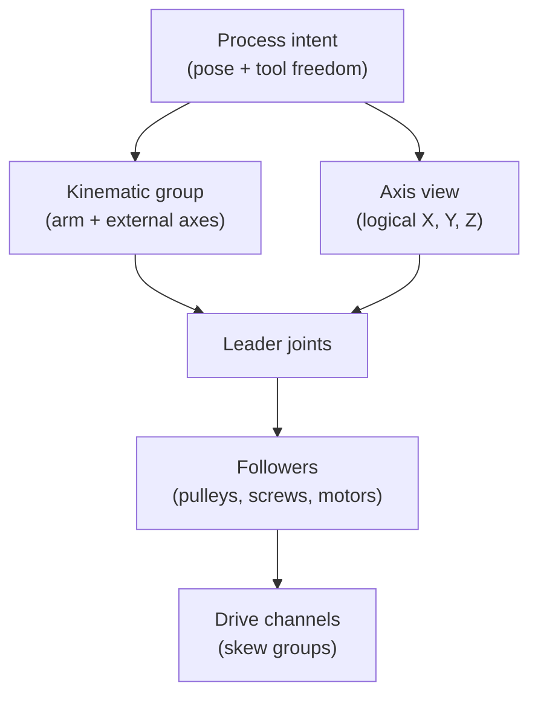

# Machine-axis views

## The problem

A process thinks in tool poses: put the cup on top of this carton, keep the
torch at this angle along the seam, move the cutter to X 100. A machine is a
set of joints: carriages, pulleys, screws, motor shafts, rails under arms.
Something has to say which joints are "the X axis", how a pose becomes joint
values, and what to do with the joints a pose does not pin down.

Three cases make this harder than a lookup table:

- **One axis, many joints.** A belt axis is a carriage plus a pulley plus a
  motor shaft; a dual-drive Y has two of each. They must move in proportion.
- **More joints than the task needs.** A 7-axis arm, or a 6-axis arm on a
  track, can reach the same pose in endlessly many ways.
- **Fewer joints than a full pose.** An XYZ gantry cannot tilt its tool. A
  pick with the cup pointing down should still be reachable.

## The model

### Leaders, followers and axis views

The robot model keeps every physical joint. Where a transmission couples
joints, one is the **leader** (the coordinate motion is planned in, usually
the carriage) and the rest are **followers** that move by
`follower = ratio × leader + offset` (see
[Transmissions](../modelling/transmissions.md)).

A **machine-axis view** names logical axes over those joints. Each logical
axis has an id, limits, speed and acceleration caps and a home position, and
maps to its leader plus every follower whose chain reaches only that leader,
each with its own scale and zero. Planning happens in the logical coordinate;
writing an axis position writes all its joints at once, so a geared or
dual-motor axis stays in proportion through every move. A joint that follows
several axes (a CoreXY motor) belongs to no axis: it is computed as the sum of
its terms after the axes are planned.

The mapping is not typed in. It is resolved from the model's couplings and
transmissions, and an authored mapping that contradicts the physical
couplings is an error.

### Tool freedom is stated by the process

A pose has six degrees of freedom, but a step rarely needs all six. The
**process** says which it needs, not the robot:

| Freedom | Meaning | Typical use |
|---|---|---|
| Full | position and whole orientation | fixed orientation, yawed placement |
| About the tool axis | position and tool Z direction; spin free | picking without a yaw, welding, probing |
| Cone | tool Z within a half-angle of an axis | tilted approaches |
| Free | position only | any orientation will do |

The same freedom drives pose IK, differential IK (only the needed twist rows)
and the planner's task-space check, so the solver and the check cannot
disagree. A machine that lacks the needed freedom (an XYZ gantry asked for a
tilt) simply fails IK for that pose. There is no per-robot "capability" flag:
the kinematics already know.

### Redundant and external axes

When the joints outnumber the task, the remaining motion is **redundancy**,
and it is chosen along the whole path, not pose by pose:

- a **7-axis arm** names its extra motion as a **swivel** angle of the elbow;
- an arm on a rail, or a workpiece on a positioner, has **external axes**: the
  rail and positioner values.

External axes are **derived from the assembly**, never listed in the scene.
The arm is the include that owns the tool flange nearest the tool; joints on
the path to the tool outside that include are external. A track under an arm,
or the X, Y and Z of a gantry carrying an arm, all become external axes this
way. External axes are damped in every solve, so they move for what the arm
cannot do alone. Along a path, a beam search over the redundancy (swivel or
external values) picks a connected route that keeps the arm comfortable and
lets the cheaper axes carry the travel.

The arm, its rail and its positioner are one robot model, so one plan over
all their joints runs on one clock: coordination is a property of the plan,
not a synchronisation protocol.

### Dual drives: skew groups and squaring

A dual-drive axis (the gantry's Y) has one leader and two motors, each on its
own belt or screw. On the controller, a **skew group** is the set of actuators
whose shafts resolve, through their one-leader coupling chains, to the same
leader joint. The device compares their pulse counts in leader units and
faults if they drift apart by more than the **skew bound**, which comes from
the axis's stated **racking tolerance** (0.5 mm by default on a gantry,
marked as assumed). A shaft that sums several leaders cannot be in a skew
group.

**Squaring** happens during homing. An axis with a home switch per side runs
toward both switches; the first side to trip is held while the other side
keeps going until it trips too. Each motor's counter is then calibrated
against its own switch, and the leader's zero is corrected for the travel made
while the first side was held. During squaring the skew bound for that pair is
temporarily widened to a stated finite limit, never switched off.

## In Materia

| Piece | Where |
|---|---|
| The axis view | `motionkit.robot.MotionSystem`, `MotionSystemBlueprint`; `motionkit.axis.MotionAxis`, `MotionAxisBlueprint`; `motionkit.AxisTarget` |
| Resolving followers into axes | `MotionSystemBlueprint.fromRobotModel`, `MotionAxisCouplings` (`expand`, `derived`), `CouplingProjection` |
| Gantry to axis view | `MachineKitRobotCompiler.compileGantry`, from `machinekit.gantry.Gantry` / `GantrySpec` |
| Exact XYZ kinematics over an axis view | `motionkit.robot.AxisKinematics` (used by CNC through `MachineBinding`) |
| Tool freedom | `motionkit.path.OrientationPolicy` → `motionkit.robot.ToolFreedom` → `kinematicskit.FrameOrientation` |
| Arms, groups and external axes | `robotkit.manipulation.KinematicGroup`, `Manipulator`, `ExternalAxes.derive`, `ArmSwivel`; `kinematicskit.DofDampingTask` |
| Redundancy along a path | `RedundancyResolver`, `RedundancyParameterization`: `SwivelParameterization`, `ExternalAxesParameterization` |
| Track as an external axis | `machinekit.gantry.LinearTrack` |
| Skew groups | `robotkit.device.DeviceTransmission`, `DeviceLayout.forActuators`, `DeviceBinding`; racking tolerance on the leader's joint limits |
| Squaring | `motionkit.robot.HomingCycle`, `HomingAxis`; `robotkit.runtime.HomingSideControl` |
| Planning limits | `motionkit.robot.PlanningLimits`, over `RobotModel.coupledLimits` |

## What it isn't

- **Not a second robot model.** The view names joints of the one compiled
  `RobotModel`; it adds no joints, links or limits of its own beyond job caps,
  which may only lower the drive-derived ones.
- **Not the safety layer.** Axis limits shape plans; the runtime and the
  controller still enforce joint limits and skew faults
  (see [The robot runtime](../execution/robot-runtime.md)).
- **Not an execution plan.** The view plans and hands over joint-space plans;
  the plan is the contract (see [Execution plans](execution-plans.md)).
- **Not 5-axis CNC.** Rotary heads serve missions and process paths; the CNC
  route stays three-axis X, Y, Z (see [Toolpaths](../process/toolpaths.md)).
- **Not a racking simulation.** The dual Y's far side is carried rigidly by
  the beam; racking is a tolerance and a device fault, not a flexing beam.

## See also

- [The life of a machine](../start/life-of-a-machine.md), steps 3 and 5
- [Transmissions](../modelling/transmissions.md)
- [Execution plans](execution-plans.md)
- [Paths vs. trajectories](paths-and-trajectories.md)
- [Toolpaths](../process/toolpaths.md): the machine binding
- [The controller boundary](../execution/controller-boundary.md)

## Open questions

- **Two Cartesian mappings for one gantry.** Missions plan a gantry through a
  `Manipulator` and IK over its joints (`app/src/MissionPlayer.hx`), while CNC
  plans it through a `MotionSystem` and `AxisKinematics`
  (`app/src/CncProgramPlayer.hx`). The picker builds a `MotionSystem` only for
  homing.
- **Explicit axis mappings are "deprecated" but used.** `MotionAxisBlueprint`
  marks authored scales and offsets as deprecated
  (`motionkit/haxe/motionkit/axis/MotionAxisBlueprint.hx`), yet
  `CncProgramPlayer`, `MissionPlayer.configureHoming` and
  `PrintingMotionBinding` all pass them.
- **Follower expansion depends on home switches.** `MotionSystem` runs
  `MotionAxisCouplings.expand`/`derived` only when the model has home
  switches (`motionkit/robot/haxe/motionkit/robot/MotionSystem.hx`, the
  `hasHomes` test); without them the view relies on the blueprint's own
  mapping.
- **Stale plan and README text.** `motionkit/plans/LANE_D_REDUNDANCY_SERVO.md`
  still calls itself a stub "not yet scheduled" and names `CoordinatedGroup`
  and `CoordinatedKinematics`, which no longer exist (their work frame lives
  in `KinematicGroup`). The MotionKit README still describes software homing
  to an authored coordinate and a pause between queued trajectories.
- **The first actuator is the reference.** When a joint has two drives,
  `MotionSystemBlueprint.fromRobotModel` takes the first actuator's ratio as
  the axis's reference; skew is guarded only on the device.
