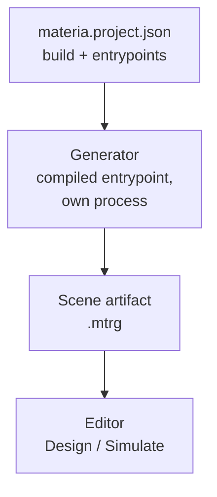

# The editor and projects

## The problem

A Materia machine is a program: a Haxe function that builds parts, mates,
drives and a mission out of the kits. Nobody wants to read that program to see
the machine. They want to open it, look at it, move its joints and press Play.

So the editor must find a machine's code, run it without linking it into
itself, keep what it produced, and reopen it quickly, the same way for a
gantry, a press brake or a welding cell.

## The model

### A project is a manifest and an entrypoint

A **project** is a `materia.project.json` file (format `materia.project`,
version 1) beside the project's own Haxeon manifest. It names:

- the **build**: always `{"system": "haxeon", "manifest": "haxeon.json"}`;
- one or more **entrypoints**, each a module and a static function of kind
  `cad-preview`, plus a `defaultEntrypoint`;
- optional **variants**: whole alternative scenes, of kind `configuration` or
  `study`, each pointing at an entrypoint, with a `defaultVariant`;
- optional runtime settings the code does not carry, such as `dynamicParts`
  (parts simulated as free bodies, like the gantry picker's six cartons) and
  `robotMotions` (a file of joint tracks).

The entrypoint function returns the bytes of a scene artifact. One folder can
hold several manifests (the cobot has one per reach).

### The generator runs outside the editor

The editor never links a project's code into itself. To open a project it
compiles the entrypoint, with the project's own `haxeon.json` and its
dependencies, into a small separate HashLink program (a wrapper around the
named function), and runs that program in a child process. The program writes
an `.mtrg` file and exits; the editor reads the file. A crash or a slow model
stays in the child, and the editor's own build does not depend on any example.

Because the code runs with the user's normal permissions, opening a saved
document that refers to a project asks before running its code.

### The scene artifact is the hand-off

The **scene artifact** (`SceneArtifact`, binary `MTRG`) is everything the
editor needs, with no reference back to the source: display meshes with CAD
face and edge identities, the assembly definition and its initial state, and
whatever the kits attached to it, such as missions, robot tools and sensors, a
machining or print job, a mobile base, controllers and signal wiring,
inspection cameras. Readers accept exactly one schema version and reject
everything else; the fix for an old artifact is to rebuild it from its source.

The artifact is derived output. The project's code and manifest stay the
truth, and edits made in the editor to a generated scene are saved as
overrides layered over it, not as a copy of it (see
[Data vs. runtime](../foundations/data-and-runtime.md)).

### Caching

Opening the same project again should not rebuild it. Three caches, all
disposable, sit under the user's cache directory (`~/.cache/materia`):

- **Compiled generators** (`generated-artifacts/<fingerprint>.hl`). The
  fingerprint hashes every source file and manifest of the resolved packages,
  the compiler and runtime, the native libraries' build stamps and the
  compiler options. Any change compiles again.
- **Artifacts** (`generated-artifacts/<fingerprint>.mtrg`), only for
  entrypoints that declare `"cache": {"inputs": [...]}`. That declaration is a
  promise that the output is deterministic and depends only on the sources and
  the listed files. Most examples make it.
- **Prepared scenes** (`prepared-scenes`): packed vertex streams, mass
  properties and collision hulls derived from an artifact, keyed by the
  artifact's hash and the editor's build identity.

Opening runs on a worker thread with Cancel; a failed or cancelled open keeps
the current scene.

### Modes and Play

The editor has two **modes**, Design and Simulate. They are dock layouts over
the same document, selection and undo history, not separate documents. In
Design you inspect the hierarchy, edit properties, and move joints within their
travel from the **Machine** panel; those are design positions, not commands.

**Play** (F5) builds a simulation from the installed scene and enters
Simulate. The assembly is compiled into a robot model and a runtime, the parts
become bodies in a physics session (MuJoCo by default), and whatever the
artifact carries is attached as a player: a mission, a CNC or print job, an
axis program, joint tracks. Step (F10), Reset (Shift+F5) and Stop drive the
same simulation; Stop discards it and returns to the design pose. See
[Simulation worlds](../execution/simulation-worlds.md) and
[The robot runtime](../execution/robot-runtime.md).

### Examples

The **Start page** lists the bundled examples from one hard-coded catalog in
the app (`ExampleCatalog`). Each entry is a project manifest path (with an
optional variant), a registered setup script, or one of the saved worker
documents. A project opened on the command line uses the same background path
as a catalog entry. There is no registration from the project side: adding an
example means adding a line to the catalog.

### Extending the editor from a project

A project can add its own inspector panel through a **UI extension**
(`uiExtension` in the manifest, protocol `materia.project-ui.v1`). The editor
builds a second Haxeon program named by the project and runs it once per
event, passing the full ordered history of button presses and selections as
JSON. The program answers with a panel description (rows and buttons), scene
colours and an optional new selection. The project owns the logic and state;
the editor owns the widgets. The picking station is the one example.

Everything else a kit adds to the editor (a panel, a player, an object kind)
is code in the app itself, which depends on the kits directly.

## In Materia

| Piece | Where |
|---|---|
| Project manifest reading, compile and run | `app/src/MateriaProjectRunner.hx` |
| Variants and legacy jobs | `ProjectVariants`, `ProjectJobs`, `ProjectVariantController` |
| Source vs. prebuilt `.mtrg` | `ProjectSourceLoader` |
| Generator build and fingerprint tools | `app/tools/MateriaProjectModuleBuild.hx`, `MateriaProjectFingerprint.hx` |
| Scene artifact format | `materia.project.SceneArtifact` ([ProjectKit](../../../projectkit/README.md)) |
| Assembly definition and state | `materia.assembly.AssemblyDefinition`, `AssemblyStateRecord` |
| Loading and preparation | `ProjectArtifactLoader`, `ProjectScenePreparation`, `PreparedProjectCache` |
| Background open | `ProjectLoadJob`, `ExampleLoadJob` |
| Overrides saved over a generated scene | `ProjectSceneRecord`, `ProjectDocumentSession` |
| Modes | `EditorMode`, `EditorWorkspaceLayout` |
| Play and its players | `ApplicationSimulation`, `editor/SimulationCommands`, `MissionPlayer`, `CncProgramPlayer`, `PrintProgramPlayer` |
| Example catalog and Start page | `editor/ExampleCatalog`, `editor/StartPanel` |
| Project UI extension | `editor/ProjectUiExtension`, `app/docs/project-ui-extension.md` |
| End-to-end example checks | `app/tests/project-source` (`ProjectSourceTests`) |
| Editor reference | [app/README.md](../../../app/README.md) |

The browser editor cannot start child processes, so it never compiles a
project: the native build exports every catalog entry to a prebuilt artifact
(`app/web/examples/WebExampleExport.hx`), and the browser downloads and caches
those. See [Web vs. native](web-and-native.md).

## What it isn't

- **Not a plugin host.** Projects cannot load code into the editor. A UI
  extension is a separate process speaking JSON; kits reach the editor by
  being compiled into it.
- **Not a sandbox.** Generators, setup scripts and UI extensions run with the
  user's permissions. The prompt before running project code is the only
  guard.
- **Not the source of truth.** The `.mtrg` and the caches can always be
  deleted and rebuilt. A prebuilt artifact can be opened, but it cannot
  regenerate another variant or an edited recipe.
- **Not a CAD document editor for generated machines.** A machine written as
  code is changed in code; the editor layers overrides (visibility, mass,
  joint state, extra mates) on top. CAD documents are a separate path (see
  [CAD documents](../modelling/cad-documents.md)).

## See also

- [The life of a machine](../start/life-of-a-machine.md), steps 4 and 8
- [Data vs. runtime](../foundations/data-and-runtime.md)
- [Web vs. native](web-and-native.md)
- [Haxeon](haxeon.md)
- [Simulation worlds](../execution/simulation-worlds.md)

## Open questions

- **ProjectKit's README gives old schema numbers.** It says `MTRG` version 29
  and assembly schema 10 in one place, 11 in another
  (`projectkit/README.md:14,43,83`); the code is 41
  (`SceneArtifact.VERSION`, `SceneArtifact.hx:925`) and 11
  (`AssemblyDefinitionCodec.hx:19`).
- **The legacy `AssemblyRecord` is gone but still documented.** ProjectKit's
  README says artifacts carry a legacy `assembly` record that the tree view is
  built from (`projectkit/README.md:53-55`); `AssemblyRecord.hx` now holds only
  frames and connectors.
- **The manifest `cnc` block does not exist.** `app/README.md:224-230`
  describes a `cnc` field in `materia.project.json`; no code reads it, and
  machining jobs travel in the artifact (`SceneArtifact.machining`).
- **Motion grips are documented but refused.** `app/README.md:214-219`
  describes `grips` in a project's `robotMotions` file;
  `MateriaProjectRunner.projectMotions` throws "no longer supported".
- **There is no Demo selector.** `app/README.md:152,171` lists `demo` as a
  third variant kind with its own selector; `ProjectVariants.decode` folds
  `demo` into `configuration`, and the view shows Configuration, Study or
  Scene preset (`ProjectVariantView.hx:26`).
- **Two schemas for scene choices.** Legacy `jobs`/`defaultJob` manifests
  (the robot welder, the reference arms) and `jobId` in saved documents are
  still read beside `variants`/`variantId` (`ProjectJobs.hx`,
  `ProjectSceneRecord.hx:8`), against the one-schema rule.
- **The catalog lives in the app.** Examples cannot register themselves;
  `editor/ExampleCatalog.hx` hard-codes about forty repository paths, which
  also decide what the browser build publishes.
