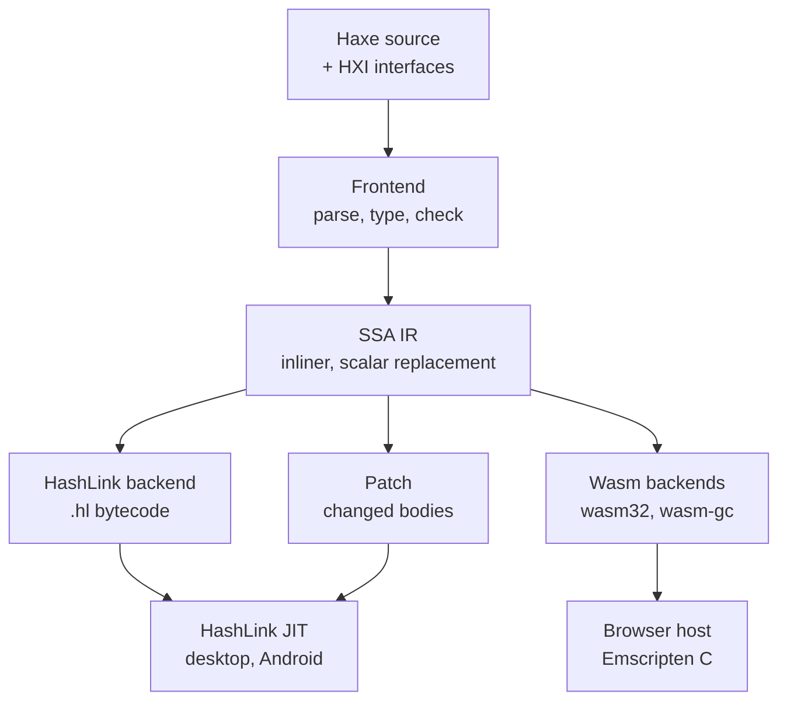

# Haxeon

## The problem

Materia is a large program in one language: about thirty kits, an editor, and
dozens of machine examples, all calling C and C++ libraries such as Open
CASCADE, MuJoCo and coal. It has to run on the desktop and in the browser, and
an editor this size should not restart on every edit.

The reference Haxe compiler gets part of the way. It has no WebAssembly
target, a different way of calling C on every target (hand-written HashLink
glue, hxcpp externs, JS externs), no fixed-layout native data, and no way to
change a running program. Materia's native build was left to the user.

Haxeon is Materia's answer: a Haxe-compatible compiler, a patchable HashLink
runtime, and one project tool, built together so that these pieces share one
contract.

## The model

### One language, a subset of Haxe

Haxeon accepts Haxe syntax and Haxe's static typing: classes, interfaces,
anonymous structures, enums and enum abstracts, abstracts, generics, closures,
exceptions, pattern matching, arrays and maps. It is a **subset**, not a
drop-in replacement. Macros are the largest gap: a `macro` function is parsed
and dropped, so code that needs build-time metaprogramming does not compile.
Strings are HashLink's UTF-16 strings and may not contain NUL; binary data is
`Bytes`. An unsupported construct is a compile error, never a silent fallback
to dynamic code.

The compiler is itself written in this subset. A checked-in compiler builds
the next one, and a full bootstrap through reference Haxe must reproduce it
byte for byte.

### One IR, three backends

The frontend lowers every module to an immutable SSA IR. All optimisations
run there, once, for every target: an inliner (on by default), strength
reduction, copy elision, and scalar replacement, which removes the heap
object behind a small value that never escapes.

**Value classes** (`@:value`) are the language side of that: a value class is
copied on every bind and stored inline in its parent, the same way on every
target. **Native records** (`@:value @:repr("C")`) have an exact C layout and
live only in native memory (arenas, FFI buffers), with `sizeof` and
`offsetof` folded to constants.

From the IR, three backends emit code:

- **HashLink**: standard `.hl` bytecode, which ordinary HashLink can run.
  Materia runs it on Haxeon's fork of HashLink, with its JIT, on Linux, macOS,
  Windows and Android.
- **wasm32**: WebAssembly with linear memory and Haxeon's own precise
  collector.
- **wasm-gc**: WebAssembly GC objects collected by the browser; the editor's
  default in the browser (see [Web vs. native](web-and-native.md)).

### Calling native code: HXI

A native library is described once as an **HXI interface**: its functions,
records with exact layouts, enums, callbacks, and who owns each pointer. A
Clang-based importer generates it from the C header (and a small C++ subset),
and a projection file maps C names to Haxe ones (`cad_shape` becomes
`ShapeHandle`). Haxe code then calls the library as typed Haxe, with
generated wrappers for out-parameters, owned handles closed with `close()`,
and byte buffers. On HashLink the call goes through libffi with no glue code;
on Wasm it becomes a typed import that the host forwards to an Emscripten
build of the same library. Constructs the importer cannot bind are
diagnosed, not guessed.

### One tool for projects

Each project or package has a `haxeon.json` manifest: its entry, source roots,
dependencies (by path, Git, or registry, pinned in `haxeon.lock`), FFI
interfaces, and native code, either C/C++ sources or a whole CMake project.
The `haxeon` CLI resolves the package graph, plans the Haxe compile and the
native builds as one action graph, skips what is unchanged, and runs the
result. A resident compiler worker keeps the typed program between builds, so
a small edit recompiles only what it touched.

A **workspace** file merges many projects into one graph: shared native
libraries are built once, everything shares one job limit, and each project's
tests become graph nodes whose passing results are cached while their inputs
stay the same.

### Live patching

Under `haxeon run --watch --live`, the program keeps running while you edit.
The compiler emits a patch of the changed function bodies; the runtime
validates and JIT-compiles all of it privately, then publishes it at once. A
bad, stale or incompatible patch is rejected and the program is untouched.
Objects, closures and state survive. A change to a module's structure (new
types, for example) instead reloads the module, and the program carries its
state across through `saveState` and `restoreState`.

Live builds keep compiler history so that patches can address the running
module. Ordinary builds do not: without `--live`, the output is a function of
the source alone (see [Determinism](../foundations/determinism.md)).

## In Materia

| Piece | Where |
|---|---|
| Compiler: frontend, IR, passes | `haxeon/src/compiler` (`Frontend`, `ir/IrGenerator`, `ir/IrInliner`, `ir/IrScalarReplacement`) |
| Backends | `compiler/backend/hl/HlBackend`, `compiler/backend/wasm` (`linear`, `gc`) |
| Checked-in compiler | `haxeon/bootstrap/compiler.hl` |
| Runtime | `haxeon/vendor/hashlink` (fork), `haxeon/native/runtime` (strings, arrays, maps, native calls) |
| Standard library | `haxeon/stdlib` (Haxe's, plus `haxeon.*` and `hl.*`) |
| Project CLI | `haxeon/scripts/haxeon`, `src/tools/HaxeonCli.hx`; manifests and resolution in `src/project` |
| Build planning | `src/build` (`BuildPlanner`, `WorkspaceBuild`) |
| Materia's workspace | `materia.workspace.json`: every kit's test project, run with `haxeon workspace test` |
| FFI tools | `scripts/haxeon-ffi-import`, `scripts/haxeon-ffi-audit` |
| A kit's interface | `cadkit/haxe/abi/CadKit.hxi` (generated, `portable-abi64`) and `CadKit.hxmap` (projection) |
| Packages | `haxeon/packages`: `haxeon-platform`, `-gpu`, `-ui`, `-audio`, `-animation`, `-editor`, `-filesystem`, `-credentials` |
| Live editor | `app/haxeon.live.json` with entry `app.DevEntry`; host `src/tools/LiveHost.hx` |
| Editor tooling | `haxeon fmt`, the language server (`src/LspMain.hx`), the sampling profiler |
| Docs | [`haxeon/README.md`](../../../haxeon/README.md), `haxeon/docs/` |

Materia's kits check their HXI files in, generated for one 64-bit portable
ABI. The browser build regenerates them for `wasm32` before compiling the
guest. The UI and platform packages are described in
[NativeKit and UIKit](nativekit-and-ui.md).

## What it isn't

- **Not full Haxe.** It has no macros, and Haxelib packages are imported only
  as plain sources: their `extraParams`, macros and HXML settings are refused.
- **Not a new bytecode format.** Initial builds are standard HashLink
  bytecode; patches and function identities travel in separate sidecar
  formats.
- **Not best-effort hot reload.** A patch applies whole or not at all; a
  structural edit is an explicit reload, not a guess.
- **Not live in the browser.** Live patching runs on desktop and Android
  HashLink; the web guest is compiled once.
- **Not Materia-specific.** Haxeon and its packages know nothing about
  machines; Materia is one consumer of them.

## See also

- [The life of a machine](../start/life-of-a-machine.md)
- [NativeKit and UIKit](nativekit-and-ui.md)
- [Web vs. native](web-and-native.md)
- [The editor and projects](editor-and-projects.md)
- [Determinism](../foundations/determinism.md)

## Open questions

- **`LANGUAGE_SUPPORT.md` is behind the compiler.** It does not list
  abstracts, though `haxeon/tests/programs` has `generic-abstract.hx` and
  `abstract-underlying-this.hx`, and `haxeon/ROADMAP.md:203` still lists
  abstracts as deferred. Nor does it say that `macro` functions are silently
  dropped (`src/compiler/syntax/Parser.hx:647`).
- **Value-type status.** `haxeon/docs/INLINING_AND_VALUE_TYPES.md:3` says
  stages 2 to 4 are still design, but scalar replacement and construct-in-place
  run from `src/compiler/ir/IrInliner.hx:542-544`. No Materia code outside
  Haxeon uses `@:value` yet, so stage 3's conversion of `Rect`, `Point` and
  poses has not happened.
- **The CLI knows only `wasm32`.** `src/build/Target.hx:88,129` rejects any
  other Wasm target, so `wasm-gc`, the browser default, is reachable only by
  calling the compiler directly. `app/web/build.sh:56,78,87` does that,
  regenerating HXI and turning `app/haxeon.json` into compiler arguments with
  `app/web/tools/guest-arguments.py`, outside the package graph.
- **Reference Haxe is still on the editor's path.**
  `app/src/MateriaProjectRunner.hx:159-161,353` needs the pinned reference
  Haxe to bootstrap the project tools that compile example entrypoints, and
  runs them on Haxe's interpreter when no cache directory exists.
- **Small doc gaps.** `haxeon/packages/README.md` omits `filesystem` and
  `credentials`; `docs/CLI.md` does not document `haxeon heap`
  (`src/tools/HaxeonCli.hx:119`).
