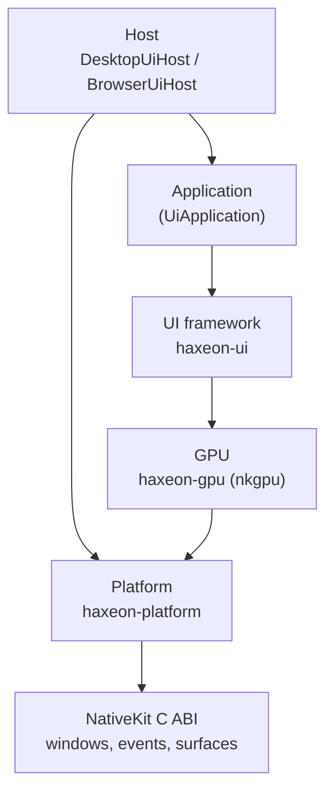

# NativeKit and UIKit

## The problem

An editor needs a window, a GPU surface to draw into, keyboard, mouse and
text input, file dialogs and a clipboard, and on top of that a UI: panels,
docked tabs, trees, inspectors, text fields. It needs all of it on Linux,
Windows, macOS and in the browser, called from Haxe, and without a C++
application framework that wants to own the program.

Materia splits this into two layers. **NativeKit** is a small C library for
the platform and the GPU. The **UI layer** above it does layout, text and
widgets. Both are part of Haxeon, not Materia, so other Haxeon programs (such
as the Exosuit code editor) use them too.

## The model

### NativeKit: one C boundary, one event queue

NativeKit gives access to windows, graphics surfaces, input, dialogs,
clipboard, drag and drop, notifications, monitors, gamepads, WebViews and
HTTP through one **C ABI**. It is handle based and UTF-8 throughout:

- **Handles** are opaque and generation-checked, so a handle to a destroyed
  window is rejected instead of naming whatever later reuses its slot.
- **One event queue.** Window resizes, dialog results, clipboard reads,
  drops and HTTP responses all arrive through `nk_poll_event`, in order. An
  asynchronous call returns a request id and its result comes back as an
  event.
- **One UI thread.** The thread that calls `nk_init` owns windows, surfaces
  and events. Other threads hand work back with `nk_dispatch_to_app`.
  The platform, application and render **executors** are named separately
  but today are all that thread; the names are there so rendering can move to
  its own thread later.
- **Capabilities are queried**, not assumed: `nk_get_capabilities` says what
  this platform and build support.

A **graphics surface** is a resource attached to a window. It can render
continuously or **on demand**, in which case a frame is drawn only when
something requests one. The GPU layer is a separate NativeKit module
(`nkgpu_*`) over Sokol: OpenGL, GLES, D3D11 or Metal on the desktop, WebGL2
in the browser. It owns passes, buffers, images, shaders and submission.

### The UI: views rebuilt, everything below retained

The UI follows a declarative model:

- A **`View`** is a short-lived description; its `build` produces
  **`RenderNode`s**. The application rebuilds the view tree when something
  changes.
- **Identity and state survive the rebuild.** Every node has a stable id.
  Focus, hover, scroll offsets and widget state live in the `UiContext`'s
  state store, keyed by those ids, not in the views.
- **Layout and text are native.** The tree is sent to native code as one
  layout transaction. Clay lays out boxes, Skribidi shapes text (bidi, line
  breaking, glyph atlases), and the result comes back as one snapshot of
  resolved geometry.
- **Rendering is a plan.** The resolved layout and any custom painting
  become one ordered `RenderPlan`, which the UI renderer submits through
  `nkgpu_*`. A plan can be **sealed** so it owns all its resources and no
  longer depends on the frame that built it.

"Retained" refers to what is kept between frames: text layouts, display
lists, measured sizes, and whole subtrees whose inputs have not changed
(`RetainedView`, `submitCached`). A frame where nothing changed is skipped
entirely.

On top of this sit **styles** (typed `StyleSheet` rules generated from a
`Theme`'s tokens), **commands** (scoped commands and shortcuts with an
`EditHistory` for undo), and **widgets**: controls, virtualized lists, trees
and tables, text editing, menus and dialogs, a property inspector, and a
**dock workspace** whose layout is a saved model separate from its panels.

A 3D view is a `GpuViewport`: the UI owns compositing, camera navigation and
pointer input, and the application (in Materia, SceneKit) owns the renderer
that draws into it (see [SceneKit rendering](rendering.md)).

### Hosts and applications

An application implements **`UiApplication`**: it owns a `UiContext` and
returns a `RenderNode` tree for each frame. A **host** owns everything
around it: on the desktop, `DesktopUiHost` opens the NativeKit window and
surface, loads fonts, pumps events, routes input, and requests frames when
input, an animation, or the application (for example a running simulation)
needs one. `BrowserUiHost` does the same in the browser without blocking.

The host is driven by `open` and then `tick` until it returns false, so a
development host can own the loop instead of `main`. That is how the editor
is **reloadable**: under `haxeon run --watch --live`, an entry class exposes
`start`, `tick`, `saveState`, `restoreState` and `close`. Compatible edits
are patched into the running program; a structural change reloads the module,
carrying the editor's state across through `saveState` and `restoreState`
(see [Haxeon](haxeon.md)).

## In Materia

| Piece | Where |
|---|---|
| NativeKit C ABI | `haxeon/vendor/nativekit` (`include/nativekit*.h`, contracts in `docs/api.md`) |
| GPU module | `haxeon/vendor/nativekit/modules/gpu` (`nativekit_gpu.h`, `NativeKit::gpu`) |
| Platform bindings | `haxeon/packages/platform` (`haxeon-platform`): `NativeKitEvents`, `NativeKitWindow`, `NativeKitSurface`, `NativeTransport` |
| GPU bindings | `haxeon/packages/gpu` (`haxeon-gpu`): `haxeon.gpu.Renderer`, `Pipeline`, `Buffer`, `Image` |
| Native UI | `haxeon/packages/ui` (`nativekit_ui.h`, `NativeKit::ui`): layout, text, `RenderPlan`, `UiRenderer` |
| UI framework | `haxeon.ui.core`: `View`, `RenderNode`, `UiContext`, `BuildContext`, `State`, `RetainedView` |
| Styles and themes | `haxeon.ui.style.StyleSheet`, `haxeon.ui.theme.Theme` |
| Widgets | `haxeon.ui.widgets` (controls, collections, text, overlays, docking, `GpuViewport`) |
| Commands and undo | `CommandRegistry`, `EditHistory`, `EditorDocument`, `PropertyInspector` |
| Hosts | `haxeon.ui.host`: `UiApplication`, `DesktopUiHost`, `BrowserUiHost`, `UiHostSession` |
| The editor as an application | `ReferenceEditorApp` in `app/src/Main.hx`; live entry `app/src/DevEntry.hx`, `app/haxeon.live.json` |
| Package readme | [`haxeon/packages/ui`](../../../haxeon/packages/ui/README.md) |

Other NativeKit services have their own Haxeon packages: `haxeon-audio`,
`haxeon-filesystem` and `haxeon-credentials`.

## What it isn't

- **Not an application framework.** NativeKit does not own `main`, a run
  loop or an object model; the host calls it. On Android and iOS it attaches
  to a view the app owns.
- **Not a 3D renderer.** `nkgpu` is a thin GPU API, and the UI only draws 2D.
  Scenes, materials and picking are [SceneKit](rendering.md).
- **Not immediate mode.** Views are rebuilt, but ids, state, layout and text
  persist, and unchanged frames do no work.
- **Not incremental layout.** Layout is one native pass over the whole tree
  each time the tree is submitted; reuse happens at the subtree and frame
  level, not inside layout.
- **Not Apple's UIKit**, which NativeKit itself attaches to on iOS.
- **Not a Materia kit.** It lives in Haxeon and has no dependency on Materia
  or SceneKit.

## See also

- [The life of a machine](../start/life-of-a-machine.md)
- [Haxeon](haxeon.md)
- [SceneKit rendering](rendering.md)
- [The editor and projects](editor-and-projects.md)
- [Web vs. native](web-and-native.md)

## Open questions

- **The UI layer has five names.** The package is `haxeon-ui` with Haxe
  package `haxeon.ui`; its README is titled "Haxeon UI" and calls it
  "NativeKit UI" (`haxeon/packages/ui/README.md:1,3`); its CMake project is
  `UIKit` (`haxeon/packages/ui/CMakeLists.txt:3`), its targets
  `NativeKit::ui` and `nativekit_ui`, its C prefix `nkui_`; doc comments say
  UIKit (`haxeon/packages/ui/haxe/haxeon/ui/host/DesktopUiHost.hx:20`), as do
  the root README (`README.md:5`) and this page's title. "UIKit" also
  collides with Apple's iOS framework, which the NativeKit README uses in the
  other sense (`haxeon/vendor/nativekit/README.md:73`).
- **NativeKit's modules README is stale.** It says UIKit and SceneKit "live
  as sibling projects in the Materia repository"
  (`haxeon/vendor/nativekit/modules/README.md:10`); the UI moved to
  `haxeon/packages/ui`. Its module table is also split by that paragraph.
- **`DesktopUiApplication` is a leftover.** It is a "compatibility name"
  adding only `diagnosticState`
  (`haxeon/packages/ui/haxe/haxeon/ui/host/DesktopUiApplication.hx:3`), yet
  `DesktopUiHost` requires it rather than `UiApplication`, and Exosuit calls
  it "the reloadable interface" (`exosuit/README.md:8`), though reloading
  comes from the live entry's static methods, not from the interface.
- **The GPU module calls itself an "isolated experiment"**
  (`haxeon/vendor/nativekit/modules/gpu/README.md:3`) while the UI and
  SceneKit both render through it.
