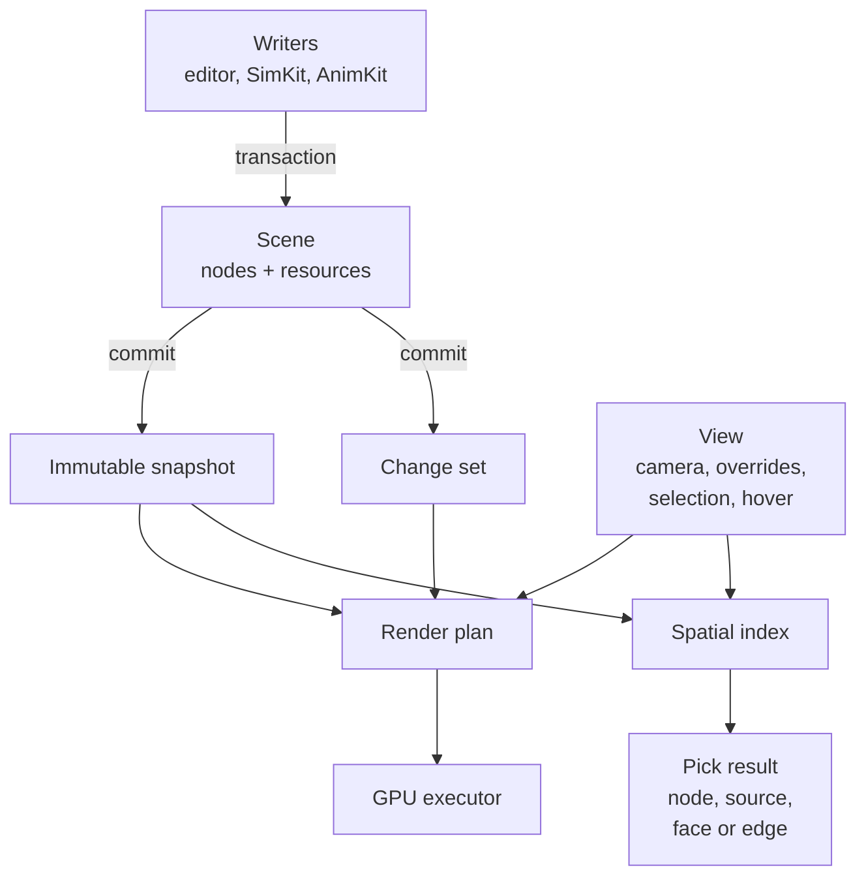

# SceneKit rendering

## The problem

The editor shows a machine: thousands of parts, some moving, some hidden, one
selected, one under the mouse. A CAD rebuild, a simulation and the user all
change that picture at once, and the reverse question comes as often: which
part, face or edge is under this pixel? Redrawing everything every frame is
too slow, and letting each subsystem touch the GPU makes the picture and the
picking disagree. SceneKit sits between them: one retained
scene that changes only through transactions, a renderer that updates only
what changed, and picking that answers against exactly what was drawn.

## The model

### Entities, nodes and resources

A **node** is one placed item in the scene hierarchy: a parent, a local
transform, visibility, and optionally a geometry, a material, a camera or a
light. An **entity** is the logical thing a node shows; four wheel nodes can
share one wheel entity. In CAD terms a node is an occurrence. Both are stable
identifiers that an application may keep and persist; the integer handles of
the C interface are temporary and are neither (see
[Identity](../foundations/identity.md)).

**Resources** (geometry, materials, images, textures, samplers, cameras,
lights) are created on the scene and referenced by nodes. Geometry carries
triangles, lines or points, optional extra vertex streams, and two CAD
extras: **subelement ranges**, which tag runs of triangles with a face id, and
**stroke segments**, the B-rep edges drawn over the faces. Those tags are what
lets a pick name a face or an edge rather than only a part.

The scene's contract matches [Conventions](../foundations/conventions.md):
metres, radians, seconds, right-handed with +Z up, column-major 4×4
transforms.

### Transactions, snapshots and change sets

Nodes change only through a **transaction**: create and destroy nodes, set
parents, transforms, names, visibility, geometry, material and source entity.
On commit the whole transaction is validated first (stale ids, hierarchy
cycles, bad arguments) and then applied at once; a failing transaction changes
nothing.

A commit produces a new **snapshot**, an immutable view of the whole scene
with world transforms and bounds already derived, and optionally a **change
set**: which nodes changed in which domains (transform, hierarchy, geometry,
material, visibility, ...) and which world transforms that touched below them.
Snapshots share unchanged storage with their predecessors, so taking one is
cheap and holding an old one is safe while the scene moves on (see
[Immutability and snapshots](../foundations/immutability.md)).

Resource data is different: setting a geometry's or material's data publishes
it directly, outside any transaction. The scene keeps separate geometry and
material revisions so a renderer can ask which resources changed since it
last looked.

### The view

A **view** is everything about *how* to show a snapshot that is not part of
the scene: the camera and projection, a root node, section planes, the grid
and studio lighting, and layers of overrides. Visibility and material
overrides change the base picture; diagnostic, selection and hover **tints**
recolour a subtree while keeping each surface's own material, alpha and
texture (hover wins over selection, selection over diagnostics). Source-level
rules and **isolation** hide or restyle everything belonging to an entity.
**Pose overrides** place nodes at runtime world poses without editing the
scene.

The scene is shared; a view belongs to one viewport.

### Planning and execution

The **render plan** is compiled from a snapshot and a view: the list of
visible items, culled against the camera, grouped into instance batches by
geometry and material. Given the next snapshot and its change set, the plan
**patches** itself: instance transforms, visibility, materials and culling for
the changed nodes only, and rebuilds a batch only when its layout changes.
Without a change set it **refreshes**: unchanged revisions cost nothing, and a
new scene revision recompiles the plan.

The **GPU executor** turns the plan into NativeKit GPU resources and draw
commands, uploading only changed instance records. It can draw into a
window's renderer, a retained image the UI composites, or an RGBA8 capture for
tests and tools. A headless executor runs the same resource and
command path with no GPU at all.

### Picking and spatial queries

There are two ways to ask what is under a point:

- the **spatial index** is a CPU bounding-volume index over one snapshot. It
  answers box and ray queries and nearest-hit ray picks, honouring the view's
  visibility, isolation and pose overrides, and it can pick edges within an
  angular radius. After a transform-only change it **refits** instead of
  rebuilding;
- the **GPU pick** renders an id pass and reads back one pixel, either
  blocking or asynchronously. An asynchronous result answered for an older
  plan or snapshot comes back **stale** rather than wrong.

Both return the same **pick result**: the node, its source entity, the
subelement (face or edge id), the world position and the depth.

### Selection and hover

What is selected is application state, not scene state. SceneKit gives it a
place to live in two forms: a plain **selection set** of subtrees the view
tints, and a native **interaction** object that holds selection
(replace/add/toggle) and an asynchronous GPU hover request, and drops nodes
that no longer exist in a new snapshot. Neither ever mutates the scene.

Translation, rotation and scale **gizmos** are a separate pure-Haxe package
that computes handles and drag proposals; committing the move is the caller's.

## In Materia

| Piece | Where |
|---|---|
| Scene, transactions, snapshots, change sets | `nativekit.scene.Scene`, `Transaction`, `SceneSnapshot`, `ChangeSet`, `SceneFrame` (`scenekit/scene`) |
| Identities and nodes | `NodeId`, `SceneNode`; entity ids as `Int64` source values |
| Resources | `Geometry`/`GeometryData`, `Material`/`MaterialData`, `Image`, `Texture`, `Sampler`, `Camera`, `Light` |
| View and presentation rules | `SceneView`, `SceneViewPolicy`, `SceneViewFilter`, `VisibilityFilter` (`scenekit/scene_render`) |
| Planning and GPU execution | `SceneRenderer` (render, `renderImage`, `captureRgba8`), native `RenderPlan`, `NativeKitGpuExecutor` |
| One-owner frame loop | `SceneSession` |
| Spatial queries and CPU picking | `SpatialIndex` (`pickRayWithView`, `pickRayWithViewEdges`, `queryBounds`) |
| GPU picking | `SceneRenderer.pickPixel`, `pickPixelAsync`, `PickRequest`, `PickResult` |
| Selection and hover | `SelectionSet`; `SceneInteraction`, `ScenePresentation` (`scenekit/scene_interaction`) |
| Gizmos | `nativekit.scene.gizmo`: `TranslationGizmo`, `RotationGizmo`, `ScaleGizmo` |
| Kit README | [`scenekit/`](../../../scenekit/README.md) |

The editor keeps one `Scene` for the open project
(`app/src/EditorScene.hx`). It commits document edits with change sets, hands
one change set per frame to `SceneRenderer.renderImage`, keeps a
`SpatialIndex` beside each snapshot, and picks parts, faces and edges with CPU
ray picks. Selection and hover are the editor's own state, applied each frame
as `SelectionSet` and hover tints. During Play, simulated poses reach the
viewport as view pose overrides. SimKit's scene sync writes dynamic bodies
back through a transaction instead (see
[Simulation worlds](../execution/simulation-worlds.md)).

## What it isn't

- **Not a document model.** The scene holds what is drawn, not what was
  designed. CAD documents, assemblies and scene artifacts live in their own
  kits and are projected into nodes (see
  [Data vs. runtime](../foundations/data-and-runtime.md)).
- **Not a game engine scene graph.** Nodes have no behaviours, scripts or
  physics; simulation and animation write poses into it from outside.
- **Not the GPU layer.** Devices, surfaces and command submission belong to
  NativeKit (see [NativeKit and UIKit](nativekit-and-ui.md)).
- **Not an undo history.** A transaction is atomic, but the scene keeps no
  history; the editor's undo lives above it.
- **Not a collision world.** The spatial index answers picks and bounds
  queries against display meshes; clearance and contact belong to
  [the collision model](../modelling/collision.md).

## See also

- [The life of a machine](../start/life-of-a-machine.md), steps 4 and 8
- [Identity](../foundations/identity.md)
- [Immutability and snapshots](../foundations/immutability.md)
- [Simulation worlds](../execution/simulation-worlds.md)
- [The editor and projects](editor-and-projects.md)

## Open questions

- **The README's gizmo sections describe another project.** They refer to
  "Beartooth" and a "Documents" preview as the consumer and test host
  (`scenekit/README.md:129,137,146,148,169`); nothing in Materia uses the
  gizmo package outside its own tests.
- **The interaction library is not wired into the kit package.**
  `scenekit/haxeon.json` lists only the scene and render interfaces and
  source roots, and the app builds only `scene` and `scene_render`
  (`app/haxeon.json:96-97`), so `SceneInteraction` and SceneKit's
  `ScenePresentation` are unused; the editor has its own
  `app.editor.ScenePresentation` (`app/src/editor/ScenePresentation.hx:25`)
  with the same name.
- **Three names for one kit.** SceneKit is `nativekit.scene` in Haxe,
  `nkscene_` in C and `NKSCENE_` in CMake (`scenekit/README.md:56`), a remnant
  of living inside NativeKit.
- **Change sets are opaque from Haxe.** The C interface exposes only a change
  set's revision (`scenekit/scene/include/nativekit_scene.h`,
  `nkscene_change_set_get_revision`); the changed nodes and domains exist only
  in C++ (`nativekit_scene.hpp:425`).
- **Any pose override change recompiles the plan.** The pose signature hashes
  every override's matrix (`scenekit/scene_render/src/render_items.cpp:424`)
  and a changed signature recompiles in `update`
  (`render_compiler.cpp:182-188`), so the editor's Play view, which moves its
  poses every frame, never takes the incremental path.
- **Two commits between frames fall back to a recompile.** The editor keeps
  one pending change set and turns a second into a refresh
  (`app/src/editor/ScenePresentation.hx:52-60`), and a refresh across a new
  scene revision recompiles (`render_compiler.cpp:934-940`).
- **The robot simulation renders through a private scene.**
  `SimulationSpace` creates its own `Scene`
  (`robotkit/sim/haxe/robotkit/runtime/SimulationSpace.hx:63`); the editor
  copies its poses into view overrides rather than sharing one scene.
- **Small boundary leaks.** `PickResult` sits in the scene library but imports
  the render bindings (`scenekit/scene/bindings/haxe/nativekit/scene/PickResult.hx:3`),
  and `SceneSession`/`SceneFrame` are unused outside SceneKit.
