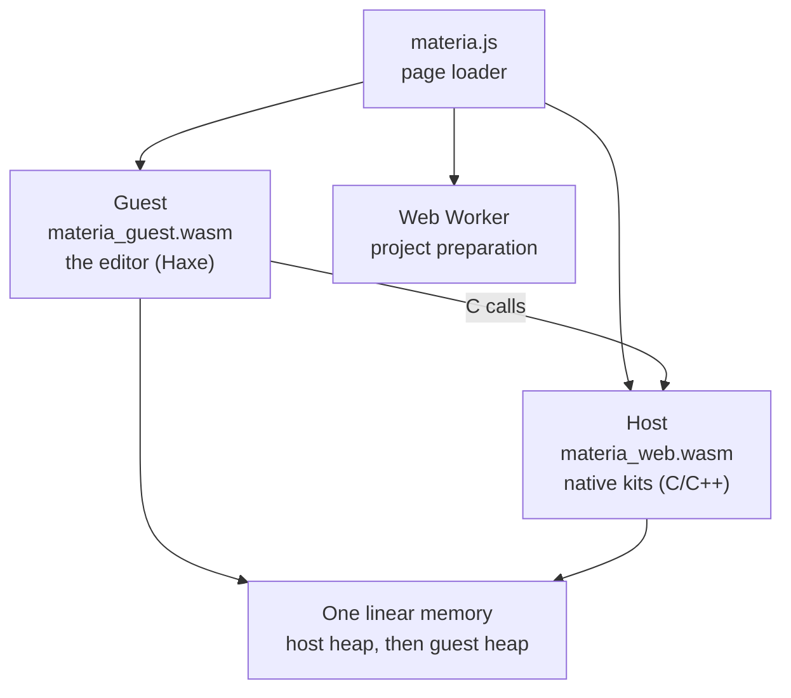

# Web vs. native

## The problem

Materia's editor is a desktop program: Haxe code on HashLink, calling native
libraries for the GPU, the solid modeller, the physics engine and the motion
planners. Running it in a browser raises three questions. Is it the same
editor, or a second one that drifts? Which of the native kits come along? And
what does the browser simply not allow, such as threads, child processes and
a real filesystem?

The answer Materia gives is one editor, one set of C interfaces and two
builds. This page says what is shared, what differs and what is still missing.

## The model

### Two modules, one memory

In the browser the editor is two WebAssembly modules.

- The **guest** is the editor itself, compiled by Haxeon from the browser entry
  point (`app.MainWeb`). It builds the same `ReferenceEditorApp` the desktop
  entry point opens; only the host around it differs.
- The **host** is an Emscripten program that links the native kits and supplies
  WebGL2, input and fonts. It exports every C function the guest imports.

They share one fixed-size linear memory, split by a **memory contract**: the
host's heap comes first, the guest's region follows, and the memory never
grows. The guest is compiled against the contract and carries a copy of it; the
page checks that the host agrees before it starts the guest, then drives the
editor from `requestAnimationFrame`.

The guest has two targets, both from the same Haxeon IR:

- **wasm-gc** (the default) keeps Haxe objects as WebAssembly GC objects,
  collected by the browser. It needs a browser with Wasm GC.
- **wasm32** keeps Haxe objects in the shared memory with Haxeon's own
  collector. It runs where Wasm GC does not, at several times the frame cost.

Both call the same host through the same C interfaces. Those interfaces are the
desktop ones, regenerated for the browser's 32-bit ABI, so a kit's boundary is
written once.

### Which kits come along

Everything written in Haxe compiles into the guest: ProjectKit, MachineKit, the
editor, the planners' Haxe layers. Native kits run only if the host links them:

| In the browser | Native kits |
|---|---|
| Linked | NativeKit (with GPU and UI), SceneKit, SimKit with MuJoCo, RobotKit's runtime and its SimKit binding, MotionKit, TrajectoryKit's core, KinematicsKit, CollisionKit, AnimKit, StockKit |
| Linked only with a browser build of OCCT | CadKit |
| Not linked | RobotKit's serial and simulated-board devices, its policy and inference layers, VisionKit |

A call into a kit the host does not provide throws `haxeon.wasm.HostError` into
the guest instead of aborting the page, and the page lists those modules in
`window.materia.unavailable`. At build time an import check compares every
guest import with the host function it binds to; only CadKit may be missing,
so a planning kernel cannot silently go unlinked.

NativeKit treats the browser as one more platform with its own equivalents:
a canvas for the window, the File System Access API for pickers, the Gamepad
and Notifications APIs, Web Share. Its parity contract classifies each
capability as required, an equivalent, optional or not applicable on the web
(see [NativeKit and UIKit](nativekit-and-ui.md)).

### Projects arrive prebuilt

On the desktop, opening an example runs its project source: the editor compiles
the example's entrypoint and runs it to produce a scene artifact (see
[The life of a machine](../start/life-of-a-machine.md), step 4). A browser
cannot start child processes, so it cannot do that. Instead the examples are
**published** at build time: the desktop publisher runs every project source
and writes content-addressed artifacts beside a small catalog.

The Start page uses the same `ExampleCatalog` as the desktop. At startup only
the catalog downloads; choosing a card downloads that example's files, checks
each against the catalog's size and SHA-256, and installs it. A standalone
prebuilt project (a `.mtrg` artifact) can be opened from the File menu or by
drag and drop. Projects that only exist as source cannot be opened.

### Storage and threads

The guest's files live in an in-memory filesystem. When the browser has the
origin private file system (OPFS), the page mirrors those files there, so
settings, workspaces and downloaded example data survive a reload. Browser
storage can be evicted; missing or damaged example files are downloaded again.
The editor shell itself is not cached for offline use.

The guest runs on one thread. Cold preparation of a downloaded project runs in
a separate guest in a Web Worker, with its own private memory and no native
libraries; everything else, including simulation steps, planning steps and
workspace saves, runs on the page's thread. MotionKit's incremental program
compiler, which the desktop schedules on a native worker, is advanced on demand
in the browser with bounded lookahead.

## In Materia

| Piece | Where |
|---|---|
| Browser entry point | `app.MainWeb` (`configure`, `main`, `frame`, `openArtifact`, `report`) |
| Shared editor | `app.Main.ReferenceEditorApp`, `haxeon.ui.host.BrowserUiHost` and `DesktopUiHost` |
| Page loader and file mirror | `app/web/materia.js`, `app/web/MateriaWebFiles.hxi`, `app.BrowserFiles` |
| Host program and linked kits | `app/web/CMakeLists.txt`, `app/web/host.cpp` |
| Build, memory contract, import check | `app/web/build.sh`, `app/web/tools/check-imports.js` |
| Guest-to-host glue, `HostError` | `haxeon/stdlib/haxeon/wasm/haxeon-host.js`, `HostError.hx` |
| Host heap allocator | `NativeKit::wasm_host_allocator` |
| Published examples | `app/web/build-examples.sh`, `app.editor.ExampleCatalog`, `app.BrowserExamples` |
| Preparation worker | `app.PreparationWorkerMain`, `app/web/preparation-worker.js` |
| Browser tests | `app/web/test.sh` (`--tour`, `--examples`, `--missions`) |

Build and run steps, the OCCT recipe and the measured frame times are in the
[browser build README](../../../app/web/README.md). The Wasm backends
themselves are described in [Haxeon](haxeon.md).

## What it isn't

- **Not a second editor.** There is no web-specific UI. `MainWeb` starts the
  same editor on a browser host; a feature that works on the desktop and not in
  the browser is a missing native link or a browser limit, not a fork.
- **Not a thin client.** Nothing runs on a server. Simulation, planning and
  rendering run in the page; the server only hosts static files.
- **Not a project-source runner.** The browser opens published artifacts. It
  cannot build an example from its source or pick up edits to it.
- **Not live-patched.** Haxeon's live code patching is a desktop and Android
  feature; the web build is compiled once.
- **Not threaded.** The memory is not shared with workers, and the one worker
  has its own memory. Haxeon can build a shared-memory guest for hosts that use
  threads, but the editor does not.

## See also

- [The life of a machine](../start/life-of-a-machine.md), step 4
- [Haxeon](haxeon.md)
- [NativeKit and UIKit](nativekit-and-ui.md)
- [SceneKit rendering](rendering.md)
- [The editor and projects](editor-and-projects.md)

## Open questions

- **Stale lists of linked kits.** The headers of `app/web/build.sh` (line 7)
  and `app/web/materia.js` (lines 1-2) say the host links NativeKit, UIKit and
  SceneKit; `app/web/CMakeLists.txt` (line 112) also links SimKit, RobotKit,
  MotionKit, KinematicsKit, AnimKit, StockKit and CollisionKit. The README's
  host list omits CollisionKit.
- **Example count.** `app/web/README.md` (line 99) says the Start page has all
  25 examples; `ExampleCatalog.entries` now lists 40.
- **Interfaces generated for kits the host does not link.**
  `app/web/tools/generate-wasm-hxi.sh` (lines 19-21) generates browser
  interfaces for RobotKit policy and inference and for VisionKit, but neither
  `build.sh`'s linked set (line 120) nor the host links them, and the README
  does not list them as missing.
- **"Build-only" status.** `haxeon/README.md` (line 66) calls the Wasm targets
  experimental and build-only, while the editor runs on them with browser tests
  for editing, examples and missions.
