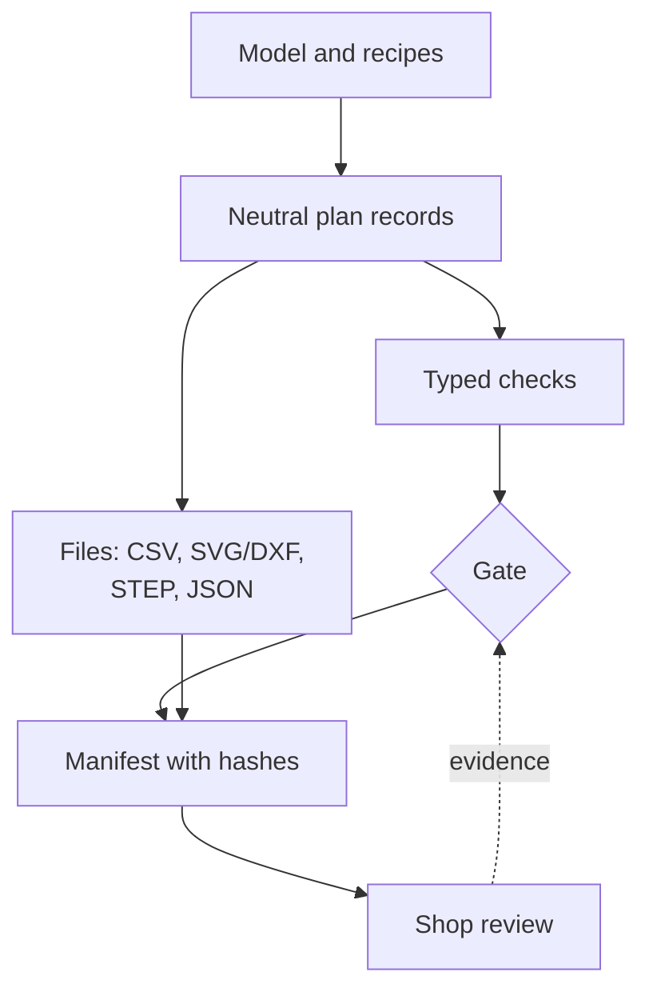

# Manufacturing outputs

## The problem

A model that moves correctly in simulation still has to be built. Someone has
to buy stock, cut it, weld it, machine it, or cast it in a mold. They need cut
lists, drawings, weld sequences and sheet layouts, and they need to trust them.

Two things make that hard. Outputs drawn up by hand drift from the model as
soon as the model changes. And an output that looks finished is easily
mistaken for one that is approved: a drawing exported from CAD says nothing
about whether the weld is strong enough, the resin cures safely or the shop
has the right machine.

## The model

A **manufacturing output** is a file the shop works from, generated from the
model and never edited by hand. When the design changes, it is regenerated.
Outputs are grouped into a **packet**: everything for one job, together with
the checks that were run and a record of which source produced it.

Three ideas hold this together:

- **Plan before files.** Generation first builds neutral records (panel
  operations, blank requirements, weld groups, mold volumes). Drawings, CSV
  tables, STEP files and CAM programs are all rendered from those same records,
  so they cannot disagree with each other.
- **Traceability.** Every input record has a revision and a fingerprint of its
  canonical content. Outputs carry the fingerprint of what they were made from,
  and a manifest hashes every file. Change the source without bumping its
  revision and the fingerprint still changes, so stale outputs are detected
  rather than trusted.
- **A fail-closed gate.** Each check has a status: pass, fail, pending or
  unsupported. Readiness is a separate result, and it is ready only when every
  check passes. Missing data is *pending*, never assumed to pass. Successful
  generation, a valid codec round-trip or clean CAD never make a packet ready
  by themselves. Checks that need the physical world (a coupon fit, a
  thermocouple trace, a signed shop review) stay pending until real evidence
  is attached; simulated sign-offs do not count.

Review outputs are still exported while checks are pending, labelled as drafts,
so people can review them. What the gate blocks is *release*, not export.

### The kinds that exist today

- **Sheet stock plans.** A cut plan places rectangular part blanks on a stock
  sheet with guillotine cuts, kerf and an edge margin. Validation checks
  material, thickness, tolerances, overlaps and the area balance. Exports are a
  CSV cut list and an SVG layout. Separately, the **inventory** tracks real
  sheets and remnants: a sheet is allocated to a plan, previewed, then cut. A
  confirmed cut writes an immutable **execution record**: the blanks it
  produced, the remnants it kept, and the kerf and waste areas.
- **Frame weld packets.** The sheet router's welded base is split into
  prepared, coped tube pieces. The packet has a cut list, stock totals, seams
  found from the actual B-rep contacts, weld stitches with leg sizes, a weld
  sequence, jig stops, service routes and a layout drawing, plus a
  `shop-release.json` gate.
- **Casting tooling.** For a mineral casting, the planners build a mold from
  plywood panels, EPS cores, formers and insert fixtures. The fabrication
  review package adds panel blank requirements and shelf layouts, fit coupons,
  load estimates, panel/EPS/hardware CSV, SVG/DXF drawings, STEP and a physical
  trial template, all listed in a hashed manifest.
- **Drawings.** Panel contours become 2D drawings through CadKit's drawing
  writers (SVG and DXF), with one layer per operation kind.
- **CAM inputs.** Sheet blanks and tooling panels can be turned into CAM
  profiles, which produce [toolpaths](toolpaths.md). CamKit applies cutter
  compensation; the plan records always hold finished geometry.

The bill of materials is also derived from the model; it is described in
[Machine components](../modelling/machine-components.md).

## In Materia

ManufacturingKit holds the neutral records. It depends only on ProjectKit: no
CAD, no MachineKit, no CAM. MachineKit realizes the records as CAD and files;
CamKit turns them into programs.

| Piece | Where |
|---|---|
| Sheet requirements, stock, plans, validation | `materia.sheet`: `SheetPartRequirement`, `SheetStockSpec`, `SheetCutPlan`, `SheetPlanValidator`, `SheetPlanValidation` |
| Sheet inventory and cut records | `materia.sheet`: `SheetInventory`, `StockPiece`, `SheetCutExecution`, `SheetBlankOutput`, `SheetProjectCodec` (`.sheet.json`) |
| Sheet exports | `SheetPlanExporter.csv` / `.svg` (refuse an invalid plan) |
| Sheet-metal blanks | `cadkit.sheetmetal.SheetBlank.requirement` (flat pattern to `SheetPartRequirement`) |
| Casting inputs and fingerprints | `materia.tooling`: `CastingToolingInput`, `CastingSetup`, `ToolingRecipe`, `ToolingDocument`, `ToolingCodec` |
| Panels and joints | `materia.tooling.panel`: `PanelPlan`, `PanelOperation`, `PanelContours`, `PanelJoints`, `PanelCoupon` |
| Mold planning | `materia.tooling.casting`: `BoxMoldPlanner`, `CastingMoldPlanner`, `CastingMoldPlan` |
| Fabrication review package | `materia.tooling.export`: `ToolingFabrication`, `FabricationPlan`, `ToolingManifest` |
| Process analysis | `materia.tooling.process`: `CastingProcessAnalysis`, `CastabilityAnalysis`, `MoldOrientationStudy` |
| Checks and the gate | `ToolingValidation`, `FabricationReadiness`, `ToolingReadiness.evaluate` |
| CAD, drawings and files | `machinekit.tooling`: `CastingMoldCad`, `PanelDrawing`, `ToolingFabricationExport`, `ToolingPackageManifest`; `cadkit.drawing`: `Drawing2D`, `Svg`, `Dxf` |
| CAM bridges | `camkit`: `CamSheetProfiles`, `CamToolingPanels` |
| Editor | Cut planning panel (`SheetWorkflowPanel`, `app`) |

Examples: the picking station plans plywood sheets and records cuts
(`machinekit/examples/picking-station/`); the box mold, panel tooling and bench
mill examples generate casting tooling; the sheet router produces the frame
weld packet (`machinekit/examples/sheet-router/fabrication/`).

**Implemented:** sheet plans, inventory and cut records; panel tooling; box and
multi-core mold planning; the phase-5 fabrication review package; fill, cure
and castability screening. **Not yet:** a full foundation design model, the
mill column, physical calibration, and any path that marks a casting packet or
the router frame as released.

## What it isn't

- **Not hand-edited.** An output file is regenerated, not corrected. Fixes go
  into the model or the recipe. Authored inputs (a sheet cut plan, a
  fabrication spec, measured stock) are inputs, versioned and fingerprinted
  like the model.
- **Not an approval.** Generation, CAD success and digital checks are evidence.
  Release needs every check to pass, including the physical ones.
- **Not nesting.** Sheet plans are rectangular blanks and guillotine cuts that
  are placed explicitly. Contour nesting is not done.
- **Not an inventory side effect.** Generating a packet never allocates or
  consumes stock. Only a confirmed cut changes the inventory.
- **Not the robot's process.** Robot welding, bending and machining are
  [processes](process-and-robots.md) a machine runs. These outputs are for
  people building the machine.

## See also

- [The life of a machine](../start/life-of-a-machine.md), step 10
- [Machine components](../modelling/machine-components.md)
- [Toolpaths](toolpaths.md)
- [Stock and material removal](stock.md)
- [Determinism](../foundations/determinism.md)
- [Diagnostics](../foundations/diagnostics.md)

## Open questions

- **Two gate models.** Casting tooling uses typed `ToolingValidation` and
  `FabricationReadiness`. The sheet router's gate is untyped JSON written by
  Python scripts (`fabrication/detail.py`, `fem/weld_qualification.py`) with
  `released` hard-coded to false, and its native packet is `Dynamic` records
  (`SheetRouterFabrication.hx`).
- **The router's reproduction steps are incomplete.** The fabrication README
  runs only `render.py` and `detail.py`, which write a `weldStrengthScreen`
  check. The committed `shop-release.json` was then rewritten by
  `fem/weld_qualification.py` (`weldReactionQualification`, other pending
  items), which no README mentions.
- **Life of a machine says "nesting layouts".** The router's `layout.svg` is a
  frame centreline and jig layout, and no example nests contours.
- **Sheet requirements are not all derived.** The picking station writes its
  `SheetPartRequirement`s and its cut plan by hand
  (`PickingStationDesign.hx`); only sheet-metal blanks and tooling panels
  derive them from geometry.
- **Panel CAM programs are not in the package.** The tooling plan lists
  per-panel LinuxCNC programs from `CamToolingPanels`, but
  `ToolingFabricationExport` emits none and only CamKit's tests call it.
- **"Packet" means two things.** `SheetRouterFemExport.packet` writes the FEM
  input manifest, not a shop packet; tooling calls its output a "review
  package".
