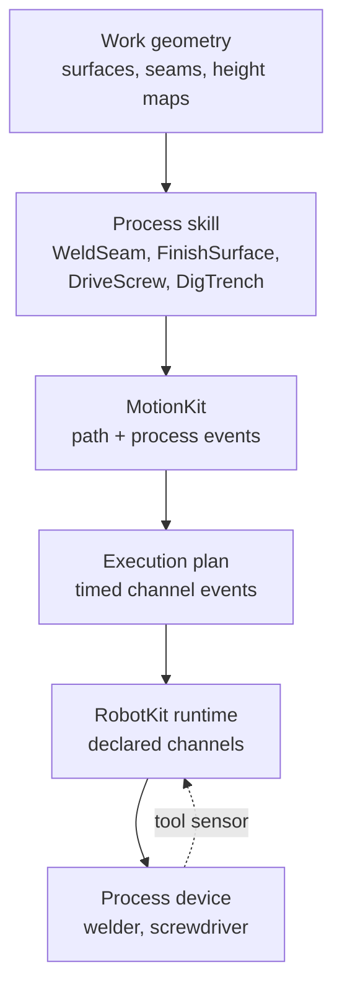

# Process vs. robot

## The problem

A robot that welds, sands, drives screws or digs a trench does two kinds of
work at once. It moves: joints, limits, safety, plans. And it runs a process:
an arc that has to strike before the torch travels, a wire feed that has to
match the travel speed, a screw that has to reach its torque inside an angle
window, a wall that has to be covered without touching a window.

If the process lived inside the robot layer, every new process would add
fields to the robot model and branches to the runtime, and the runtime would
need to understand welding to stop a weld safely. If the process drove the
motors itself, it would bypass the runtime's validation and safety. So Materia
splits the two, and lets them meet only at a few small, generic interfaces.

## The model

### Two layers, one direction

**RobotKit** knows robots: the model, the runtime, tools as mass and a TCP,
grippers, the skill lifecycle, and generic skills such as `GoTo`, `FollowPath`
or `HandlePart`. **ProcessKit** knows work: what is being welded or painted,
how a process starts and ends, what a good result looks like. ProcessKit
depends on RobotKit and MotionKit; **RobotKit never depends on ProcessKit**,
and neither does MotionKit. A new process is new ProcessKit code, never a new
robot-model field or a runtime branch.

### Work geometry

ProcessKit describes the work in its own frames:

- a **work surface** is a planar region with a boundary and exclusions, in its
  own plane frame, and a kind: *design* (from CAD or BIM), *observed* (from a
  scan) or *work* (design corrected by registration);
- a **coverage map** and a **deviation map** are grids over a surface: which
  cells the process has covered, and how far the real surface bows from the
  design;
- a **height map** is terrain; an **earthwork region** pairs an existing and a
  design height map with a grade tolerance;
- a **process path** (`processkit.path.Toolpath`) is a list of TCP poses in one
  frame, each with a feed and whether the process is on for that move.

Generators turn geometry into paths: a raster over a surface minus its
exclusions, a dig cycle for an excavator, weld passes offset from a CAD seam.

### Skills

A **skill** is a task a robot runs tick by tick: start, update with the
latest snapshot, cancel, and a result. RobotKit defines the interface;
ProcessKit supplies the process skills:

| Process | Skills |
|---|---|
| Welding | `WeldSeam`, `WeldPasses` (cooling between passes) |
| Finishing | `FinishSurface`, `Paint`, `Sand` |
| Scanning and registration | `ScanSurface`, `RegisterSurface`, `FindContactWork` (touch sensing with the wire) |
| Screwdriving | `DriveScrew`, `DriveFastening`, `RecoverScrew`, `WaitForScrewFeeder`, `ReceiveBlownScrew` |
| Earthwork | `DigTrench`, `GradeRegion`, `DumpAt` |

A skill commands the robot only through the `Robot` interface and the motion
it plans, so the same skill runs on a simulated robot and a real one.

### A process run

Under a skill, a **process run** ties a path to a device. A **recipe** gives
the speed range, standoff and the output rate per path speed (wire feed per
metre of travel, for instance). An **engagement** adds what happens around the
path: strike the arc and wait for it, fill the crater, burn back. The run
moves through preparation, ready, active, controlled interruption, recovery
and completion, and logs each transition with its path distance. When the arc
is lost, the run restarts from that distance with an overlap, and the
engagement runs again.

### Process channels: where the two meet

The process reaches hardware through **process channels**, not through its own
wires:

1. The robot's setup declares each channel with a **safe value** and a stop
   policy (`ProcessChannelDeclaration`). A tool owns its channels
   (`ToolChannels`): a torch says its arc goes off on every stop; a vacuum says
   it keeps its part through a commanded stop. Two owners that disagree are
   refused.
2. Motion programs carry **process events** on those channels: at a path
   distance (with a lead time) or as a `SetOutput` between moves. Planning
   turns them into events at a time in the execution plan, each with a hold
   policy (keep, safe while held, restore on resume).
3. The runtime fires each event at its time and reports it. A **process
   device** (`ProcessDevice`: prepare, ready, fault, safe, apply) turns the
   fired records into a welder's or screwdriver's commands.
4. The device's measurements come back as a typed **tool sensor**
   (`tool_weld`, `tool_screwdriver`) in the robot's snapshot, which the skill
   reads.

On a fault or emergency stop, the runtime sets every channel to its safe
value itself, whatever the process was doing. That is why the process never
needs to be trusted with safety.

### Process paths and the planner

Long process paths (a 2.6 m weld with the arm on a track) need the planner to
choose an IK branch, how far the external axes move and the free tool roll,
once for the whole path. MotionKit's joint-path planner does this over a
ladder of candidates (see [Paths vs. trajectories](../motion/paths-and-trajectories.md)).
The process only **states preferences**: which tool rotations are free, a
preferred roll and the cost of changing it, posture weights, the cost of
moving an external axis. The planner never imports ProcessKit.

## In Materia

| Piece | Where |
|---|---|
| Work geometry | `processkit.work`: `WorkSurface`, `SourceKind`, `CoverageMap`, `DeviationMap`, `HeightMap`, `EarthworkRegion`, `RasterToolpathGenerator`, `DigCyclePlanner` |
| Process paths | `processkit.path`: `Toolpath`, `ToolpathPoint`; `processkit.motion.ToolpathPosePath` lowers them to a MotionKit `PosePath` with events |
| Placement and reach | `processkit.manipulation`: `WorkPatchPlanner`, `WorkPatch`, `ReachabilityChecker` |
| CAD and BIM to surfaces | `processkit.cadbridge`: `FaceBridge`, `WallBridge` |
| Registration | `processkit.perception`: `SurfaceRegistration`, `ContactRegistration`, `SimulatedSurfaceScanner` |
| Skills | `processkit.skill`; plan runners behind interfaces (`SurfacePlanRunner`, `ToolpathPlanRunner`, `WeldRunner`) implemented in `processkit.motion` and `WeldingPlanRunner` |
| Process runs | `ProcessRun`, `ProcessRecipe`, `ProcessEngagement`, `ProcessRunState`, `ProcessPathSlice` |
| Welding | `WeldPlan`, `WeldPathProblem`, `WeldPathProgram`, `WeldChannels`, `WelderProcessDevice`; supplies in `processkit.simulation` (`SimulatedWelder`, `WeldArcModel`) and `processkit.modbus` |
| Screwdriving | `processkit.screwdriving`: `ScrewdrivingRunner`, `TighteningProgram`, `DiscreteScrewdriver`, `ScrewdriverDeviceOwner`, Open Protocol client |
| The generic side | `robotkit.skill.Skill`, `ResumableSkill`; `robotkit.tool.Tool`, `ToolChannels`, `ChannelToolAdapter`; `robotkit.execution.ProcessChannelDeclaration`, `ProcessTimedEvent`, `FiredProcessEvent` |
| Planner preferences | `motionkit.robot`: `ToolFreedom`, `JointPathPreferences`, `JointPathPlanner` |
| Machine-specific process code | `machinekit/process` (`machinekit-process`): screwdriving missions, weld contact selection, press-brake sheet |
| Kit README | [ProcessKit](../../../processkit/README.md) |

Examples: `machinekit/examples/robot-welder` (a fixed welding cell),
`robot-screwdriver` and `machine-tending`. The wall-finishing
and excavator cases run in RobotKit's test suites.

ProcessKit also holds a few process-device interfaces that are not skills: the
press-brake handshake (`processkit.pressbrake`), an enclosure door guard
(`processkit.guard`), screw feeders, and a Moonraker client with Klipper
resonance import for printers.

## What it isn't

- **Not the safety layer.** Process devices, guards and skills are
  application logic. Safe outputs on a stop are enforced by the runtime from
  the channel declarations (see [The robot runtime](../execution/robot-runtime.md)).
- **Not machining toolpaths.** CAM, G-code and printing work use the
  `ToolpathProgram` format (see [Toolpaths](toolpaths.md)). ProcessKit's
  `Toolpath` is a list of TCP poses for arm processes.
- **Not a planner.** ProcessKit builds problems and states preferences;
  MotionKit chooses joint paths and times them.
- **Not facility work.** Transport, rack picks and charging are AutomationKit
  tasks mapped onto RobotKit's generic skills (see
  [Facilities and fleets](../execution/facilities-and-fleets.md)).
- **Not weld design.** Which seams a weldment has is MachineKit
  (`machinekit.welding`); ProcessKit runs them.

## See also

- [The life of a machine](../start/life-of-a-machine.md), step 6
- [The robot runtime](../execution/robot-runtime.md)
- [Execution plans](../motion/execution-plans.md)
- [Paths vs. trajectories](../motion/paths-and-trajectories.md)
- [Toolpaths](toolpaths.md)
- [Facilities and fleets](../execution/facilities-and-fleets.md)

## Open questions

- **Process tools still live in RobotKit.** `Sprayer`, `Sander`, `SurfaceTool`
  and their simulated versions are in `robotkit/core/haxe/robotkit/tool/`, and
  `Paint`/`Sand` import them from there. `robotkit/RESTRUCTURE_PLAN.md` (R7e)
  plans the move; it has not happened.
- **The runtime validates process sensors by name.** `RobotRuntime.hx:747-752`
  hard-codes the `tool_screwdriver` and `tool_weld` frame checks, so a new
  process sensor kind needs a runtime change. R7e plans registration by the
  owning package.
- **Screwdriver and welder contracts sit on opposite sides.**
  `ScrewdriverChannels` and `ScrewdriverContract` are in
  `robotkit/core/haxe/robotkit/tool/`; `WeldChannels` and `WeldContract` are in
  `processkit/haxe/processkit/tool/`.
- **RobotKit's tests depend on ProcessKit** (`robotkit/tests/haxeon.json:23`),
  and so do `robotkit/cadbridge/tests`. The package rule holds; the test rule
  in R7e does not yet.
- **`processkit.cadbridge` uses undeclared dependencies.** `FaceBridge.hx` and
  `WallBridge.hx` import `cadkit` and `bimkit`, which `processkit/haxeon.json`
  does not list; they compile only when a consumer brings them in.
- **Stale RobotKit wording after R3.** `WeldRunner.hx:8` says "RobotKit names
  the work", `WelderProcessDevice.hx:16` says "RobotKit's `SimulatedWelder`"
  (it is `processkit.simulation.SimulatedWelder`), `ToolpathPosePath.hx:17`
  says "RobotKit authoring points", and `robotkit/ARCHITECTURE.md:1005,1137,1198`
  still describes `robotkit.process` and `runtime.SimulatedWelder`.
- **The README names a class ProcessKit does not have.**
  `processkit/README.md:93` presents `cadbridge.BeltResonanceCalibration`; it
  is in `robotkit/cadbridge/haxe/cadbridge/`.
- **Two toolpaths and two weld seams.** `processkit.path.Toolpath` and
  toolpathkit's `ToolpathProgram` are both "toolpaths", and
  `toolpathkit/motion` depends on ProcessKit for `ProcessPathSlice`.
  `machinekit.welding.WeldSeam` is a seam of a weldment;
  `processkit.skill.WeldSeam` is the skill that welds one.
- **ProcessKit's scope is wider than its README's first line.** The Moonraker
  client, Klipper resonance import, press-brake interface and enclosure guard
  are device interfaces, not work geometry or skills.
