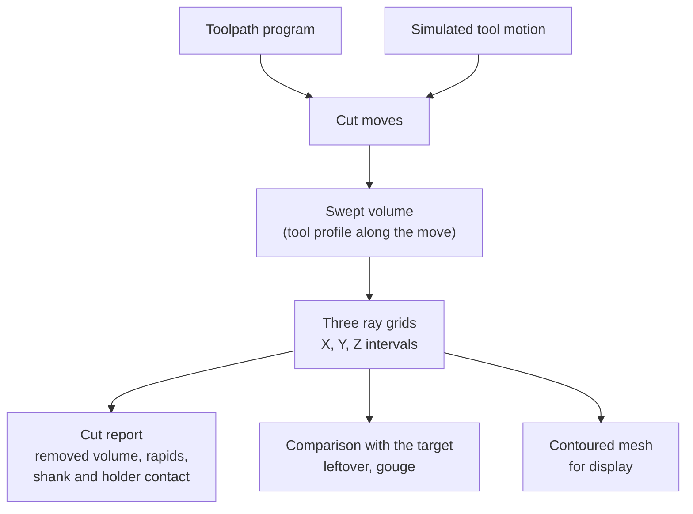

# Stock and material removal

## The problem

A machining program can look right and still be wrong. A pocket can go a
tenth of a millimetre too deep, a rapid can go through a corner nobody
cleared, or a holder can rub a wall left by the last pass. You only see these
mistakes in the material, so something has to track the stock as each move
cuts it.

That tracker must be exact where it matters, at the floors and walls you will
inspect. It must handle tens of thousands of moves, and it must say which move
caused each problem. Exact CAD booleans per move are too slow and too fragile.
A height map cannot show undercuts or side walls. A voxel field rounds every
sharp edge, which looks like a gouge exactly where you check.

## The model

The stock is a **tri-dexel** model: three grids of parallel rays, along X, Y
and Z. Each ray holds a sorted list of **material intervals**, the stretches of
that ray that are inside the stock. The ends of an interval are exact depths,
not rounded to a cell. Each end also carries the surface normal there and the
**source** that made it: the original stock, or the move that cut it.

### What a cut does

A **cut move** is one tool motion in the workpiece frame: a tool, a line, arc
or helix, the move's kind (rapid, cut, plunge, and so on) and where it came
from. The tool is a surface of revolution from its tip upwards, split into
**zones**: cutting flutes, shank and holder (see
[Toolpaths](toolpaths.md) for where tools and moves come from).

Moves reach the stock only through a **swept-volume query**: given a ray,
where does the moving tool's flutes cover it? Lines and arcs are answered in
closed form, ramps and helices by a refined search. A cut subtracts that
stretch from every ray it crosses, in all three grids. Z rays see floors and
ceilings; X and Y rays see walls, so a wall shaved sideways by less than one
ray spacing still moves.

Only the cutting zone removes material. The shank and holder are swept as
separate bands, and the stock they overlap is measured after the move's own
cut. That gives the checks per move:

- **Removed volume**, and totals per operation.
- **Rapids through material**: a rapid move that removed anything.
- **Collisions**: shank or holder overlapping stock.

The same sweep can **add** material instead: the stock becomes its union with
the swept volume. A printed bead is such a move, with the bead's section
revolved about the nozzle axis as the "tool".

### Comparing with the target

The finished part is cast onto the same grids as a second stock. Comparing
the two ray by ray gives **leftover** (stock outside the part) and **gouge**
(part missing from the stock), the largest stretch of each, and the move whose
surface bounds the largest gouge. The comparison runs on all three grids, so a
wall cut too deep from the side is not missed.

### Seeing it

To display the stock, the three grids are **dual-contoured** into a closed
mesh. Each crossing between nodes lies on a ray, so its point, normal and
source are exact; flat floors and walls stay flat and edges stay sharp.
Curved surfaces become chords, and a feature thinner than a cell can be
lost. Every triangle keeps its source move, so picking a surface leads back
to the operation and the G-code line. Meshes can be coloured by source (by
operation) or by deviation from the target.

### Resolution and determinism

The ray spacing is the one resolution setting. Along a ray, depths are exact
at any spacing; between rays, the stock is sampled. Volumes are sampled on the
Z grid, so they converge as the spacing shrinks.

The grids are stored in tiles of 16 × 16 rays. Each tile belongs to one
thread, which applies every move to it in order, so the stock and the volumes
are bit-identical for any number of threads (see
[Determinism](../foundations/determinism.md)). Tiles are copy-on-write, so a
snapshot costs a pointer per tile; scrubbing a program restores the nearest
snapshot and cuts forward.

### Other stock shapes

- **Ring stock**, for gears: material arcs on circles about the work axis at
  fixed (radius, height), with exact angular endpoints. A hobbing sweep cuts
  it with the hob's actual rake faces as the machine's six axes move. Gear
  metrology reads the circles directly, and cutting loads come from the volume
  each gash pass removes.
- **Material components**: a scan of the Z rays that finds the separate pieces
  of material, with their volume and their area on a support plane. The sheet
  router uses it to check that parts freed from a sheet are still held down.

## In Materia

| Piece | Where |
|---|---|
| Cartesian stock: `Stock`, `StockLattice`, `StockGrid`, `StockAxis`, `StockInterval` | `stockkit` (Haxe), over `stockkit/core` (C++17, C ABI, no dependencies) |
| Moves: `CutMove`, `CutMotion`, `CutMoves.fromProgram` | `stockkit` |
| Tool shapes and zones: `CutterProfile`, `Tool.shaped` | `toolpathkit.tool` |
| Results: `CutReport`, `MoveOutcome`, `OperationTotals`, `StockComparison` | `stockkit` |
| Display: `Stock.contour`, `StockColoring`, `StockPreview`, `StockTimeline`, `StockSnapshot` | `stockkit` |
| Material pieces: `StockComponents`, `StockComponent` | `stockkit` |
| Gear stock: `RingStock`, `RingGrid`, `RingComparison` | `stockkit` |
| Hobbing: `HobbingSweep`, `IdealHobbingJob`, `HobbingForces` | `stockkit.hobbing` |
| Machining in the editor: `MachiningStock`, driven by `CncProgramPlayer` | `app` |
| Printing and hobbing in the editor: `PrintingStock`, `HobbingStock` | `app` |
| Design decisions and references | `stockkit/docs/DESIGN.md`, `stockkit/docs/REFERENCES.md` |

Two inputs feed the same stock. `CutMoves.fromProgram` replays a
[toolpath program](toolpaths.md) as written, for CAM tests: CamKit's
island-pocket test requires no gouge, no rapid or shank through stock, and
leftover only in the inside corners. In the editor, `MachiningStock` instead
cuts the segment from where the simulated tool tip was to where it is now, so
the stock records the motion the machine actually made, following error
included (see [Fidelity levels](../execution/fidelity.md)).

The core's answers are checked against two references kept in the test
project: exact OCCT booleans for lines and arcs, themselves checked against
closed-form volumes, and a sampled inner/outer bound for ramps and helices.
Rays must match the exact reference to 1e-9 m.

## What it isn't

- **Not CAD.** The stock is not a B-rep and does not become one. The contoured
  mesh is for display and comparison; there is no STL export yet.
- **Not the machine's collision model.** StockKit sees the tool against the
  stock only. Holders against fixtures and the machine belong to the setup
  checks in [Toolpaths](toolpaths.md) and to the
  [collision model](../modelling/collision.md).
- **Not multi-axis yet.** Every cut move keeps the tool axis along the stock's
  +Z. Five-axis and robot machining would be new swept-volume kinds on the
  same stock.
- **Not turning yet.** There is no lathe stock; a section stock for turned
  parts is planned.
- **Not a voxel or height map.** Depths along each ray are exact, and walls
  are seen by their own grids.
- **Not a cutting-force or chip model** for milling. Removed volume per move is
  reported; engagement and forces are computed only for hobbing.

## See also

- [The life of a machine](../start/life-of-a-machine.md)
- [Toolpaths](toolpaths.md)
- [Manufacturing outputs](manufacturing-outputs.md)
- [Fidelity levels](../execution/fidelity.md)
- [Determinism](../foundations/determinism.md)
- [Specialized models](../modelling/specialized-models.md): gears
- [Collision model](../modelling/collision.md)

## Open questions

- **Two unit systems.** `Stock` works in metres, `RingStock` and the hobbing
  sweep in millimetres to match GearKit (`stockkit/README.md:6`). The
  project convention is metres.
- **Contact is measured after the move's own cut.** A climbing move whose
  shank meets material its flutes remove later in the same move is not
  reported (`stockkit/TODO.md`, "Check shank and holder contact during a
  move").
- **Turning has two designs.** `stockkit/docs/DESIGN.md` says turning is a new
  swept-volume kind on the same stock; the lathe plan defines a separate
  `SectionStock` of meridian sections (`machinekit/examples/lathe/PLAN.md:239-242`).
  Neither exists in code.
- **Stale status lines.** The README heading still says "phases 0–5, phase 6
  under way" (`stockkit/README.md:107`), while `stockkit/TODO.md:3-5` says
  phase 6 is done apart from manifold contouring and STL export. The TODO's
  "drive the viewer from real programs" (`stockkit/TODO.md:15`) looks done by
  `CncProgramPlayer` and `MachiningStock`.
- **MotionKit input is claimed but absent.** `stockkit/docs/DESIGN.md:40` says
  StockKit takes MotionKit motion directly; `CutMotion` has only `Path`, an
  analytic path with a +Z tool axis.
