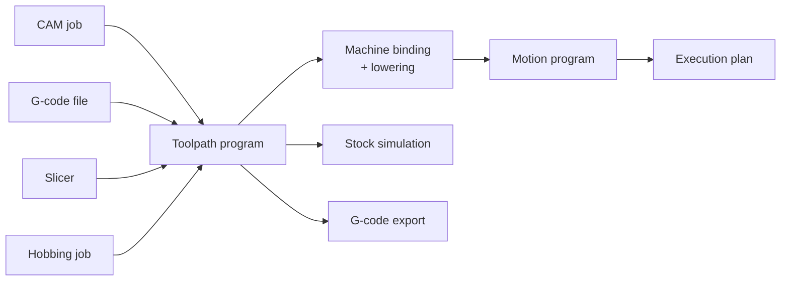

# Toolpaths

## The problem

Machining and printing work arrives in different forms. CAM generates it from
a part's geometry; a G-code file arrives from FreeCAD or Fusion; a slicer turns
a model into layers; a gear hobber needs a spindle and a hob turning together.
That work has to reach several consumers: motion planning, the material-removal
simulation, export back to G-code, and eventually a controller.

If each producer talked to each consumer in its own form, every pair would
need its own translation. G-code cannot be the common form either: it is a
controller language, full of modal state, dialects and machine-specific
meanings.

## The model

A **toolpath program** (`ToolpathProgram`) is the one format in the middle. It
says *what the tool does*, in the part's coordinates, independent of any
controller or machine:



A program has three parts:

- **Operations** (`ToolpathOp`), in order, as a controller would run them:
  - moves (`Move`): a line, an XY arc or a helix, with a kind (rapid, cut,
    plunge, ramp, link, retract), a feed and a blending tolerance;
  - machine moves (`MachineMove`) in machine coordinates, for G53, G28 and G30;
  - process commands: spindle, coolant, tool change, tool length offset, dwell,
    stops;
  - printing (deposit, filament, heaters, fans, layers) and gearing (electronic
    gears, joint positions, signals) for printers and hobbers.
- **A tool library** (`ToolLibrary`): tools by number, with length, diameter
  and cutter profile.
- **Setups** (`Setup`): each a named work-coordinate origin, optionally with
  its stock and fixtures. The first setup is active at the start; `SetSetup`
  switches to another.

All lengths are metres and feeds are metres per second (see
[Conventions](../foundations/conventions.md)). Every operation carries its
**provenance**: the G-code line and column it came from, or the CAM operation
and feature that produced it. Errors anywhere downstream point back to it.

### Where programs come from

- **CAM** (`CamJob`) produces 2.5D work directly from CAD or sheet geometry:
  outside and inside profiles, pockets with islands, drilled holes, in depth
  steps. `finish(setup)` returns the program.
- **G-code** is compiled by CncKit (`CncCompiler.compileDetailed`) against a
  `CncController`, which holds the dialect (LinuxCNC, or printer firmware), the
  G54–G59 work offsets, the G28/G30 home positions and the tool table. Each
  work offset used becomes a setup; cutter compensation (G41/G42) is resolved
  here and never enters the program. Problems come back as diagnostics with
  the G-code line and column.
- **The slicer** and **hobbing jobs** produce printing and gearing operations.

### Try it: G-code into a program

The program below is compiled by CncKit, running in your browser. Edit it:
the plot shows the moves seen from above (rapids dashed), and a mistake comes
back as a diagnostic with its line and column. Try `G5 X10` on a new line.

<figure class="materia-figure materia-widget" data-widget="gcode">

```gcode
G21 G90 G17
G0 X0 Y0 Z5
G1 Z-1 F300
G1 X40 F600
G3 X60 Y20 I0 J20
G1 Y40
G3 X40 Y60 I-20 J0
G1 X0
G1 Y0
G0 Z5
M30
```

<figcaption>CncKit compiling LinuxCNC G-code into a toolpath program, live. The figure needs a browser with WebAssembly GC; without it, this is the program as text.</figcaption>
</figure>

### Where programs go

- **To motion.** A **machine binding** (`MachineBinding`) says how a program
  meets a particular machine: which axes are X, Y and Z, the rapid speed, the
  travel envelope, the I/O channels for spindle and coolant. Lowering moves
  each operation into machine coordinates, checks travel, rounds corners within
  each move's tolerance, and produces a [motion program](../motion/execution-plans.md).
  Spindle start-up, tool changes and stops become barriers that wait for an
  input. From there the normal planning path applies.
- **To the stock simulation.** StockKit replays the cutting moves against the
  stock (see [Stock and material removal](stock.md)).
- **Back to G-code.** `CncWriter` exports LinuxCNC G-code, checking each
  setup's stock and fixtures and the machine's travel first.

### Checks

A program refuses inconsistent content when it is built: an unknown setup, a
duplicate setup id, a malformed gear. A setup with stock can check the program
against it: cuts below the stock's bottom, rapids below the safe height, the
cutter or holder hitting a fixture. A travel envelope checks every move,
including arc extremes, against the machine's reach.

## In Materia

| Piece | Where |
|---|---|
| The format: `ToolpathProgram`, `ToolpathOp`, `ToolLibrary`, `Setup`, `SetupStock`, `TravelEnvelope`, `Provenance` | `toolpathkit` (no dependencies) |
| Machine binding and lowering to motion | `toolpathkit/motion`: `MachineBinding`, `ToolpathMotion`, `ToolpathLowering`, `ToolpathMotionBinding`, `MachiningRun` |
| CAM | `camkit`: `CamJob`, `CamContour`, `CamSheetProfiles`, `CamToolingPanels` |
| G-code in and out | `cnckit`: `CncController`, `CncCompiler`, `CncWriter` |
| Material removal | `stockkit`: `CutMoves.fromProgram` |
| Playing a job in the editor | `CncProgramPlayer` (`app`) |
| Design decisions | `toolpathkit/docs/ADR-001-toolpath-ir.md` |

Examples: the CNC router's mount plate and the bench mill's bearing block are
CAM jobs exported as G-code; the flexspline hobber uses a hobbing job; the
printer benchmark uses sliced programs.

## What it isn't

- **Not G-code.** G-code is one input and one export. Work offsets, modal state
  and dialects exist only at that boundary.
- **Not a motion program or an execution plan.** A toolpath has no timing and
  no joint positions; lowering and planning add them.
- **Not a path `q(s)`.** Lowering builds the geometric path and adds the corner
  blends (see [Paths vs. trajectories](../motion/paths-and-trajectories.md)).
- **Not a machine description.** Axes, speeds and travel belong to the machine
  binding; setups belong to the program.
- **Not only machining.** The same format carries printing, gearing and hobbing
  work.

## See also

- [Execution plans](../motion/execution-plans.md)
- [Stock and material removal](stock.md)
- [Manufacturing outputs](manufacturing-outputs.md)
- [Diagnostics](../foundations/diagnostics.md)

## Open questions

- **Programs are not yet the hand-off format.** Every example and the editor
  go CAM → G-code text → `CncCompiler` → program; there is no file form of a
  program. `toolpathkit/docs/NATIVE_PROGRAM_PLAN.md` (NP0–NP5, not started)
  makes the program itself what runs on Materia's own controller, with G-code
  as an export.
- **`CamJob.finish` does not check the setup's stock.** Stock and fixture
  checks run only on G-code export and in `CamToolingPanels`; lowering a CAM
  program directly checks travel only.
- **CAM rapids carry feed 0.** With `rapidsAtFeed` (printer bindings), a rapid
  is lowered at the lesser of its feed and the rapid speed, which would be 0.
- **Old names.** Provenance is documented as two variants but is one class with
  a kind; CAM provenance stores the operation index in `line`, so setup errors
  read "CAM setup line N". Several messages and comments still say "CNC" for
  what is now general.
