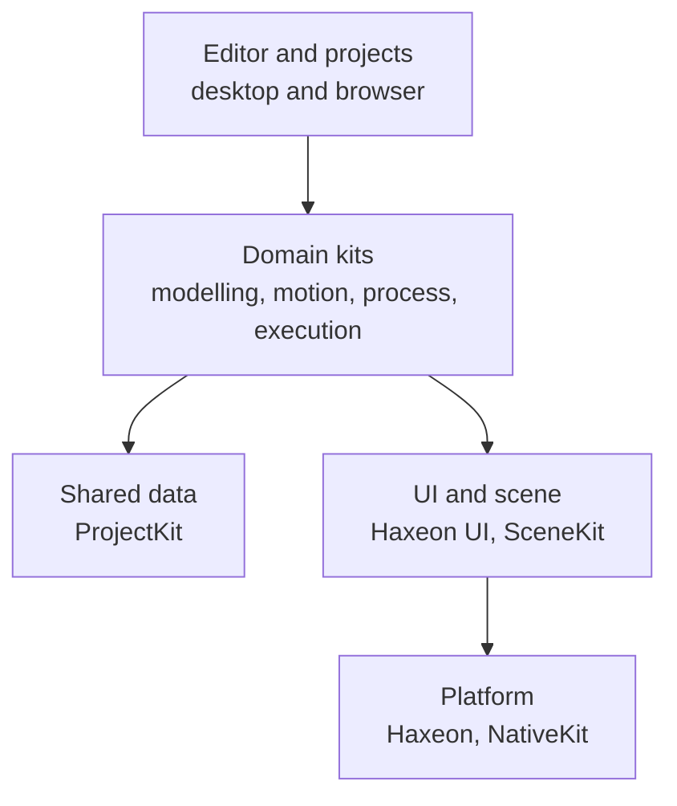

# Materia in one page

## The problem

Building a machine usually takes a chain of separate tools: a CAD package for
the parts, a spreadsheet for the drive sizing, a simulator with its own copy of
the model, a CAM package or a robot programming tool for the work, and
controller firmware configured by hand. Each tool holds its own version of the
machine. When a pulley or a motor changes, every copy has to be updated, and
the copies drift.

Materia is one stack that holds one model of the machine, from its geometry to
the controller that runs it. This page says what the stack is for, how its
layers fit, and which kit owns what.

## The model

### One machine, one model, every stage

Materia is for designing, simulating, planning and running machines: gantries,
routers, printers, arms, press brakes, mobile bases. A machine is written as
code (or edited as a CAD document), and every later stage reads that same
model:

- **Modelling** turns parts into an assembly with joints, transmissions,
  motors and a bill of materials.
- **Motion** compiles the assembly into a robot model, derives its limits from
  the parts, and times paths into validated execution plans.
- **Process** describes the work itself: toolpaths, stock, welds, sheet
  layouts, printed layers.
- **Execution** runs the plans, in simulation or on a controller, through the
  same runtime.

Everything above the native cores is written in one language, Haxe, compiled
by Haxeon, and shown in one editor that runs on the desktop and in the browser.

### The layers

Each layer depends only on the layers below it. Arrows point from a layer to
what it uses; every layer also runs on the platform.

- **Platform.** Haxeon is the compiler, runtime and project tool: Haxe source
  compiled to HashLink on the desktop and to WebAssembly in the browser, with
  live code patching. NativeKit provides windows, input and the GPU.
- **UI and scene.** Haxeon UI is the retained widget layer the editor is built
  from; SceneKit holds the 3D scene, renders it and handles picking.
- **Shared data.** ProjectKit holds the plain data formats the kits exchange:
  scene artifacts, assembly definitions, materials, units. It has no native
  code and depends on no other kit.
- **Domain kits.** The four groups follow the four stages above. Heavy
  numerical work lives in native libraries behind small C interfaces: Open
  CASCADE for geometry, MuJoCo for physics, coal for collision, Ruckig and
  TOPP-RA for timing.
- **Editor and projects.** The editor loads a project, runs its entrypoint,
  and shows the resulting machine: hierarchy, inspector, viewport, Play.

### Open stack, commercial products

Everything in this repository is open, the code under Apache-2.0 and the
documentation under CC BY 4.0: the kits, the editor,
the machine examples and a reference controller you can build your own
machine on. A future commercial controller and finished, certified machines
sit on the other side of a published interface, never a private hook. See
[The controller boundary](../execution/controller-boundary.md).

## In Materia

| Layer | Kit | What it owns | Where |
|---|---|---|---|
| Platform | Haxeon | Compiler, HashLink runtime, `haxeon` CLI, packages | [`haxeon/`](../../../haxeon/README.md) |
| Platform | NativeKit | Windows, surfaces, input, GPU | `haxeon/vendor/nativekit/` |
| UI and scene | Haxeon UI | Layout, text, widgets, docking | [`haxeon/packages/ui/`](../../../haxeon/packages/ui/README.md) |
| UI and scene | SceneKit | Retained scene, rendering, picking, selection | [`scenekit/`](../../../scenekit/README.md) |
| Shared data | ProjectKit | Scene artifacts, assembly records, units | [`projectkit/`](../../../projectkit/README.md) |
| Modelling | CadKit | Headless CAD over Open CASCADE, parametric documents, assemblies | [`cadkit/`](../../../cadkit/README.md) |
| Modelling | MachineKit | Machine components, catalogs, transmissions, BOM, examples | [`machinekit/`](../../../machinekit/README.md) |
| Modelling | CollisionKit | Collision world and distance queries over coal | [`collisionkit/`](../../../collisionkit/README.md) |
| Modelling | GearKit | Gear geometry, tooth profiles, inspection | `gearkit/` |
| Modelling | BimKit | Buildings as typed CadKit documents, IFC export | [`bimkit/`](../../../bimkit/README.md) |
| Modelling | AnimKit, HumanKit | Skinned characters; human workers with landmarks and held props | [`animkit/`](../../../animkit/README.md), [`humankit/`](../../../humankit/README.md) |
| Motion | KinematicsKit | One kinematics core: forest, forward kinematics, Jacobians, solvers | [`kinematicskit/`](../../../kinematicskit/README.md) |
| Motion | MotionKit | Paths, planners (Ruckig, TOPP-RA), machine-axis views | [`motionkit/`](../../../motionkit/README.md) |
| Motion | TrajectoryKit | Joint polynomials and immutable execution plans | [`trajectorykit/`](../../../trajectorykit/README.md) |
| Process | ProcessKit | Work surfaces, process paths, welding, finishing, screwdriving skills | [`processkit/`](../../../processkit/README.md) |
| Process | ToolpathKit | The machining path format shared by CAM, CNC and stock | [`toolpathkit/`](../../../toolpathkit/README.md) |
| Process | CamKit | Toolpaths from geometry: 2.5D milling, slicing, hobbing | [`camkit/`](../../../camkit/README.md) |
| Process | CncKit | LinuxCNC G-code in and out | [`cnckit/`](../../../cnckit/README.md) |
| Process | StockKit | Material-removal simulation on a tri-dexel stock | [`stockkit/`](../../../stockkit/README.md) |
| Process | ManufacturingKit | Sheet-stock planning and cut records; tooling contracts | [`manufacturingkit/`](../../../manufacturingkit/README.md) |
| Execution | SimKit | Simulation sessions; MuJoCo backend | [`simkit/`](../../../simkit/README.md) |
| Execution | SensorKit | Sensor scheduling and measurement models | [`sensorkit/`](../../../sensorkit/README.md) |
| Execution | RobotKit | Robot model, runtime, device protocol, `robotd`, autonomy | [`robotkit/`](../../../robotkit/README.md) |
| Execution | VisionKit | Camera geometry over OpenCV | [`visionkit/`](../../../visionkit/README.md) |
| Execution | AutomationKit | Facilities, missions, fleets, traffic | [`automationkit/`](../../../automationkit/README.md) |
| Editor | App | The editor, desktop and web | [`app/`](../../../app/README.md) |

The groups are a reading aid, not strict layers inside the domain: motion
kits read modelling kits, process kits lower into motion, and RobotKit's
packages depend on KinematicsKit, CollisionKit and VisionKit.

Three things do not follow the "one language" rule, by design. The native
cores are C and C++ (CadKit's core, StockKit's core, the trajectory core,
the runtime). The reference controller's device core
(`robotkit/device_protocol`) is Rust, so it can run on a microcontroller.
And machines can be written as Haxe code or edited as CAD documents; both
produce the same assembly.

## What it isn't

- **Not a game engine.** It has a renderer, physics and animated characters,
  but they exist to show, test and populate machine cells: workers in a
  facility, cartons on a table. There is no game runtime or asset pipeline for
  shipping games.
- **Not a ROS replacement.** RobotKit has its own runtime, device protocol and
  daemon, and does not use ROS. It is not a general robotics middleware either:
  it runs the machines Materia models. External conventions such as ROS's are
  converted at the boundary; no ROS bridge exists today.
- **Not a CAM package.** CamKit produces the toolpaths the example machines
  need (2.5D profiles, pockets and drilling, slicing for printing, gear
  hobbing), and CncKit reads and writes LinuxCNC G-code. It does not try to
  cover the strategies of a full CAM system.
- **Not a certified controller.** The open runtime and reference controller
  are enough to run a machine you build, but their safeguards are software.
  Certified safety functions belong to the controller side of the boundary.
- **Not a set of separate tools glued by files.** The kits share types and one
  model in one process; files (project manifests, scene artifacts, documents)
  are for storage and caching, not for handing the machine between programs.

## See also

- [The life of a machine](life-of-a-machine.md): one gantry followed through
  every layer on this page
- [The controller boundary](../execution/controller-boundary.md)
- [Haxeon](../platform/haxeon.md)
- [NativeKit and UIKit](../platform/nativekit-and-ui.md)
- [The editor and projects](../platform/editor-and-projects.md)
- [Glossary](../glossary.md)

## Open questions

- **The root `README.md` is behind the stack.** It describes Materia as "an
  experimental native application stack for building interactive 3D, CAD,
  simulation, and editor software" (`README.md:3`), and its layout table
  (`README.md:15-27`) omits fourteen kits, among them MachineKit, ProjectKit,
  KinematicsKit, TrajectoryKit, CollisionKit, ProcessKit and CamKit.
- **Three names for the UI layer.** The root README calls it UIKit
  (`README.md:5`), its own README calls it "Haxeon UI" and "NativeKit UI"
  (`haxeon/packages/ui/README.md:1,3`), and the package is `haxeon-ui`.
- **GearKit has no README**, though [Open core](../../OPEN_CORE.md) lists it
  as a kit and MachineKit, CamKit and StockKit depend on it.
- **AnimKit and HumanKit moved partly into Haxeon.** Their import, posing and
  rig types now live in `haxeon/packages/animation`; the root README still
  describes AnimKit as glTF import above ozz-animation (`README.md:27`).
- **SensorKit is not wired into the editor.** No package depends on it; only
  RobotKit's tests reach `sensorkit/sensor_io` by source path
  (`robotkit/tests/haxeon.json:9`).
- **ManufacturingKit sits below CadKit.** CadKit's sheet-metal blanks use
  `materia.sheet` (`cadkit/haxeon.json:17`), so a process-side kit is a
  dependency of the CAD layer.
