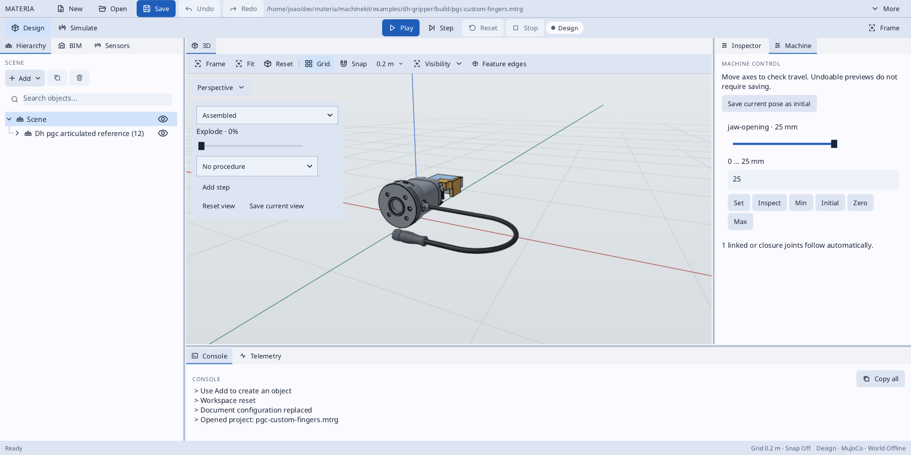
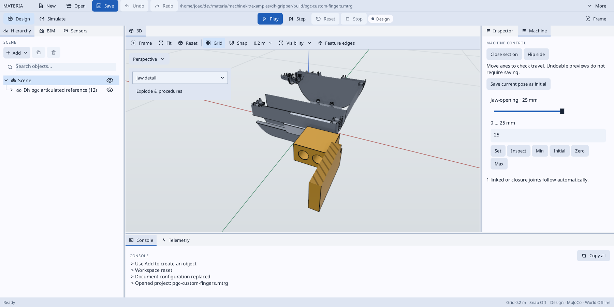
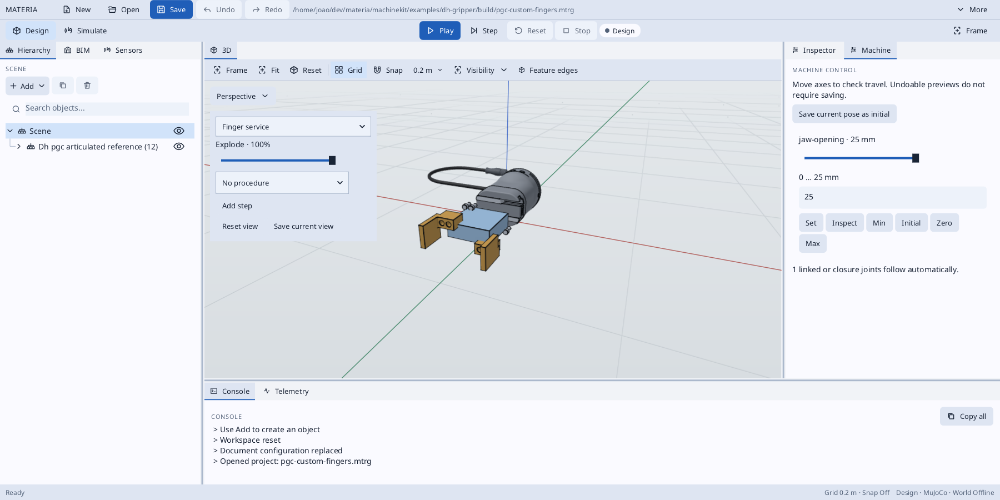
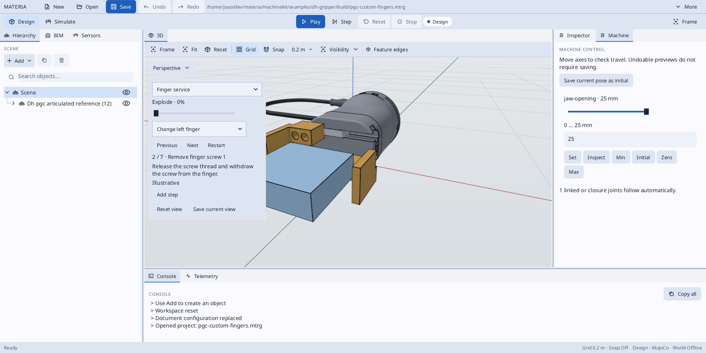

# DH Robotics PGC-140-50 CAD reference

Isolated supplier geometry with synchronized reference jaws and a routed electrical cable, before mounting on the tending wrist.

From the repository root:

```sh
python3 machinekit/examples/dh-gripper/prepare-reference.py
./haxeon/scripts/haxeon run --project=machinekit/examples/dh-gripper/haxeon.json
./app/run-built.sh --project="$PWD/machinekit/examples/dh-gripper/build/pgc-140-50.mtrg" --perspective
```

The example also provides `materia.project.json` with the `gripper` preview entrypoint.

Source: [DH Robotics Türkiye download center](https://dh-robotics-tr.com/indirme-merkezi),
STEP Modeli (PGC-140-50), `f47f5d03ad.step`. STEP header identifies
PGC-140-50-W-S, v4.0, 2024-08-14, SolidWorks 2020 / AP203.
The download script pins its SHA-256. Supplier CAD is downloaded into ignored `build/vendor`;
no open-source redistribution license is assumed.

The preview separates the fixed housing/cable exit, two moving jaws, a routed
electrical cable, and the relocated supplier cable-end connector. It retains
all ten jaw solids and the housing's free-shell faces. The original STEP stays unchanged.
The importer pins both the file checksum and the expected topology (40 shells, ten solids).
The supplier cable is removed at its 6.4 mm jacket, keeping both connector assemblies.
Derived STEP files for the rigid gripper and routed cable are written to `build/`.
The remote connector contains invalid supplier topology; its faces are tessellated
individually into one visual object, preserving the supplied geometry without repair.

The example route starts at the measured supplier jacket exit, travels straight for
100 mm, turns 180 degrees with a true circular 55 mm centreline radius, and returns
40 mm toward the wrist. Its analytic length is approximately 312.8 mm. The circular sweep has continuous tangents; it is not a sharp polyline.
The diameter follows supplier geometry. The 100 mm clearance and R50 minimum come from
[DH's PGC drawing](https://en.dh-robotics.com/wp-content/uploads/2022/08/DH-Robotics-Servo-Electric-Gripper.pdf).
The chosen R55 also leaves more than 50 mm at the jacket's inner surface.

Generation checks the retained jaw solids, supplier cable partition, fixed-exit attachment distance,
routing bounds, and swept-cable validity and analytic volume. The connector is rotated
and translated so its original cable axis follows the new cable end tangent.

The model is translated to center the rigid gripper in X/Y and rest on Z=0.
Colors are reference styling; the current STEP reader does not retain supplier colors/names.
Simulation masses are zero and collisions explicitly disabled for this visual reference:
connector contacts and the supplier's surface-only housing are not commissioned collision
bodies. The dual tool adds a second split saddle on each return lead, connected to the
existing adapter-mounted support. These support the cable just before the supplier
connector, replacing the unsupported upward-facing ends. The connector mating faces point toward the wrist; assembly access, sockets,
connector retention, liners and fastening details remain unverified. The existing exit saddle spans 90–100 mm from the measured jacket exit;
the drawing's 100 mm callout reference and fixation requirements need confirmation.

The return leads are rigid references attached to the tool. They do not represent a
finished robot dress pack: mating sockets, a flexible wrist service loop, forearm
attachment, torsion limits and full-motion checks remain to be designed. In particular,
a valid isolated-tool check does not establish clearance from robot links or the cell.

## Jaw articulation

The ten supplier solids are split into two five-solid jaw groups (including each
contact pad and its fasteners). The supplier STEP is at full opening: its contact
pads have a measured 50 mm gap along supplier X. Each jaw moves 25 mm inward to
close; the two prismatic axes oppose each other and their coordinates are coupled
1:1. `jaw-opening` is the independent coordinate, in millimetres **per jaw**:
0 = closed, 12.5 = 25 mm gap, 25 = 50 mm gap. The follower cannot move independently.
The housing and cable remain fixed. This is a geometric reference; no motor or
force-control hardware is commissioned by these joints.

Generation checks eleven openings using the actual pad geometry, independent
expected jaw displacements, exact pad distance, opposing-jaw intersection volume,
and coordinate limits. It also writes `pgc-140-50-opening-0.mtrg`,
`pgc-140-50-opening-25.mtrg`, and `pgc-140-50-opening-50.mtrg` for visual inspection.
The default `pgc-140-50.mtrg` opens at the supplier's full 50 mm gap. Separate
`jaw-left.step` and `jaw-right.step` exports use the closed preview frame.

The supplied fingers open to 50 mm and cannot accept the tending cell's 60 mm blank.
The custom-finger variant below provides the desired 76 mm open gap. The
surface-only housing has no trustworthy volume for an exact jaw/housing collision
certificate, so the reference remains visual-only in simulation. Wrist mounting, strain relief, payload and cell-access checks remain separate work.

## Custom fingers for the tending blank

The default generator now creates `build/pgc-custom-fingers.mtrg`; the project manifest's
`custom` entrypoint selects the same design. The `gripper` entrypoint still provides the
supplier fingers. To regenerate the supplier artifacts, pass `--supplier` to the example.

```sh
./app/run-built.sh --project="$PWD/machinekit/examples/dh-gripper/build/pgc-custom-fingers-opening-60.mtrg" --perspective
```

The custom design replaces supplier solids 0/4 and 5/9 (pads/fingers), retaining
carriages 1/6 and screws 2/3/7/8. Each custom finger is one valid solid with a
24 mm wide, 14 mm high mounting block, two 4.5 mm clearance holes on the measured 10 mm centres,
and 7.5 mm counterbores leaving a 4.5 mm mounting floor. Mounting positions follow
the two distinct supplier screw patterns; they are not generated by mirroring a
nominal hole pattern. Actual supplier screws are checked for interference, positive bearing contact and driver access.

The two bridges sit at their respective mounting heights, avoiding each other at
minimum opening. Their contact legs put each inner face 13 mm farther outward than
the supplier pad. Jaw travel stays 0–25 mm per jaw, giving a 26–76 mm contact gap.
The grip coordinate for the 60 mm blank is 17 mm per jaw, leaving 8 mm clearance
on each side at maximum opening. A 60 × 60 × 20 mm reference blank is shown in
the grip/open snapshots; it is omitted from the 26 mm minimum-gap snapshot.
The nominal contact patch on the blank is 20 × 20 mm per side.

`DhCustomFingers` checks solid validity, carriage attachment, no carriage/screw
penetration, and blank clearance/contact at 60, 65, 70 and 76 mm gaps. The existing
11-state jaw test now covers 26–76 mm with the custom fingers and checks their fixed
attachment to their moving jaws. A separating plane proves at least 1 mm clearance
between the custom fingers and fixed housing throughout X travel. The preview remains
visual-only; the blank is placed for geometric inspection and has no simulated grasp.

Separate `build/cnc-aluminium/finger-left.step` and `finger-right.step` are exported in the closed preview
frame, ready for CAD review. These are prototype geometry with R2 at the main pad/bridge roots, but without complete edge finishing,
manufacturing drawings or fastener torque specifications.

Preliminary load calculation (explicit design assumptions): Al6061 density 2700 kg/m³
makes the blank approximately 0.1944 kg. With friction coefficient 0.1, acceleration
10 m/s² added to gravity and safety factor 3, the required normal force is approximately
57.8 N per jaw. A provisional 80 N/jaw target produces approximately 3.38 N·m about
the mounting plane and 1.06 N·m from the 13.2 mm lateral offset, below the catalogue's
7 N·m moment figure. This calculation does **not** establish available force at these
longer fingers: the manufacturer's finger-length/force curve, actual pad friction,
fastener strength and structural deflection still require verification before hardware
selection. No motor force is configured in the model.

Next work: dual wrist adapter, two grippers at 90 degrees, cable strain relief and
payload/access checks in the tending cell.


## Collision and manufacturability review

The first prototype checked non-penetration but missed a 0.5 mm gap beneath each
supplier screw head. That meant the modeled retained screws would not clamp the finger.
The counterbore floor is corrected from 4.0 to 4.5 mm ahead of the mounting plane,
matching the actual supplier screw bearing face. Regeneration now rejects unseated
screws, inadequate mounting contact, blocked driver access and blank penetration.

Measured in the revised CAD:

| Interface | Result |
| --- | --- |
| Finger/carriage | About 109.29 mm² of projected mounting contact per finger; zero penetration |
| Screw head/counterbore floor | About 22.58 mm² of projected bearing contact per screw; zero penetration |
| Finger/blank at 60 mm gap | 400 mm² contact per side; zero penetration |
| Opposing jaw groups | No intersecting volume at eleven sampled gaps from 26 to 76 mm |
| Driver access | 6 mm cylindrical envelope reaches each head without either finger obstructing it, at four jaw positions |

Tangential solid/solid booleans can omit contact faces. Contact areas are therefore
computed from interior sections 0.001 mm into each part, projected to the same plane,
while actual body separation and intersecting volume are checked independently.
These are geometric contact measurements, not a pressure or joint-strength model.
The visible coincident finger/stock surfaces are intended gripping contact.

The 4.5 mm clearance follows the M4 medium-clearance value in
[Bossard's assembly reference](https://media.bossard.com/hu-en/-/media/bossard-group/website/documents/technical-resources/en/f-040-en.pdf).
The 7.5 mm counterbores provide 0.25 mm radial clearance around the modeled 7 mm heads.
The main concave pad/bridge roots include explicit R2 relief suitable for a 4 mm cutter
in that section. The custom parts are intended as machined aluminium prototypes.

This is not a released manufacturing design. Remaining work includes CAM review of
all other inside corners and workholding, material/finish and edge-break callouts,
mounting-face/hole tolerances, and bolt preload/strength and finger-deflection checks.
The mounting blocks were widened to 24 mm and thickened to 14 mm, leaving at least
3.25 mm to their outer edges around a 7.5 mm counterbore. Material, preload and
structural performance still need verification.
The clearance-hole joint also has no separate locating dowels or shoulder; positional
repeatability after finger replacement is not established. Assemble/access the screws
with the workpiece removed. No cell collision or wrist/payload certificate is claimed.

## Final shape refinement

Both custom fingers now call shared `Part.refined()` after drilling and root
construction. The returned part is used for all geometry checks, the preview mesh
and the STEP export. This removes boolean construction seams by merging adjacent
same-domain faces/edges, rather than hiding lines in the renderer. CadKit verifies
unchanged solid count, bounds, area and volume and preserves face-name aliases
through OCCT history. The supplier source remains untouched.

## Manufacturing family

The example now uses the registered `machinekit.robotics.offset-gripper-finger`
family. Geometry lives in MachineKit (`OffsetFingerSpec`, `OffsetGripperFinger`,
`OffsetFingerGeometry`); this example retains supplier-specific extraction and checks.
The shared interface remains unchanged between manufacturing routes.

- `cnc-aluminium`: current machined aluminum geometry and direct screw bearing seats.
- `sls-pa12`: 8 mm contact legs, 28 × 18 mm mounting blocks, R3 roots and explicit
  steel compression sleeves. Each sleeve has OD6/ID4.5, total length 4.5 mm and an
  OD10 × 1 mm flange. The polymer has 6.2 mm sleeve holes and 10.2 mm flange recesses.
  This is a printable prototype; stiffness, creep, print tolerances, sleeve-length
  tolerances and preload still need validation. It is not approved for an 80 N grip.

The `sls` project entrypoint opens the SLS variant. Generate and inspect it with:

```sh
./haxeon/scripts/haxeon run --project=machinekit/examples/dh-gripper/haxeon.json -- --sls
./app/run-built.sh --project="$PWD/machinekit/examples/dh-gripper/build/pgc-sls-fingers-opening-60.mtrg" --perspective
./haxeon/scripts/haxeon run --project=machinekit/examples/dh-gripper/haxeon.variants.json
```

Each generator run writes a `*-manufacturing.json` with the family/interface,
selected variant/process/material, prototype status, pending checks, hardware
requirements per finger and variant-specific BOM lines. The SLS scene contains
four separately visible steel sleeves, fixed to the moving jaws. They are assembly
hardware, not included in the estimated polymer mass. The scene remains a visual
reference with no simulated grasp or commissioned mass/collision model.

Variant exports live in `build/cnc-aluminium/` and `build/sls-pa12/`, so regenerating
one variant does not overwrite the other's finger or sleeve STEP files.

### Dual electric wrist reference

`DhDualToolPreview` composes two checked CNC-finger references with approach axes
90 degrees apart. A single machined aluminium L-adapter with an R3 internal root places one gripper along
+Z and the other along +X. Its wrist origin is the robot-side mounting face.
The supplier's 50 mm bolt circle is clocked 45 degrees; its rear 31.5 mm locating
boss enters a 2.7 mm-deep pocket. The robot-side pattern matches the existing
`RobotFlange(50)` reference, including its raised pilot. This is that model's
interface, not a claim that every robot with a nominal ISO pattern fits it.

Two adapter-mounted support concepts each carry an exit clamp and a return clamp.
The R55 hairpins turn the leads back toward the wrist instead of leaving upright
connectors unsupported. Connector bodies are not structural attachment points.
The clamps use a nominal 6.6 mm bore around the 6.4 mm cable and a 0.2 mm split;
liners and tightening behaviour need validation. M3 clamp and M4 support holes
are modelled, but screws, tapped threads and final screw lengths are not a released
fastener design. Adapter M6 holes are represented at their tap-drill diameter.
The blind pin and opposing tapped hole retain a nominal 4.8 mm axial web;
that detail requires structural/tolerance review before manufacture.

Build and inspect:

```sh
./haxeon/scripts/haxeon run --project=machinekit/examples/dh-gripper/haxeon.dual.json
./app/run-built.sh --project="$PWD/machinekit/examples/dh-gripper/build/dual/dual-electric-tool.mtrg" --perspective
```

Materia entrypoint `dual` is also available in this directory's project. The tending
folder exposes the same isolated reference through
`materia.electric-tool.project.json`. The active pneumatic mission and its reach
certificate are separate; this reference does not replace them.

The build checks all 121 sampled pairs of jaw positions across the 26–76 mm gap,
including supplier housing surfaces, jaws, custom fingers, cable loops, conservative
remote-connector boxes and held-blank envelopes. Opposing-tool clearance uses conservative
bounds or exact CAD distance when bounds overlap. Added metal parts must be valid
single solids without mutual volume overlap. Support clearance from gripper
members and cable/metal interference are checked separately. The individual
11-position jaw checks still run. These are sampled geometric checks, not a
continuous-motion or full-cell collision certificate.

Generated `build/dual/report.json` records the mass budget, assumed housing-centre
CoGs, two 194.4 g blanks, both CNC finger pairs, CAD adapter/support masses and a
250 g allowance for screws, liners and unweighed services. The full 1 kg planning
allowance per gripper is retained even though original fingers are removed. This
is conservative about removed fingers but still requires actual supplier mass,
CoG and service measurements. The gravity-moment figure bounds arbitrary gravity
orientation about the wrist origin. A nominal 12.5 kg Reach1300 mass comparison
alone does not establish allowable moment, inertia or acceleration.

The two grippers have independent synchronized jaw mechanisms and expose
`grasp-a`/`grasp-b` frames at the centres of the planned blanks. Blanks remain fixed
in their held reference poses; there is no electrical driver or simulated grasp.
The generated scene explicitly disables collision physics, as does the single
supplier reference. STEP files for the adapter and six clamp/support pieces are
exported beside the scene for review. All new adapter and support geometry is a
prototype pending mounting access, stiffness, fatigue, tolerance, cable flex and
full tending machine/vise-access checks.


The optional cobot wrist socket and passive dual-output junction now have a separate
[tool-service reference](../tool-service/README.md), including electrical contract
checks and local mounting CAD. They are not yet installed in this dual-tool artifact.
The previous large-return cable/support routing has confirmed interference with the
arm at a tested pose; its isolated-tool clearance result does not make that route usable.

The dual-PGC concept selects the Fairino **Expert ICACX1500GSCEXP** adapter
(Welectron FA2-860952), with external 24 V power, through
`DhDualGripperServices`. The dual preview exports `build/dual/service-bom.json`
for this purchased harness; this is a service purchase list, not a complete tool BOM.
The purchase entry remains inventory-only; the installation study below adds separate
provisional geometry. Its mass remains
unknown rather than using the short illustrative cable model as actual stock mass.
The old cable returns are still a prototype and have known installed tending
interference; selecting this adapter does not validate or replace those routes.
DH compatibility, adapter current rating, supply/cable selection and backfeed handling
remain open. See the [adapter reference](../tool-service/FAIRINO-ADAPTERS.md).

### Expert installation layout

The dual preview entry now displays the Expert installation study, built by
`DhExpertToolPreview`. The old `DhDualToolPreview.preview()` remains the baseline
geometry builder for comparison; its old cable/support checks do not qualify the
replacement routing. Expert outputs live separately in `build/expert/`.

```sh
./haxeon/scripts/haxeon run --project=machinekit/examples/dh-gripper/haxeon.expert.json
python machinekit/examples/dh-gripper/render_expert.py
./haxeon/scripts/haxeon run --project=machinekit/examples/dh-gripper/haxeon.expert-audit.json -- --tool-only
```

`-- --cached-dual` may be used on the Expert preview command for routing-only
iterations after generating the baseline. Omit it when source gripper geometry changes.
The renderer uses the scene triangles and recorded assembly poses.

The A DH cable's R55 return is rotated into the tool-side XY plane; B retains its
horizontal return. Both preserve 100 mm straight exits and 40 mm return tails.
All tall carriers, cable-loop cantilevers and screw clamp caps are removed.
A 52 × 54 × 4 mm low saddle sits on the exposed +Y adapter edge, with a recessed
1 mm soft pad and two reusable 10 mm strap envelopes. Two counterbored M3x10 mounting
screws require **two new blind M3 tap drills** at tool XY (-47,44) and (-3,44),
modeled in the adapter. Strap slots pass through the shelf. Strap material,
closure, tension and retention remain prototype choices; these are planning
envelopes, not a selected commercial strap. The two DH cable loops are flexible
and unsupported along their length; preserving the drawn bend radius does not
prove their shape or strain relief under acceleration. No tape or clamps across
robot joints are modeled. The splitter is lowered beside the A gripper, reducing
the support envelope instead of carrying it high on a frame.

Expert branch lengths, diameters, connector envelopes and wrist plug placement
remain estimates. Expert routes use analytic circular arcs and straight segments, with radii and
lengths reported. R25 is a provisional planning target, not a supplier rating; the
cable's allowed bend radius is still unknown. The right-angle
plug's displayed location is a layout assumption on the generic cobot, not a
FAIRINO measured mating frame. External power ends at a provisional wrist-side handoff without a qualified anchor: no cable
across moving robot joints is claimed. The purchased harness is one line in
`service-bom.json`; prototype saddle/strap hardware is not a procurement-ready BOM.
The baseline dual tool payload budget excludes this new installation and must not
be reused as a qualified payload check.

`layout-report.json` records every new static service pair, including connector
attachment contacts. `tool-cad-audit.json` checks retained gripper/tool CAD at jaw
openings 0, 17 and 25 mm. `tending-pose-audit.json` uses saved solved configurations
from the historical `machine-tending/build/electric-access/report.json`, recording
its hash and individual STEP source hashes. Clear bounds above 5 mm are lower
limits; closer pairs use exact CAD distance and solid common volume. This is a
static saved-pose audit, not a continuous sweep or a new cell-access certificate.
By default it audits all solved tending-top-entry poses; `-- --all-profiles` also
includes the older side-entry comparison poses. The overmold entry points are
layout assumptions; they are not supplier connector frames. Modeled branch
lengths do not establish stock cable lengths or permit cutting the supplied harness.

The historical diagnostic audit includes four outfeed/B configurations already
rejected by the original access study. Exact CAD confirms forearm/service clashes
there; they must remain rejected rather than being treated as approved tending
poses. The access checker now tries all four headings and additional elbow seeds
before accepting an endpoint. Fresh Expert access results go to the separate
`electric-expert-access` directory. To audit that dataset independently:

```sh
./haxeon/scripts/haxeon run --project=machinekit/examples/machine-tending/haxeon.electric-access.json -- --cached-expert
./haxeon/scripts/haxeon run --project=machinekit/examples/dh-gripper/haxeon.expert-audit.json -- --current-access --poses-only --approved-only
python machinekit/examples/dh-gripper/review_expert.py --current-access
```

`--cached-expert` uses the already generated Expert scene and saved gripper frame;
omit it to rebuild the entire tool. This study screens top-entry by default;
`--all-profiles` also includes the older side-entry comparison. The audit's
`--tool-only` mode refreshes just retained-tool checks without rewriting robot-source
artifacts. Current-access robot CAD is stored separately. Changes to service geometry invalidate
older service hashes; rerun a diagnostic audit before interpreting it as current. A nonzero review exit means actual overlap, less than 0.5 mm retained-tool clearance,
or less than 5 mm robot clearance remains in at least one audited configuration; a successful static review
still does not certify the full cell or a continuous trajectory.

`--poses-only` reuses a retained-tool audit only after verifying its scene hash.

`--approved-only` checks the poses selected by source paths whose status is
`sampled route solved and clear`. It does not convert rejected or unsolved source
cases into passes. The review summary separately lists all unresolved required
station/gripper cases; static review success is not full study completion.

The generator trials two catalog ISO 4762 M3x10 screws against the saddle,
including head counterbores and the neighboring splitter envelope. This checks saddle interference, not thread strength,
preload or a procurement-ready mounting BOM. `fastenerTrials` records both checks.
Regenerate the baseline adapter when changing these mounting holes; `--cached-dual`
must only reuse a baseline built from the current adapter source.

The simplified saddle layout passes 91 service/service checks, 406 retained-tool
CAD checks at three jaw openings, and both M3x10 screw trials. At the simplified-saddle checkpoint, the full access
study retained 17 of 28 station/gripper cases; 11 remained unresolved. An independent
audit of those 17 accepted poses checks 24,752 service/robot pairs across 104
mechanical components and passes the 5 mm static margin. The nearest reported
robot separation is a conservative bounds lower limit of 5.51 mm. These results
do not establish dynamic cable retention, swept clearance or full-cycle access.

A subsequent focused vise study resolves all four vise approaches through staged
routing and a 50 mm approach lift, with no tool/support geometry changes. See
`../machine-tending/build/electric-expert-vise/report.json` and the machine-tending
README for its command and scope. Independent endpoint review:

```sh
./haxeon/scripts/haxeon run --project=machinekit/examples/dh-gripper/haxeon.expert-audit.json -- --vise-access --poses-only --approved-only
python machinekit/examples/dh-gripper/review_expert.py --vise-access
```

This produces `vise-tending-pose-audit.json` and `vise-review-summary.json`, with
separate `robot-source-vise/` CAD captures. It does not promote the older full-cell
report to a full-cycle pass. The accepted route joint traces and actual final
joint configurations are saved in the focused source report.

## Assembly views and finger service

The custom-finger artifact opens assembled. **Jaw detail** frames the left jaw,
finger and its two mounting screws beside the sectioned housing guide. The blank,
cable, cable-end connector and opposite jaw/finger are hidden in this view so they
do not obscure the detail. Closed solid cuts are filled with material-coloured
hatch at the plane; guide cavities and screw holes remain empty.
Finger service gives an unobstructed close-up. The Explode slider removes screws
in stage 1 and fingers in stage 2. Change left finger opens the jaws with
`SetJoints`, then removes the two screws and finger, installs the replacement,
and reinstalls the screws. These service motions are Illustrative.

| Assembled | Jaw guide section |
| --- | --- |
|  |  |
| Explode at 100% | Finger-change procedure |
|  |  |

Reproduce the Jaw detail capture through the editor (the preset supplies the framing):

```sh
./haxeon/scripts/haxeon run --project=app/tests/haxeon.presentation-capture.json -- \
  --view=jaw-detail \
  --project="$PWD/machinekit/examples/dh-gripper/build/pgc-custom-fingers.mtrg" \
  --capture-dir=/tmp/gripper-jaw-detail --capture-seconds=2 \
  --reset-workspace --perspective --width=1800 --height=900
```

Capture a procedure step through the editor:

```sh
./haxeon/scripts/haxeon run --project=app/tests/haxeon.presentation-capture.json -- \
  --view=assembled --procedure=finger-change --step=1 --distance-scale=1.3 \
  --project="$PWD/machinekit/examples/dh-gripper/build/pgc-custom-fingers.mtrg" \
  --capture-dir=/tmp/gripper-service --capture-seconds=2 \
  --reset-workspace --perspective --width=1800 --height=900
```

Mounting screws are independent occurrences. `jaw-left-with-screws.step` and
`jaw-right-with-screws.step` preserve the complete rigid groups used by composed-tool
clearance checks; the carriage-only STEP files use the ordinary jaw names.
