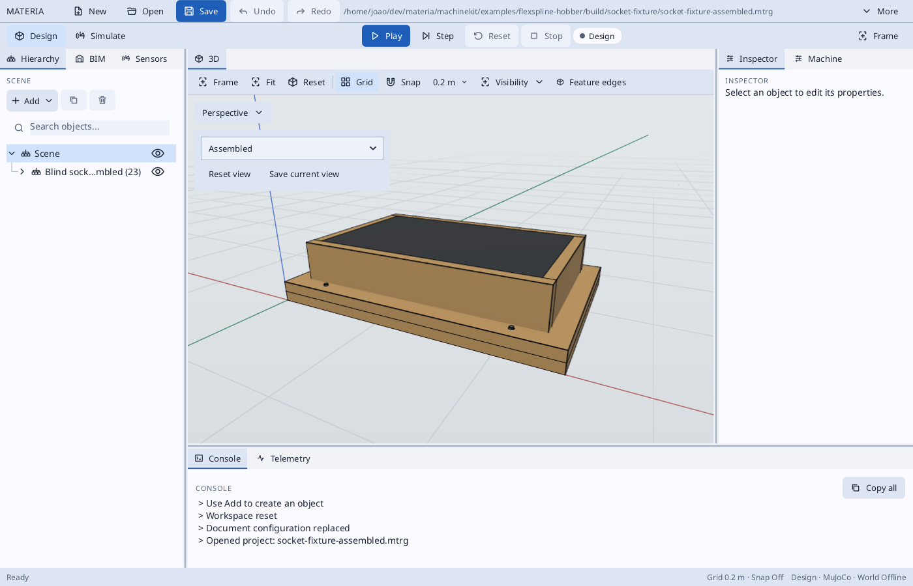
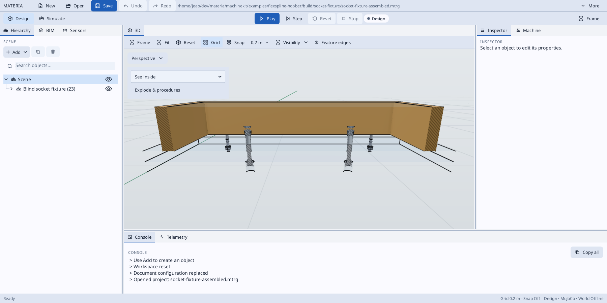
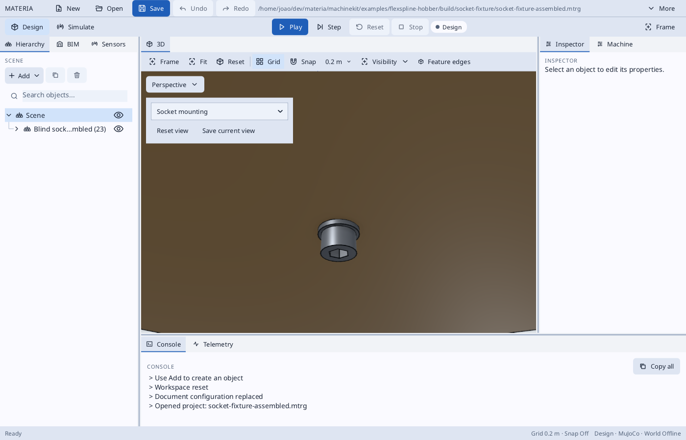
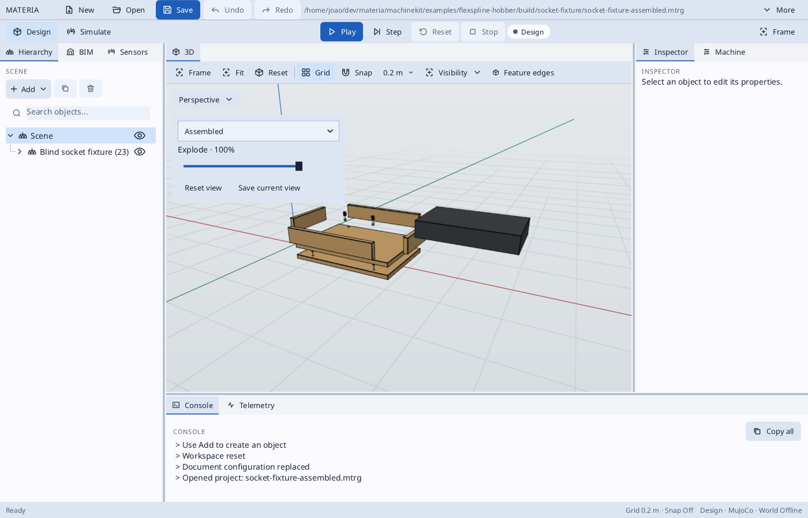

# Flexspline hobber

A vertical GE-class moving-column hobber: fixed direct-drive work table, radial
column infeed, vertical head feed, direct swivel and twin-rail hob shift.

See [MACHINE_DESIGN.md](MACHINE_DESIGN.md) for datums, travel, support and
acceptance scope, and [PLAN.md](PLAN.md) for engineering evidence and open gates.
The project entry point is `materia.project.json`; run it through Materia's
project-source loader. `check-quick.sh app` runs the coarse app/cycle smoke check.
Full reference metrology and error-budget cuts are separate, expensive checks.

Open `hobber.scene.json` and use the enclosure viewing controls for mechanical
inspection. The electrical rack starts hidden; its wiring and drives remain in
the assembly.

The head has a front-mounted compact swivel and vertical twin-rail Y stage.
[LAYOUT_SECTION.svg](LAYOUT_SECTION.svg) shows the dimensioned radial stack.

The inspection assembly now selects full supplier HGH15CA/HGH25CA blocks and a
matching HGR25R X rail profile. Before generating it on a fresh checkout, run
`python3 machinekit/examples/linear-rail-reference/prepare.py`. Asset revisions
are pinned and saved in component recipes; no runtime downloads occur. The X
screw is centred between the bed rails in a recessed channel, with its motor at
the rear. Channel covers remain a design provision.

### Watch a coarse cut

Open [hobber.scene.json](hobber.scene.json) or [materia.project.json](materia.project.json)
in Materia. One assembly contains the detailed hob, cup, mandrel, enclosure and
guarded door mechanism. The viewport's **Play scenario** controls choose
**Idle / doors**, **Cutting** (default) or **Load / cut / unload**. Pause before
changing the scenario; switching resets the runtime and stock, not the document.
Press **F5** to play/pause, **Shift+F5** to reset and **Home** to fit the machine.
The module-1, 40-tooth demonstration is not a reference-part grading run.

The enclosure starts visible. **Transparent** and **Hidden** are view-only;
physical enclosure bodies, sensors and cutting interlocks remain installed.
The electrical rack and its drive modules remain hidden by default and can be
shown from the hierarchy. Simulate opens the independent inspection camera below
Sensors/CNC; orbit, pan and zoom there do not move the main camera.

The hob spindle now includes a hollow shaft, nose, opposed bearings near the
tool, bearing retention and a drawbar-retained taper-and-face arbor with drive
pins. It is an assumed custom interface, not a qualified HSK interface; see
[MACHINE_DESIGN.md](MACHINE_DESIGN.md#hob-spindle-cartridge-2026-10-19).


### Cup loading demonstration

Select **Load / cut / unload** in that same scene and press **Play**. With the
doors secured, the head first parks at X=110 mm, Y=Z=0. After measured open-door
and standstill feedback, the cup approaches from the front, transfers 250 mm at
35 mm clearance, seats and clamps. The doors close and lock before the real cut.
The head retracts before the guard opens for release and unloading. Reset then
Play replays the selected scenario. Transfer and sleeve expansion are illustrative.

The Machine panel provides **Blank**, **Clamped**, **Finished** and **Clamped
section** inspection views. Inspection is available before cutting or after the
sequence completes. The legacy manual **Continue sequence** action is unavailable while a guarded
scenario owns the sequence. Reset then Play returns to the scenario.
Sectioning is view-only; close it with **Close section**. Inspection does not
reset or replace the actual cut stock.

The earlier blank was only an annular tooth band. It is now a single CAD cup
with a 40 mm overall length, 2 mm closed end and 0.6 mm wall below the tooth
roots (assumed dimensions). Material removal and metrology still operate on the
toothed band; the unmachined cup wall/end remain visible in the runtime mesh.
This demo uses module 1, 40 teeth and a 4 mm band, not the precision reference.

Loading is a guided kinematic illustration, without a robot or loose-body
contact dynamics. The separate sleeve closes the nominal 25 µm radial fit gap
at true display scale; its expansion is explicitly illustrative, not a solved
hydraulic strain or pressure prediction. Cutting starts after seating/clamping;
unloading starts only after the spindle stops and X/Y/Z return to the loading pose.

The HB-D11 foundation is a 930 × 800 × 800 mm monolithic plinth on three rigid
levelling feet in side-access cast pockets, with removable steel load plates
and accessible support/lock nuts. The tooth band is 1000 mm above the floor. The default bought DD table has a Ø200 mm face, 210 mm height and Ø40 mm bore;
unpublished accuracy/stiffness and mounting details remain assumed. The built-up
table remains selectable through the same interface. See PURCHASED_TABLE_REPORT.json.
See [MACHINE_DESIGN.md](MACHINE_DESIGN.md#heavy-plinth-acceptance-hb-d11) for mass,
support and preliminary stiffness evidence. The app's machining time excludes
the illustrative loading/unloading sequence.

### Post-plinth reference budget

The current HB11 run is in `build/flexspline-reference-budget-plinth`.
`review.md` / `review.json` summarize completed inspections; `progress.json`
lists missing cases. The background units are `flexspline-hb11-plinth-budget`
and `flexspline-hb11-plinth-review` (`journalctl --user -u UNIT -f`).

To resume after the unit has stopped, use the same frozen evidence and provider:

```sh
python3 machinekit/examples/flexspline-hobber/run-plinth-budget.py \
  build/flexspline-reference-budget-plinth \
  --previous build/flexspline-reference-budget-parallel \
  --native build/flexspline-shared-sweep/native-pair
```

The runner refuses changed binary/input/settings fingerprints. Do not replace
its frozen binary during a run. HB4 convergence and HB12 reference acceptance
remain open; a completed numerical budget does not establish ISO certification.

Z now uses a centered, recessed 420 mm ball screw between the guides, with its
fixed bearing and motor at the top. See [Z_DRIVE_SECTION.svg](Z_DRIVE_SECTION.svg).

The replacement rectangular-tray proposal has its own [BOM](tray-bom.json) and
[supplier records](tray-anchor-sourcing.json); see [enclosure notes](ENCLOSURE.md#tray-proposal-bom-and-sourcing-exports).
Run the proposal generator and `haxeon.tray-bom.json` to refresh its sourced JSON
and CSV exports in `build/tray-mounting/`. It remains separate from the installed
enclosure BOM until the replacement is integrated.

The [two-socket mould fixture](SOCKET_FIXTURE.md) demonstrates the cast-in socket
positioning method with its own Materia scenes, tooling BOM and panel drawings.

## Socket fixture presentation

The [socket fixture coupon](SOCKET_FIXTURE.md) opens in **Assembled**. The viewport
view picker also offers **See inside**, with transparent plates and casting and a section
through both socket axes, and **Socket mounting**, with the bed hidden and an
underside close-up of one screw-and-washer stack. Reset view returns to Assembled.
These views change display state without changing the fixture assembly.

| Assembled | See inside | Socket mounting |
| --- | --- | --- |
|  |  |  |

The See inside capture was reviewed again for AP8's filled sections. The opaque
socket cuts are filled and hatched at the section plane; their bores remain empty.
The casting is transparent in this inspection view so its new cap cannot obscure
the embedded sockets. Transparent parts receive no caps. This changes the view
preset, without changing the casting or fixture geometry.

The captures above use the generated `build/socket-fixture/socket-fixture-assembled.mtrg`.
Reproduce a named view from the repository root with:

```sh
./haxeon/scripts/haxeon run --project=app/tests/haxeon.presentation-capture.json -- \
  --view=see-inside \
  --project="$PWD/machinekit/examples/flexspline-hobber/build/socket-fixture/socket-fixture-assembled.mtrg" \
  --capture-dir=/tmp/socket-fixture-see-inside --capture-seconds=2 \
  --reset-workspace --perspective --width=1400 --height=900
```

The Explode slider at 100% (captured through the editor):


