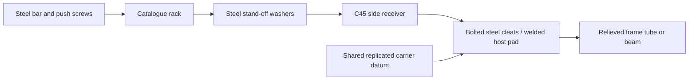

# Shared-mount/router candidate — 2026-10-22

**Review candidate; frozen CAD unchanged.** The shared source/fastener core is
implemented. The physical RM2 factory, complete support brackets, automatic FE
compliance export and full supported-router qualification are not complete.
Do not treat this document or the local contact fixture as fabrication release.

## Proposed load path

Use a side-bolted rack receiver, rather than the rejected thin cantilever shelf.
The rack's published mounting holes go across its face width. A continuous C45
receiver follows that bolt face. Real steel washers stand the rack off the
receiver enough to clear the pinion's axial overhang. A separate steel bar with
push screws adjusts the rack back datum to the master rail, then the service
bolts lock it. Do not turn that bar into a fixed precision lip.

The washer is part of the physical load path, not a virtual gap. Its compression,
bolt bearing/shear, receiver bending, carrier/cleat compliance and replication
belong to the shared mount model. Clamp threads stay in steel. The rack should
be fixed through these actual supporting parts; declaring it fixed to a remote
frame tube is insufficient.

A welded host supplies a relieved pad and carrier. A cast host supplies a retained
insert. Both use the same placed-element holes, allowance, adjustment and
measurement contracts. No new RackSeat/RackMountPattern/RackSeatHoles recipe is
introduced. The shared family remains responsible for carrier/cleat geometry,
steel and compound mass, real fasteners and compliance.

## Checked local section

The review fixture uses the actual 500 mm ATLANTA `29-15-055` section and its
four catalogue bores, together with the existing ISO 7089 M6 washer recipe.
Dimensions of the proposed C45 receiver are engineering inputs, not supplier data:
**20 mm thick × 28 mm high**. The native fixture checks a 540 mm receiver length
with 20 mm end allowance; full-axis receiver ends and section joints still need
layout. Washer thickness is the catalogue recipe's **1.6 mm**. Counterbores start
at rack x=0 and their bearing plane is x=7 mm; receiver steel lies beyond the
opposite rack face. The common fastener selector chooses **M6×25, class 8.8**.

The fixture passes **19 native assertions**, including **1.10 mm** minimum
clearance. It tests actual rack/washer/receiver contacts and a conservative
20-tooth, 20 mm wide, left-hand pinion envelope at nine stations. This is a local
contact/clearance test, not a native check of the complete drive, host brackets,
adjusters, joint gauge, motor plate or a fatigue result. Full source and STEP
witnesses are retained with the mounting evidence.

The receiver's gross stock mass is **4.396 kg/m** before drilling. At the old
3350/3900 mm Y and 2050 mm X rack envelopes, receiver stock alone is respectively
29.453/34.289 kg fixed and 9.012 kg moving Y. These are **partial stock totals**;
carrier, cleats, adjusters, compound, hardware and end/joint allowances are not
included. They are not a new complete-machine mass or a claimed saving. The
previous complete draft's +10.470 kg moving and +32.057/+37.209 kg fixed cannot
be reused for this different topology.

## Preserve the machine datums

For the sourced module-1.5 rack with a matched 20-tooth pinion, the existing
100 mm/rev transmission remains possible; opposite helix hands are required.
The supplier rack face is 19 mm, not the frozen assumed 20 mm. No capacity rating
or stiffness is silently transferred between them.

| Datum | Y, both sides | X |
|---|---:|---:|
| Existing pinion centre Z, mm | 858 | 1132 |
| Rack pitch line below pinion Z, mm | 842.084506 | 1116.084506 |
| Sourced rack back Z, mm | 824.584506 | 1098.584506 |

The right Y rack must move below its pinion, matching the left. Preserve the
rail, beam, tool and table datums in the candidate; do not raise the gantry to
make a thick threaded plate fit. Y can use one replicated carrier datum for the
rail and rack support. The rack receiver's side-bolt face is orthogonal to the
back/mesh-height plane; a single scalar "seat height" cannot represent both.
Stepping/cleat dimensions come from this common datum and the actual mesh frame,
not a second independently invented replication allowance.

Rack parallelism is measured by an indicator on the master-rail carriage; joint
pitch is set with the rack gauge. Pinion centre distance/backlash is adjusted on
the motor plate. Unknown placement/cure budgets keep service drilling pending.
Align and clamp before transfer drilling when the clearance budget cannot close;
do not invent slots or extra rack holes. Cut sections and relocated end pilots
require a documented cut/reaming route; do not use an unfastenable 50 mm offcut
to fill the frozen X envelope.

## Rail fastening and compound remain open

The existing DIY packet's 8 mm backing cannot acquire the blind M6 thread used
by the C45 policy. Its minimum stock for that route is 12.3 mm (7.8 engagement,
1 tip gap, 2 tap runout and 1.5 back wall). The preferred datum-preserving rail
route is a separately checked through-bolt/captive-nut arrangement. Do not apply
the blind C45 policy to an S235 welded strip, or silently thicken the strip and
move the rail. Nut capture, access, frame-wall openings, bearing and bolt length
need physical modelling and checks before choosing that route.

Production compound minimum/maximum thickness, cure distortion and sustained-load
behaviour remain inputs. The shared interval is
`[minimum + fixtureError + cureDistortion, maximum - fixtureError - cureDistortion]`.
Missing values remain Pending; an empty interval fails. The manufacturer's
[Moglice P TDS](https://diamant-polymer.de/en/wp-content/uploads/sites/2/diamant-technical-data-sheet-moglice-moglice-p.pdf)
describes a pasty sliding-surface replication compound, not a qualification of
our free-poured static seat. It does not supply the required static-seat layer
limits/creep evidence. No production grade or new default layer is selected here.
The 2–8 mm range in the unit fixture is explicitly an assumption.

## Before frozen adoption

1. Build the full shared carrier, receiver, adjustable bar, cleats and hardware
   as RM2 geometry on both host fixtures. Include the datum-preserving rail
   fastening route. Native contact and negative controls must pass.
2. Resolve section cuts, joints and pin pilots from the actual rack recipe, then
   sweep both router beds with real motors/pinions, guides, switches and chains.
3. Export each mount's mass/inertia and directional compliance automatically,
   exactly once. Rerun both meshes/all poses and the corrected J5 envelope;
   the local contact fixture supplies no modal or stiffness pass.
4. Keep all braces. Recheck W066/W064 at 100 million reversals; geometry/detail
   upgrades need their own reaction/fatigue checks. Recheck SR-D3 and SR6-C gates.
5. Present the passing candidate for approval before changing frozen CAD.

The required-mount API remains a separate tested patch; it must distinguish the
mesh/back frame from the actual side-bolt support face. Do not land a gate which
only accepts back-supported racks and thereby rejects a valid side-mounted one.
Current Gantry changes from another session are left untouched.
