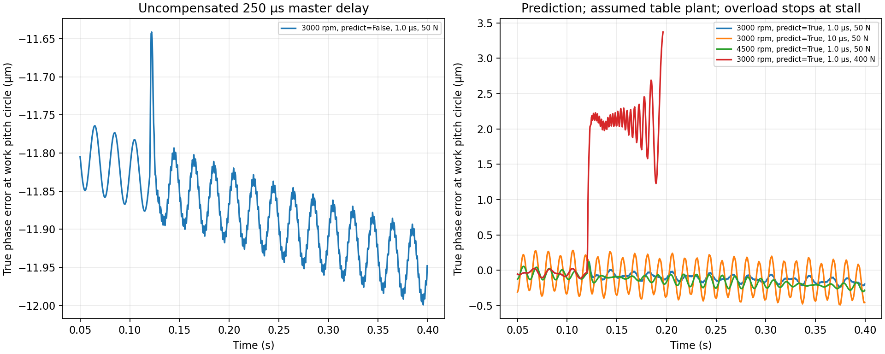

# Spindle drive requirements: BT30 mill and flexspline hobber

Study date: 2026-10-19. Analysis now reads all 55 local Leadshine motor models and
the executable BT30 reference model. No locally modeled motor passes both the
mill's rated output-point screen and its existing motor-envelope size screen.
Eight 180 mm-frame variants pass the output point alone; none fits the current
compact allocation by these size comparisons. No local Leadshine row reaches
the hobber's 8000 rpm maximum directly.

Spindle-duty vector systems remain a possible architecture, but we have not
modeled or qualified a supplier VFD/motor pair. The hobber work table remains a
position-controlled torque-motor concept. Its physical motor, drive and measured
response are absent locally. The reduced-order simulation below explicitly uses
an assumed table plant rather than silently treating an axis servo as that table.

The mill needs a useful continuous torque range. The hobber needs a measured-angle
electronic gearbox. A general-purpose VFD with an rpm command alone cannot provide
that synchronization, while using an AC servo alone does not establish it either.


## Existing design basis and new assumptions

The [BT30 packaging study](../bench-mill/README.md#bt30-spindle-packaging-study)
specifies a 2.2 kW / 8000 rpm concept and 1:1 belt drive. Its compact motor is
assumed geometry. The older ER20 example uses a different, assumed 1.1 kW motor;
its bearing-block program requests 8000 rpm. These are separate configurations.

This study interprets the BT30 target as **2.2 kW useful spindle output**. That is
a new explicit interpretation: the current 2.2 kW motor would provide only
2.09 kW after the assumed 5% belt loss. The new low-speed envelope, minimum speed
and efficiency are provisional requirements, not established cutting demands.
They must eventually be checked against tool diameter, material, engagement,
feed, spindle thermal limits and the actual electrical supply.

The [hobber reference](../flexspline-hobber/PLAN.md#reference-numbers-assumed-until-checked-against-a-datasheet-or-a-measurement)
is m=0.3, 200 teeth, 60 mm pitch diameter, a single-start 32 mm hob with 12 gashes,
3000 rpm reference cutting speed, and an 8000 rpm maximum. It already calls for
a direct-drive spindle around 1.5 kW, a direct-drive C table and load-side ring
encoder. The 1 µm control allocation below is new. It is only one contribution
to tooth error; it is not a complete gear tolerance or an ISO grade claim.

Inputs and their provenance are in [requirements.json](requirements.json).
Numerical results are in [results.json](results.json).

Manufacturer torque-speed graph images have now been downloaded for three
catalog designations. See [curve evidence and revision conflicts](sources/leadshine-curves/README.md).
They distinguish continuous and intermittent regions. The explicit MS1AE variant
now has a conditional digitized continuous curve with reading allowances; its
operating conditions remain unverified. Other conflicting graphs stay blocked.

## Executable local inputs and dynamic study

[ExportLocalMotors.hx](ExportLocalMotors.hx) calls `LeadshineServo.catalog()` and
constructs each motor's `Envelope` geometry. It also constructs the existing
`Bt30SpindleMotor`, exporting its rating and envelope. The generated
[local-motors.json](local-motors.json) replaces the earlier three manually copied
motor rows. Continuous/intermittent evidence and exact-variant curve matches
are exported from the model too. The source of truth is the Haxe catalog; the snapshot is a reproducible
bridge to the Python analysis. Use the native check command below to detect model
changes before checking the derived results.

The existing BT30 motor's bounding box is 110 × 110 × 162 mm, including its flange
and pilot but excluding the exposed shaft. Candidate comparisons use the same
housing/pilot convention and include connector envelopes. These are **size-only
screens in each motor's local frame**: a smaller bounding box does not establish
mounting compatibility, actual clearances, shaft/pulley fit, connector access or
payload acceptability. Geometry is not substituted into the mill assembly.
The full 55-row screen and failed bounding-box axes are in `results.json`.

[simulate_hob.py](simulate_hob.py) drives the reference-speed hob with local
`ELM2L-1500LA100FT-H MS1AE` inertia, rated torque, maximum speed and 23-bit feedback
resolution. It numerically integrates a speed-PI-controlled motor and an assumed
PD-controlled table, delayed/quantized master capture, velocity estimation and
phase extrapolation. The controller uses measured master angle; error is evaluated
against the true master and table angles, not their quantized readings.

The run applies an assumed 50 N tangential cutting load at 0.12 s, with 20% gash
torque ripple. Tool inertia, gains and the table inertia/torque limit are explicit
assumptions in `requirements.json`. Motor torque is limited by the lesser of rated torque and the digitized
continuous curve after reading allowances. The page variant is identified but
its operating conditions are unverified; no transient peak rating is used to
claim continuous operation. A fixed ratio of 1:200 applies to the reference
spur gear. This is an isolated model study, not production electronic-gearing
code, drive tuning, a VFD model or completion of HB7.

| Scenario (3000 hob rpm unless stated) | Peak true control phase error | Master status |
| --- | --- | --- |
| 4 kHz capture, 250 µs delay, no prediction | 12.000 µm | Rotating |
| 4 kHz capture, prediction, 1 µs timestamp residual | 0.237 µm | Rotating |
| 8 kHz capture, same 250 µs delay, no prediction | 12.000 µm | Rotating |
| 8 kHz capture, prediction, 1 µs timestamp residual | 0.238 µm | Rotating |
| 8 kHz capture, prediction, 10 µs timestamp residual | 0.488 µm | Rotating |
| 4500 rpm, 8 kHz capture, prediction, 50 N load | 0.303 µm | Rotating, descending continuous curve |
| 8 kHz capture, prediction, 400 N overload | 3.402 µm | Stalls; scenario terminated |



Full-rate peak/RMS results, saturation fractions and decimated traces are in
[hob-simulation.json](hob-simulation.json). Recorded traces are for inspection,
not gash-frequency spectral analysis. Installed encoder errors are sinusoidal
with fixed phase; these runs do not exercise every combination of the bounded
error allocation. The optimistic fast inner table loop has ideal velocity
feedback. Torsion, sensor filtering, packet loss, cogging, thermal effects and a
measured C-drive transfer function are absent. Therefore the simulated peak can
be below the arithmetic worst-case budget, and increasing jitter to 10 µs need
not fail this particular filtered trajectory even though it fails the bounded
allocation. The small predicted errors are **not** a qualified hardware result.

The overloaded master is allowed to slow, while C follows measured B. On stall,
the calculation stops instead of extending the cutting-load model into reverse
rotation. This diagnoses insufficient motor torque; it does not implement a
machine fault-stop or restart sequence.

## Mill: provisional continuous output envelope

Use 500–8000 rpm, constant torque to an assumed 3000 rpm base, then constant
power. This deliberately asks for more low-speed torque than a motor whose
2.2 kW rating occurs only at 8000 rpm.

| Spindle speed | Continuous output torque | Useful output power |
| --- | --- | --- |
| 500 rpm | 7.00 Nm | 0.367 kW |
| 1000 rpm | 7.00 Nm | 0.733 kW |
| 1500 rpm | 7.00 Nm | 1.100 kW |
| 3000 rpm | 7.00 Nm | 2.200 kW |
| 6000 rpm | 3.50 Nm | 2.200 kW |
| 8000 rpm | 2.63 Nm | 2.200 kW |

Calculations: `P = T·2πn/60`; below base speed, `T = 2200/ω(3000)`.
This does **not** ask for 2.2 kW at 500 rpm, which would require 42 Nm.
With 95% mechanical transmission efficiency, the motor must deliver at least
2.316 kW at the high-speed operating point. Investigate a **3 kW class spindle-duty
motor and compatible vector drive** as the first sourcing target. A 3 kW label
alone is insufficient: its continuous curve must cover the entire envelope,
including any field-weakening region and low-speed thermal derating.

Retain 1:1 only if a supplier motor genuinely meets the 8000 rpm requirement.
An ordinary 3000 rpm induction motor must not be assumed mechanically suitable
for 8000 rpm. A belt ratio, independently cooled motor or two ranges may be needed;
each changes torque, shaft loads, balance and the current head packaging.

Provisional ordinary-milling speed regulation target: ±1% of commanded speed at
steady load. This is a chip-load/stability target, **not a dimensional tolerance**.
Measure load-step speed droop, recovery, temperature and low-speed operation;
we have not assigned a recovery-time limit without process data. Reserve a
spindle-side encoder interface, index and CNC integration for orientation and
future rigid tapping. Rigid tapping remains unqualified until reversal, Z/spindle
phase error and recovery are demonstrated with the actual controller.

## Screening the modeled Leadshine alternatives

All local rows are screened; these three illustrate the results. The calculation
uses only the local catalog's rated torque at rated speed, a belt speed
increase to 8000 rpm, and the assumed 95% efficiency. It does not extend rated
torque to maximum speed or use transient peak torque as continuous cutting torque.

| Motor, no brake | Motor rated speed | Speed increase | Output torque at 8000 rpm | Motor mass | Result at this point |
| --- | --- | --- | --- | --- | --- |
| ELM2L-1500LA100FT-H | 3000 rpm | 2.667× | 1.75 Nm | 5.8 kg | Below mill's 2.63 Nm requirement |
| ELM2M-2000LB130F-H | 2500 rpm | 3.200× | 2.29 Nm | 8.3 kg | Below mill's 2.63 Nm requirement |
| ELM2M-7500LD180FT-H | 1500 rpm | 5.333× | 8.55 Nm | 32.3 kg | Enough at this point; poor compact-head candidate |

At 500 spindle rpm these fixed ratios put the motors at 188, 156 and 94 rpm
respectively. Continuous low-speed torque/cooling needs separate verification.
The 7.5 kW motor's 180 mm frame cannot use the assumed Ø90 mm motor allocation
without a new head design and payload assessment. No row is a qualified mill
motor. None reaches 8000 rpm directly, so none satisfies the hobber's present
direct-drive maximum-speed requirement either. Belt-driving the hob would be
a deliberate change to its direct-drive architecture and error budget.

Source: [Leadshine ELM1/ELM2 datasheet, pp. 9–16](https://www.leadshine.com/upfiles/downloads/006a40c553d0c6fc60a1221d6a764222_1675822261873.pdf).
The complete screen uses local model values, not a separately maintained vendor table.
The explicit MS1AE variant additionally has a conditional continuous-curve screen
over every requested spindle speed, rather than only the rated operating point.
It still fails the mill torque and envelope requirements. Qualification remains false.

## Hobber: power and synchronization requirements

At 3000 rpm the table turns at 15 rpm, and at 8000 rpm it turns at 40 rpm.
For the single-start, 200-tooth spur reference:

`C_target(t) = B_measured(t) / 200 + C_programmed(t)`.

Use unwrapped, timestamped angles and the correct signed ratio. Helical and hob
shift compensation require the extra terms already specified in HB-D2. Measure
hob rotation at the actual spindle and work rotation at the table; motor-only
feedback cannot observe belt slip, compliance or downstream transmission error.
Motor commutation/drive feedback may still be separately required.

Provisional output target: 1.5 kW at 8000 rpm, equivalent to 1.79 Nm. A sensitivity
calculation for 20/50/100 N **tangential** force at the 16 mm hob radius gives
0.32/0.80/1.60 Nm. At 3000 rpm that is 0.101/0.251/0.503 kW, and at 8000 rpm it is
0.268/0.670/1.340 kW. These force values are assumed scenarios, not a conversion
of the plan's unspecified cutting-force direction into motor load. The 100 N
case leaves only about 12% output-power headroom at 8000 rpm before acceleration
and additional loads. Keep 1.5 kW provisional until chip-load force prediction,
arbor/bearing loss, inertia and acceleration duty have been checked.

Allocate **≤1 µm peak absolute tangential control error at r=30 mm**, equivalent
to 6.88 arcseconds of work-table error. The worst-case pitch-position difference
from this contribution alone can be 2 µm between two samples. This is distinct
from single-pitch, cumulative-pitch, profile and helix metrics. The existing
plan's class 5–6 estimates below module 0.5 remain extrapolations requiring a
separate metrology/tolerance decision; this study does not certify those limits.

| Allocated source / provisional bound | Error at 3000 hob rpm | Error at 8000 hob rpm |
| --- | --- | --- |
| Table encoder installed accuracy ±2″ | 0.291 µm | 0.291 µm |
| Table quantization, half count at 2²³ counts/rev | 0.011 µm | 0.011 µm |
| Hob encoder installed accuracy ±60″, referred through 1:200 | 0.044 µm | 0.044 µm |
| Hob quantization, half count at 16384 counts/rev, referred | 0.029 µm | 0.029 µm |
| Residual timestamp/clock error ≤1 µs | 0.047 µm | 0.126 µm |
| Unmodeled 1000 rpm/s hob acceleration over 250 µs prediction | 0.0005 µm | 0.0005 µm |
| C-axis following residual ≤2″ | 0.291 µm | 0.291 µm |
| Unmeasured torsion ≤1″ referred to work | 0.145 µm | 0.145 µm |
| **Sum of absolute bounds** | **0.858 µm** | **0.937 µm** |
| Remaining control allocation | 0.142 µm | 0.063 µm |

These are **requirements to prove**, not observed performance. Bounds are added
arithmetically; no statistical independence is claimed. Encoder accuracy must
include mounting/eccentricity and relevant interpolation errors; resolution alone
does not specify it. The accuracy and half-count terms are separate here; if a
supplier's system-accuracy specification already includes quantization, reconcile
that definition before combining it. Define following residual consistently to
avoid counting metrology error twice in later measured budgets.

At the reference speed, 125/250/1000 µs of **uncompensated** delay produces
5.89/11.78/47.12 µm of error. At maximum speed the same delays produce
15.71/31.42/125.66 µm. A faster nominal loop alone does not meet the budget.
Time-align measurements and predict across measured constant delay; the 1 µs
bound applies to the remaining timestamp/clock uncertainty, not to all network
transport time. Constant-velocity prediction has a residual `0.5·α·τ²`; the
small computed value assumes the stated acceleration bound and is not a model
of gash-frequency torque ripple, velocity-estimation noise or torsional modes.

Start with 4–8 kHz EGB/table loops, hardware timestamping or equivalently bounded
latching, a common timebase, and maximum prediction horizon 250 µs. At 8000 rpm,
12 gashes produce 1600 Hz tooth-passing excitation: 4/8 kHz loops offer only
2.5/5 samples per gash. Those rates do not establish disturbance rejection.
Measure speed ripple and true table/hob phase error under cutting and confirm
adequate bandwidth, filtering and structural response. Extra velocity-estimation
or filtering delay must fit the same timing model. The small remaining 0.063 µm
budget at maximum speed is a reason to measure first, rather than claim accuracy.

## Drive choice and acceptance evidence

| Option | Mill assessment | Hobber assessment |
| --- | --- | --- |
| Basic V/f inverter, rpm command only | Possible for restricted cuts, but not the preferred low-speed/ATC platform | Does not meet the measured-angle synchronization requirement by itself |
| Sensorless vector drive | Candidate for ordinary milling; verify load response and low-speed cooling | May drive B in velocity mode if independent spindle feedback and C synchronization meet all bounds |
| Encoder-controlled vector spindle drive | Preferred sourcing architecture with the required motor curve and CNC functions | Preferred B-drive candidate; EGB and load-side C feedback are still separate requirements |
| AC servo and matching drive | Viable if speed/continuous torque/packaging fit; modeled small candidates fail the chosen output point | Viable with the same EGB; existing ELM rows are speed-limited for direct-drive B |

Closed-loop vector control and position-related functions exist in industrial
drives; this does not imply every VFD or firmware option provides them.
[Yaskawa A1000 capabilities](https://www.yaskawa.com/products/drives/industrial-ac-drives/general-purpose-drives/a1000-drive).
Haas documents vector spindle control and synchronized tapping as an industrial
example, not proof that a generic inverter supports those functions.
[Haas spindle systems](https://www.haascnc.com/productivity/spindles.html).
Load-side rotary feedback addresses errors invisible to motor encoders.
[HEIDENHAIN rotary-axis positioning accuracy](https://www.heidenhain.com/fileadmin/pdf/en/01_Products/Technische_Dokumentation/TI_Positioning_accuracy_of_rotary_axes_en.pdf).

Before selecting hardware, collect a continuous torque-speed curve with cooling
conditions, permissible overspeed and shaft/pulley loads, supply/drive current
requirements, thermal duty and braking energy. For the mill, redo CAD and moving
payload checks against the chosen motor drawing and confirm spindle orientation
and release interlocks. For the hobber, obtain installed encoder accuracy and
timing specifications, verify encoder capture bandwidth at maximum rpm, and
demonstrate the 1 µm phase-error allocation using an independent measurement
reference or reconciled metrology uncertainty. Stop/restart, reversal, missed
samples, loss of synchronization and loaded acceleration require explicit tests.

The present outcome is **no locally qualified replacement**, with specific failed
screens and missing data. The 3 kW class vector system and 8000 rpm / 1.5 kW hob
spindle describe gaps in the local catalog, not selected hardware. The next local
model work is to provide verified continuous curves and a physical C-table
motor/drive model, then evaluate the controller response and actual assembly
interfaces. Existing CAD and runtime bindings remain as they were.

## Reproduce

From the repository root:

```sh
LOCAL_MOTOR_CATALOG_OUTPUT="$PWD/machinekit/examples/spindle-drive-study/local-motors.json" ./haxeon/scripts/haxeon run --project machinekit/examples/spindle-drive-study/haxeon.catalog.json
LOCAL_MOTOR_CATALOG_OUTPUT="$PWD/machinekit/examples/spindle-drive-study/local-motors.json" LOCAL_MOTOR_CATALOG_CHECK=1 ./haxeon/scripts/haxeon run --project machinekit/examples/spindle-drive-study/haxeon.catalog.json
python3 machinekit/examples/spindle-drive-study/digitize_curves.py --check
python3 machinekit/examples/spindle-drive-study/analyze.py --check
python3 machinekit/examples/spindle-drive-study/analyze.py --plot
python3 machinekit/examples/spindle-drive-study/simulate_hob.py --check
python3 machinekit/examples/spindle-drive-study/simulate_hob.py --plot
```

The first two commands regenerate/check the model snapshot. The Python commands
check or regenerate calculations, time-domain traces and standalone figures.
Only plotting requires matplotlib.
No external Python packages are required for numerical calculation.

Native curve/catalog checks passed in an isolated copy of committed MachineKit
plus the curve changes, because an unrelated in-progress structural-profile
edit currently prevents the full workspace Haxe build. The isolated checks cover
55 geometries/recipes, variant isolation, declining torque, no extrapolation and
rejection of unverified or conflicting data. Python calculations and simulations
run directly in this workspace.
