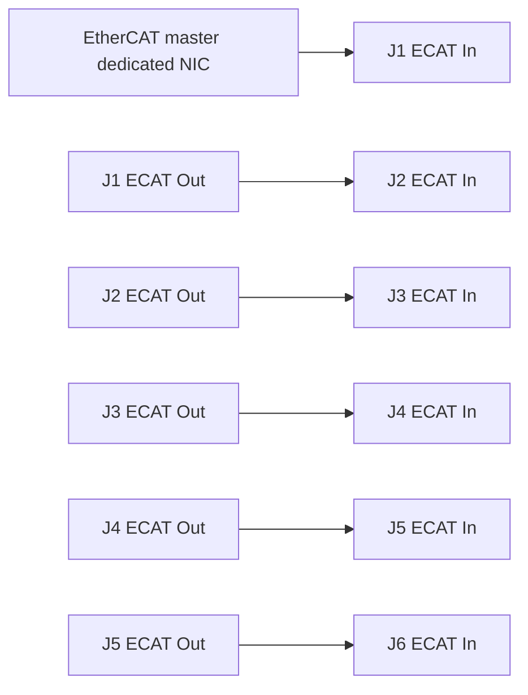

# Original 5 kg reference: build package

Use the frozen original STEP geometry. This package is ready for RFQ and assembly
planning; unconfirmed installed screws, drive revisions and harness details are
explicit release gaps. It does not substitute new modules or change geometry.
Generated source-traceable BOM: `build/reference-build/bom.csv` and `bom.json`.

## STEP bill of materials

The pinned AP214 assembly has 27 top-level occurrences, grouped into 14 asset rows:

| Quantity | Supplier part | Assembly use |
| --- | --- | --- |
| 3 | eRob110H××T.STEP | J1, J2, J3 complete modules |
| 3 | eRob70H××T.STEP | J4, J5, J6 complete modules |
| 1 | 2-091-001 | Original base |
| 1 | 3-091-001 | Base sheet cover |
| 1 | 2-091-002 | 425 mm upper-arm link, 7075-T6 |
| 1 | 2-091-005 | 401 mm forearm link, AL6061 |
| 1 | 2-130-003 | Elbow output adapter |
| 1 | 2-130-004 | Elbow housing adapter |
| 1 | 110假轴 | Original dummy housing/shaft assembly, two solids |
| 1 | 2-054-006 | Original 3/5 kg terminal flange |
| 2 each | 航插 / 航插公头 | Base aviation socket/plug pairs; electrical series unspecified |
| 6 | 线缆保护套 | Original cable protection boots |
| 3 | 过线钣金+8mm双面护线圈 | Original cable bracket/grommet assemblies, two solids each |

Likely **RFQ candidates**, not confirmed installed codes:

- J1–J3: `eRob110H120T-BM-18EN`, quantity 3.
- J4–J6: `eRob70H100T-BM-18EN`, quantity 3.

The manual V3.44 figure 6-7 labels its 5 kg example `110H120I` and `70H100I`.
The STEP T-arm's actual ratios/options are still unspecified. B is brake, M is
multiturn feedback, E is EtherCAT, N is the no-added-torque-sensor ordering option;
confirm exact naming/revision and whether HM feedback is desired before ordering.
A ratio-120 proximal profile has a published 150°/s speed, not the nominal-100
180°/s assumed in our earlier studies. This does not contradict the vendor's
5 kg rating, which never promised UR5e speed in this reference configuration.

## Fasteners and machining

Do not count module-internal CAD solids as loose purchased hardware. The full
110T/70T module includes its internal screws, drive, brake and encoders.
The original STEP does not expose a complete, trustworthy installed external
screw BOM. The generated register therefore leaves installed quantities, lengths,
grades, dowels and washers null for supplier confirmation.

The original module drawings show these output interface capacities:

| Module | Pilot | Output threaded holes | Drawing thread depth |
| --- | --- | --- | --- |
| 110T | 98 mm | 15 × M4 | 10 mm |
| 70T | 58 mm | 14 × M3 | 6 mm |

These are available holes, not automatically the quantity to buy. Use the original
part PDFs for bolt circles, fits and part thickness. Select screw length from the
actual stack and effective engagement without bottoming. Follow manual section
18 for tightening/preload; do not transfer rear-cover screw torques to output
flanges. Retain original dowels/seals where specified. Confirm fastening the
base, both link ends, elbow adapters and each wrist connection in the supplier
assembly BOM before manufacturing release.

Assemble the original base/J1/J2 support first, upper link/J3 next, original elbow
adapters/dummy housing and forearm next, then J4/J5/J6 and the original flange.
J1/J2 outputs mount upstream and their housings move downstream. Verify datum
alignment and cable access at each stage; do not reverse those joints to fit an
assumed fixed-housing model.

## Cable and EtherCAT package

The following identities come from manual V3.44 sections 5.3–5.8 and 6, and require
confirmation against the delivered revision:

| Circuit | Mating hardware / function |
| --- | --- |
| DC power | XT30U-F cable mate to module XT30UPB-M; pin 1 DC+, pin 2 DC− |
| ECAT In / Out | JST GHR-04V-S housings; SSHL-002T-P0.2 contacts; module BM04B-GHS-TBT |
| Multiturn battery | JST GHR-02V-S mate, same contact family; pin 1 VB+, pin 2 VB−; vendor battery per module |
| Protective earth | Dedicated cabinet PE bond to each module housing; use the documented rear-cover attachment |
| STO / I/O | Separate safety wiring and appropriate mating I/O connector from delivered diagram/ESI; not an EtherCAT-only safety function |

ECAT pin functions at both module ports: **1 RX−, 2 RX+, 3 TX−, 4 TX+**. Connect
transmit pairs to receive pairs according to the vendor cable drawing; confirm
connector viewing direction and continuity before power. Do not treat the
four-pin JST connector as RJ45 or connect a generic straight pin-number cable.



J6 Out stays unused unless the vendor specifies a downstream device. Keep physical
slave order J1→J6 consistent with the ESI/master mapping. Use shielded flexible
EtherCAT twisted pairs, the vendor connector assembly and strain relief. The
manual specifies signal conductors 0.05–0.13 mm² (AWG30–26). Verify impedance,
shield termination and flex life with the supplied cable specification.

Route through the original base connectors, retained 18 mm module bores and
original link cavities, using the six boots and three bracket/grommet assemblies.
Fit the large cables first, preserve service slack at each joint, and restrain
connectors/batteries to the original brackets. No ties, rigid tubes or enlarged
bundles may press against the bore. Determine travel loops and bend radius from
actual cable specifications before accepting joint travel. The base aviation
connectors' exact series/pinout is unknown; their CAD shape is not an electrical
specification.

Initial harness length allowance (routing estimate, not supplier cut lengths):
master→J1 2 m; J1→J2 0.35 m; J2→J3 0.70 m; J3→J4 0.70 m; J4→J5 0.30 m;
J5→J6 0.30 m. Measure the actual paths plus flex/service loops before cutting.

## Power, regeneration and brake wiring

Use a vendor-approved 48 V supply/regeneration solution with branch protection,
contactors and cabinet PE. Module drive electronics are integrated; do not add six
external servo amplifiers. Size the supply and wiring from coordinated current,
regeneration and voltage-drop calculations, not the sum of nameplate motor watts.

The manual's **5 kg example, figure 6-7**, shows a chained power harness with
minimum conductors: supply→J1 and through J3 ≥1.5 mm²; J3→J5 ≥0.75 mm²; J5→J6
≥0.5 mm². However, section 6.1 separately recommends direct feeds for 110-size
modules to avoid bus under/overvoltage. The supplier request explicitly asks which
topology applies to this reference. Do not finalize a six-axis power harness
until that discrepancy, connector current and fault protection are resolved.
For the first single-joint bench article use a direct protected feed.

Brakes are internally controlled, not bare coils to connect to an improvised
external output. Use the vendor enable/release/disable delays and support the
load until servo torque is established. Brake-held rest and controlled servo
stopping are separate operating states. Wire STO/emergency stopping from the
actual delivered safety documentation; the simulation stub does not qualify it.

## Rough cost

USD **planning allowances**, not supplier quotations or published selling prices:

| Item | Allowance |
| --- | --- |
| Three 110T modules | $3,600–6,000 |
| Three 70T modules | $2,400–3,900 |
| Original machined base/links/adapters/flange kit | $1,200–3,000 |
| Fasteners/dowels/seals | $150–400 |
| Harness/connectors/batteries | $350–900 |
| Supply/regeneration/distribution | $500–1,200 |
| Controller/master/cabinet | $500–1,500 |
| STO/emergency-stop/protection components | $300–900 |
| Single-joint fixture/metrology allowance | $400–1,500 |
| **Subtotal** | **$9,400–19,300** |
| **With 25% contingency** | **$11,750–24,125** |

Excludes tax, shipping, engineering labour and full-arm metrology. Replace these
assumed allowances with the requested supplier/parts quotations before purchase.
No quotation request has been sent and no order placed.

Generate and verify the BOM with:

```sh
python3 machinekit/examples/zeroerr-arm/reference-build-package.py
```

The source archive, layout and each component STEP hash are verified. A build
package can preserve unknowns; it cannot recover unmodeled screws, pinouts or
approved cable travel from exterior STEP geometry alone.
