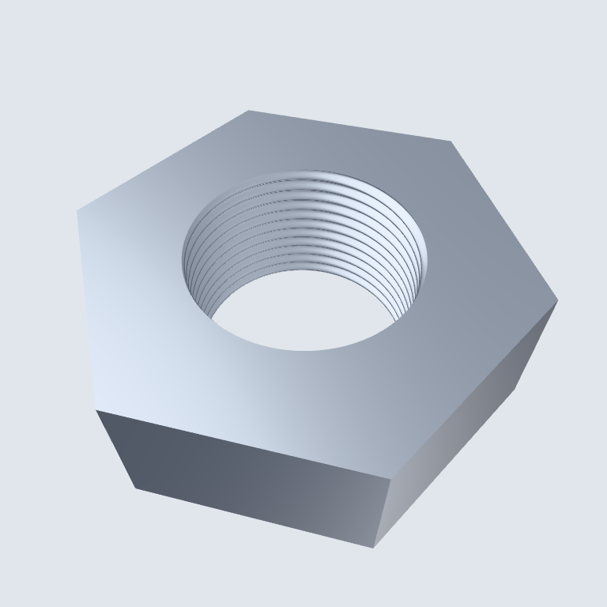

# Scene renderer shaders

`scene`, `stroke`, `workplane`, `pick`, and `postprocess` use their GLSL vertex and fragment files as
the canonical shader source. `tools/generate-shaders.py` feeds these stages to
`sokol-shdc` and writes the backend sources to the checked-in
`src/scene_shader_sources.h`. Regular builds consume that header without
requiring shader tools.

Regenerate after editing a canonical shader:

```sh
SOKOL_SHDC=/path/to/sokol-shdc ./tools/generate-shaders.sh
SOKOL_SHDC=/path/to/sokol-shdc ./tools/generate-shaders.sh --check
```

Run these commands from `scenekit/scene_render`. Generation also requires
`glslangValidator` on `PATH`. The current generated header was made with
`sokol-shdc` from `floooh/sokol-tools-bin` commit
`11d0cf678105d614d675e6d9bd2aaf3eeff12f8c`.

The tool emits GLSL 4.10, GLSL ES 3.00, HLSL 5, and macOS Metal directly.
The generator validates both OpenGL variants with `glslangValidator`. Desktop
OpenGL requires a 4.1 context. Picking stores face IDs in an expanded vertex
buffer so the same shader works on every backend.

Stroke geometry uses a body quad and two cap quads. The body endpoints keep
those of the original projected segment, preserving its depth slope. Caps
extend depth only away from the eye, so their round coverage cannot pull a
hidden edge through an occluding face. Keep depth interpolation in rasterization
for per-sample MSAA depth tests; a fragment-depth override evaluates at the
fragment center and can leak under closely spaced sloping surfaces. The stroke
pipeline uses only a constant depth-unit bias to resolve coplanar ties. At a
section, its clipping predicate retreats into the kept half-space by the ribbon
and antialiasing footprint (`half_width + 1` pixels), plus the depth tie budget.
The plane-distance derivatives convert that footprint to plane units; the inverse
view-projection's depth column, computed once on the CPU, converts two D24 depth
units to a conservative world displacement. This also covers a nearly coplanar
edge parallel to the plane, where plane-distance derivatives vanish. Both terms
scale with the plane equation, so no world-unit epsilon or section displacement
is needed. This prevents expanded, depth-biased B-rep edge remnants from reaching
an adjacent cap. Ordinary coplanar edge/face ties away from cuts keep the original
bias. Synthetic section outlines would require their own boundary strokes.

Ambient occlusion samples world-space surface positions from an on-demand RGBA32F
prepass target. Its alpha channel marks valid samples. This avoids reconstructing
positions from nonlinear device depth, which loses precision with very small near
planes and can stripe an otherwise flat surface. Picking continues to write R32F
device depth for its readback and unprojection.

Surface sidedness follows `MaterialFlags::DoubleSided`. Other materials reject back
faces in the shaded, picking and AO position shaders; view-aware CPU face picking
uses the same rule. Winding is explicitly counterclockwise, and a flat per-instance
transform parity corrects reflected instances without splitting their batches.
Double-sided sheets retain both sides and orient their shading normals towards the
visible side. Selection and hover tint the source material and retain its sidedness.
Section planes clip these passes consistently. Declared closed, single-sided,
opaque meshes also receive filled cuts. Unknown/open boundaries, double-sided
sheets, blended/transparent materials and alpha masks receive no caps.

For each plane and cut occurrence, the executor bounds the work by the projected
world bounds. A scissored fullscreen draw zeros stencil without touching colour
or depth. The occurrence is then drawn with only that plane enabled, both faces,
no colour/depth writes and an always-pass depth comparison: **occluded crossings
must still invert stencil**. Finally a unit quad transformed onto the plane draws
where parity is odd, clipped by every other plane. Stencil is independent for each
occurrence, including instances sharing a batch. It is per sample in an MSAA
attachment. The normal shaded pipeline is restored before transparency and edges.

Cap quads use ordinary rasterized depth, never a fragment-depth override. Their
normal faces the eye, and their darkened material colour has a plane-space hatch
at 3 mm spacing in world metres, anchored independently of the camera. Source UV
textures and normal maps do not apply to the synthetic cut. AO runs the same cap
passes into its world-position target, so both depth and obscurance see the plane.
The unit quad is static; plane/bounds transforms and scissoring use the ordinary
renderer data. There is no CAD intersection, mesh retriangulation or stencil
readback while dragging a section.

Picking executes the same parity and quad passes. The subelement attachment's
alpha byte encodes `plane + 1` for caps (ordinary faces use 255), preserving all
24 bits of ordinary primitive IDs. Readback returns `NKS_RENDER_CAP_SUBELEMENT_TAG`
plus the zero-based plane index. A tagged cap has no B-rep face or CAD edge id.
Haxe callers use `PickResult.capPlane()`; its negative subelement tag is excluded
from face/edge hover and mate picking. View-aware CPU ray picking performs the
same kept-boundary parity query and returns the same tag.

Closure is an explicit `GeometryPayload.closed` / `GeometryData.setClosed`
declaration, default false. Native boxes declare it by construction. CadKit solid
producers declare it only when all tessellated faces belong to solids; open
supplier connector faces stay undeclared. Portable scene artifact version 43
carries this per-part flag. Non-CAD producers can use `MeshClosure.declare`, which
checks welded boundary edges, winding against normals and positive enclosed
volume. The socket fixture generator runs that proof on its actual output meshes.
The presentation schema is unchanged.

`scene_render_sections` includes named pixel regressions
`TwoPlaneCornerBothSurfaceHitsClipped` and `CavityInFrontOfBackSurface`, as well as
one-plane caps, hollow cores, overlapping instances, mirrored transforms,
transparent/double-sided/open exclusions, plane-depth picks, AO, and hidden edges
and silhouette coverage with MSAA. Exact B-rep drawing sections remain separate.

## Geometric section outlines

Every eligible cap also draws a contour from its source **render triangles**.
`section_contours.hpp` pulls the world plane into the occurrence's local frame
with `Mᵀ * plane`, intersects indexed or sequential triangles in double precision,
and emits local segments. Shared-edge interpolation is deterministic; duplicate
segments are removed, coplanar triangles add no diagonals, and on-plane mesh
edges contribute once when their incident triangles cross to opposite sides.
Tangent vertices/edges without cut area add no outline.

The executor caches each occurrence/plane slot's local equation, mesh payload and
revision, CPU segments and reusable dynamic GPU stroke buffer. Camera moves,
material edits and transforms parallel to the plane reuse the intersections.
Plane movement, joint rotation or an explode move through the plane changes its
local equation and rebuilds that cut only; geometry edits also invalidate it.
Other active planes clip at draw time, so moving one does not rebuild the others'
contours. Buffer capacity grows as needed and is reused while dragging. Deleted
occurrences release their cache entries. Only the parts selected by the cap pass
are considered: uncut, undeclared/open, transparent, double-sided and masked
parts receive no section outlines.

Contours reuse the body/round-end stroke geometry and the material's edge contrast
policy, with an explicit **section-contour** pipeline. Its four-depth-unit tie
precedence is separate from the one-unit surface-edge bias. Expanded contour
ribbons are projected back onto their cutting plane, so both sides have cap depth
at their actual pixels; perspective-correct plane positions also clip the ribbon
against every other active plane. The source plane is omitted. Contours use the
exact clipping predicate, not the surface-edge retreat that suppresses leftover
B-rep edges. They are drawn after all surfaces and ordinary edges with depth
testing, no depth writes, and per-sample MSAA. There is no screen-space ID-edge
filter, synthetic B-rep face, or change to the presentation schema. Pick/AO passes
keep the filled-cap geometry and ownership; cosmetic contour strokes add no pick
subelements. A future exact B-rep section source can feed the same stroke path.

`scene_render_contours` checks touching same-material parts, cap picks, two-plane
clipping, perspective and reflected instances, eligibility exclusions, coplanar
and vertex degeneracies, and indexed/sequential meshes. It checks cache hits and
rebuilds across camera/material changes, an independently moved second plane,
explode transforms, parent joint motion, plane dragging and mesh replacement.
`scene_render_sections` retains the surface-edge leak regression independently of
these intentional section strokes.

The real editor capture harness accepts `--section-drag=60` alongside a sectioned
`--view`. It sweeps the first plane by ±2 assembly units, measures 60 **rendered**
frames after eight warm-up frames, restores the original section and prints
`section-drag` mean/p95/max frame times. It does not save the modified view. Use a
capture duration long enough for the full sweep, for example
`--capture-seconds=20`. See inside and Jaw detail are recaptured in their example
READMEs with their geometric cut boundaries visible (4× MSAA, 1800×900 window).
On the shared desktop, the 60-frame drag checks averaged 28.6 ms/frame for the
socket fixture and 24.2 ms/frame for the gripper (p95 45.6/37.1 ms). Renderer CPU
preparation averaged 0.57/0.21 ms (p95 0.73/0.29 ms); the geometry preparation and
mesh-packing counters stayed zero throughout the drag. These are measured local
frame times, not a hardware-independent performance guarantee.

## Specular antialiasing

Before GGX and `studio_panels`, the fragment shader filters squared microfacet
roughness (`alpha² = perceptual_roughness⁴`) using screen-space derivatives of the
final shading normal. Following [Tokuyoshi and Kaplanyan's normal-based geometric
filter](https://yusuketokuyoshi.com/papers/2019/ImprovedGeometricSpecularAA.pdf),
normal variance is `0.25 * (|dN/dx|² + |dN/dy|²)`; the added kernel is twice the
variance, clamped to 0.25. The filtered perceptual roughness is the fourth root
of `min(1, alpha² + kernel)`. Both point-light GGX and studio panel/room reflections
use that same value. Constant normals add zero geometric roughness.

Cosmetic `ThreadTexture` mips retain the **mean unit-normal vector**, rather than
renormalizing each mip. Its shortened length preserves unresolved flank variance
through every level, including the final 1×1 mip. The shader adds a Toksvig-style
`(1 - length) / length` variance term before filtering; a 0.005 dead band absorbs
RGBA8 unit-normal quantization. It normalizes the mapped shading direction as
usual. No additional texture or material field is required, and colour/shade mip
filtering stays unchanged.

`scene_render_specular_aa` renders a geometric threaded nut and a small fillet at
three distances through seven small camera moves, with 1× and 4× MSAA. It bounds
mean brightness changes, the fraction of large thread-crest changes and individual
far-fillet jumps. Silhouette pixels are excluded; changing visibility at thread
crests remains in the measurement. A flat face checks stable highlights, and a
constant-normal map with shortened mean length checks that mip variance reaches
studio reflection roughness. Removing filtering fails that normal-map regression
and increases the far-fillet jumps beyond their bound. The before/after flat-face
captures were pixel-identical at all three distances. `CosmeticThreadTests` checks
that each mip preserves its children's vector mean and inherited variance.

`scene_render_sections` also checks `TouchingFacetsCapStrokeTie`: a faceted blue
insert touches an orange shell and both are cut by one plane. Toggling feature
strokes must change no cap pixels in orthographic or perspective views at 1×/4×
MSAA, including a retained edge parallel and nearly coplanar with the cut.
`OrdinaryCoplanarEdgeTie` confirms that an unsectioned face's edge still wins.

The review close-up below uses the actual renderer, a geometric helical nut bore,
steel roughness 0.34 and the editor's Studio panels (the motion regressions use
roughness 0.06 and narrower panels as a stress case). Reproduce the capture by
running `nativekit_scene_render_specular_tests <existing-or-new-output-directory>`;
it writes `threaded-nut-closeup.ppm` alongside the distance frames.


